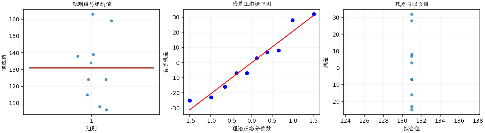

(exercise-2-23)=
# 习题 2.23：货架寿命的正态性

[习题与答案](../../index.md) / [第 2 章　简单比较试验](../chapter02.md)

第 9 版 · 第 2 章 · 原书章末习题见印刷页 55～63。

## 题目

考虑习题 [2.22](./exercise-2-22.md) 中的饮料货架寿命数据。正态分布能否充分描述或建模这些寿命？如果这一假定不成立，将对前面求解该寿命问题时所使用的检验程序产生什么影响？原书这里的交叉引用写成 2.17，按题意应指 2.22。

**所用数据（来自习题 [2.22](./exercise-2-22.md)）**

| 组别／处理条件 | 观测值（同一行属于同一组） |
| --- | --- |
| 1 | 108，124，124，106，115，138，163，159，134，139 |

## 答案与解析

| 组别（配对时指差值） | Shapiro–Wilk 正态性检验 $P$ 值 |
| --- | --- |
| 1 | 0.51521 |

正态性检验不显著仅表示未发现明显偏离；须同时检查概率图、异常值及试验的独立性。

图中未显示严重异常，正态近似可作为初步模型。这里只有 10 个观测，正态性检验识别偏离的能力有限；强偏态、厚尾或异常值可能改变 $t$ 检验实际错误率。题目原文交叉引用写成 2.17，按内容应为 2.22。

---

**答案来源**：参考：`ch02.pdf`，原题 2.20；本页按第 9 版编号。

**关联题目**：[2.22](./exercise-2-22.md)

← [上一题 2.22](./exercise-2-22.md) · [本章题目目录](../chapter02.md) · [下一题 2.24](./exercise-2-24.md) →
