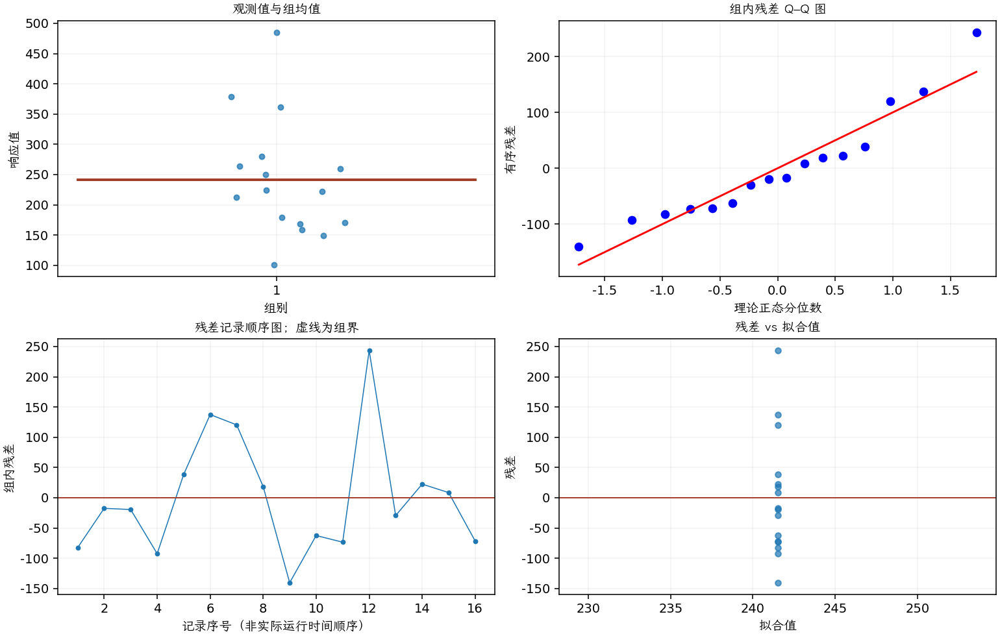

(exercise-2-25)=
# 习题 2.25：维修时间的分布

[习题与答案](../../index.md) / [第 2 章　简单比较试验](../chapter02.md)

第 9 版 · 第 2 章 · 原书章末习题见印刷页 55～63。

## 题目

你认为 2.24 的维修时间能否用正态分布充分描述？

**所用数据（来自习题 [2.24](./exercise-2-24.md)）**

| 组别／处理条件 | 观测值（同一行属于同一组） |
| --- | --- |
| 1 | 159，224，222，149，280，379，362，260，101，179，168，485，212，264，250，170 |

## 答案与解析

| 组别（配对时指差值） | Shapiro–Wilk 正态性检验 $P$ 值 |
| --- | --- |
| 1 | 0.168492 |

正态性检验不显著仅表示未发现明显偏离；须同时检查概率图、异常值及试验的独立性。

**残差定义**：$\hat y_{ij}=\bar y_i$，$e_{ij}=y_{ij}-\bar y_i$。变换分析时使用相应变换尺度的响应。

**三项诊断**：Q–Q 图用于检查尾部、偏态及异常残差；残差记录顺序图用于展示原表记录的相邻变化；残差 vs 拟合值图用于观察方差是否随处理均值变化。

**时序资料的限制**：原题只提供分组观测，没有实际运行时间和随机运行次序。左下图按原表组内记录顺序排列，虚线表示组界，**不是实际残差时序图**；组界附近的变化不能解释为时间效应。若要完成真正的时序诊断，须取得原始运行顺序后按该顺序重画。当前不能仅凭此图断言误差在时间上独立。单样本或配对差的拟合值为常数时，残差 vs 拟合值图也不能检验复杂均值结构。

样本有右尾较长的迹象，尤其是 485 小时这一较大值。原答案认为正态图没有严重问题；应把该结论视为小样本下的近似判断，可进一步检查对数时间模型并比较结论的敏感性。

---

**答案来源**：参考：`ch02.pdf`，原题 2.22；本页按第 9 版编号。

**关联题目**：[2.24](./exercise-2-24.md)

← [上一题 2.24](./exercise-2-24.md) · [本章题目目录](../chapter02.md) · [下一题 2.26](./exercise-2-26.md) →
