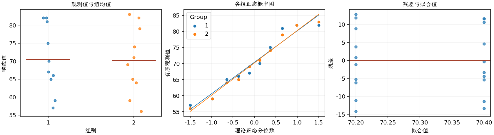

(exercise-2-28)=
# 习题 2.28：照明信号弹燃烧时间

[习题与答案](../../index.md) / [第 2 章　简单比较试验](../chapter02.md)

第 9 版 · 第 2 章 · 原书章末习题见印刷页 55～63。

## 题目

以下数据是两种不同配方的化学照明信号弹的燃烧时间，单位为分钟。设计工程师既关心平均燃烧时间，也关心燃烧时间的方差。第 1、2 组分别对应两种配方。

| 组别／处理条件 | 观测值（同一行属于同一组） |
| --- | --- |
| 配方 1 | 65，81，57，66，82，82，67，59，75，70 |
| 配方 2 | 64，71，83，59，65，56，69，74，82，79 |

**（a）** 取 $\alpha=0.05$，检验两个总体方差相等的假设。

**（b）** 利用第（a）问结果，取 $\alpha=0.05$ 检验两个平均燃烧时间相等的假设。检验的 $P$ 值是多少？

**（c）** 讨论正态性假定在本题中的作用，并检查两种信号弹数据的正态性。

## 答案与解析

方差比 $F=0.978217$，自由度为 $(9,9)$，双侧 $P=0.974366$。

未拒绝方差相等，按题意使用合并方差检验：

两组样本均值为 70.4、70.2；均值差（第 1 组减第 2 组）为 0.2，标准误为 4.166。检验统计量为 0.0480077，自由度为 18，$P=0.962239$。均值差的 95% 双侧置信区间为 $(-8.55244, 8.95244)$。

两均值差异不显著。正态性对方差比 $F$ 检验尤其重要，其稳健性通常不及均值 $t$ 检验。

| 组别（配对时指差值） | Shapiro–Wilk 正态性检验 $P$ 值 |
| --- | --- |
| 1 | 0.306542 |
| 2 | 0.72511 |

正态性检验不显著仅表示未发现明显偏离；须同时检查概率图、异常值及试验的独立性。

---

**答案来源**：参考：`ch02.pdf`，原题 2.25；本页按第 9 版编号。

← [上一题 2.27](./exercise-2-27.md) · [本章题目目录](../chapter02.md) · [下一题 2.29](./exercise-2-29.md) →
