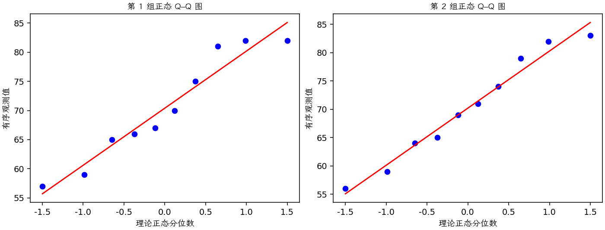

(exercise-2-28)=
# 习题 2.28：照明信号弹燃烧时间

[习题与答案](../../index.md) / [第 2 章　简单比较试验](../chapter02.md)

第 9 版 · 第 2 章 · 原书章末习题见印刷页 55～63。

## 题目

以下数据是两种不同配方的化学照明信号弹的燃烧时间，单位为分钟。设计工程师既关心平均燃烧时间，也关心燃烧时间的方差。第 1、2 组分别对应两种配方。

| 组别／处理条件 | 观测值（同一行属于同一组） |
| --- | --- |
| 配方 1 | 65，81，57，66，82，82，67，59，75，70 |
| 配方 2 | 64，71，83，59，65，56，69，74，82，79 |

**（a）** 取 $\alpha=0.05$，检验两个总体方差相等的假设。

**（b）** 利用第（a）问结果，取 $\alpha=0.05$ 检验两个平均燃烧时间相等的假设。检验的 $P$ 值是多少？

**（c）** 讨论正态性假定在本题中的作用，并检查两种信号弹数据的正态性。

## 答案与解析

### （a）方差比较

正态独立样本下检验 $H_0:\sigma_1^2=\sigma_2^2$ 对 $H_1:\sigma_1^2\ne\sigma_2^2$；统计量为 $F_0=s_1^2/s_2^2$，参考自由度 $(n_1-1,n_2-1)$。

方差比 $F=0.978217$，自由度为 $(9,9)$，双侧 $P=0.974366$。

在 0.05 水平不拒绝等方差。

### （b）平均燃烧时间比较

按题意使用合并方差，检验 $H_0:\mu_1=\mu_2$ 对双侧备择。

**估计量公式**：$\hat\Delta=\bar y_1-\bar y_2$，$s_p^2=\dfrac{(n_1-1)s_1^2+(n_2-1)s_2^2}{n_1+n_2-2}$，$SE=s_p\sqrt{1/n_1+1/n_2}$，$\nu=n_1+n_2-2$。

**计算结果**：两组均值为 70.4、70.2；差估计为 0.2，标准误为 4.166。

检验统计量 $t_0=(\hat\Delta-\Delta_0)/SE=0.0480077$，按自由度 18 的 t 分布取双侧尾概率，$P=0.962239$。

不拒绝均值相等。P 值已在上式给出，不能说已证明两配方等效。

### （c）正态性作用与诊断

**残差定义**：$\hat y_{ij}=\bar y_i$，$e_{ij}=y_{ij}-\bar y_i$。变换分析时使用相应变换尺度的响应。

**三项诊断**：Q–Q 图用于检查尾部、偏态及异常残差；残差记录顺序图用于展示原表记录的相邻变化；残差 vs 拟合值图用于观察方差是否随处理均值变化。

**时序资料的限制**：原题只提供分组观测，没有实际运行时间和随机运行次序。左下图按原表组内记录顺序排列，虚线表示组界，**不是实际残差时序图**；组界附近的变化不能解释为时间效应。若要完成真正的时序诊断，须取得原始运行顺序后按该顺序重画。当前不能仅凭此图断言误差在时间上独立。单样本或配对差的拟合值为常数时，残差 vs 拟合值图也不能检验复杂均值结构。

未见严重非正态。方差比 F 检验尤其依赖正态性，通常比均值 t 检验更敏感；实际运行顺序未知，记录图不能验证时间独立性。

---

**答案来源**：参考：`ch02.pdf`，原题 2.25；本页按第 9 版编号。

← [上一题 2.27](./exercise-2-27.md) · [本章题目目录](../chapter02.md) · [下一题 2.29](./exercise-2-29.md) →
