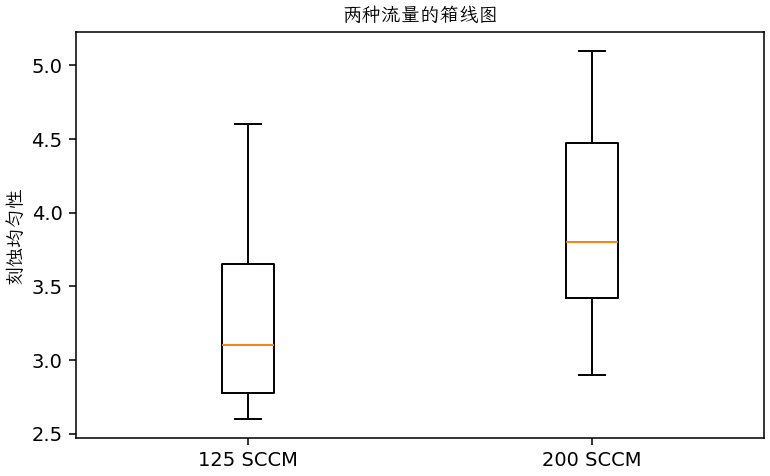

(exercise-2-29)=
# 习题 2.29：刻蚀气体流量

[习题与答案](../../index.md) / [第 2 章　简单比较试验](../chapter02.md)

第 9 版 · 第 2 章 · 原书章末习题见印刷页 55～63。

## 题目

G. Z. Yin 和 D. W. Jillie 在《Solid State Technology》1987 年 5 月的文章“Orthogonal Design for Process Optimization and Its Application to Plasma Etching”中，描述了一个研究 C₂F₆ 气体流量对集成电路制造用硅片刻蚀均匀性影响的试验。所有运行均按随机顺序实施。两种流量分别为 125、200 SCCM，各有 6 个均匀性观测，数据如下。

| 组别／处理条件 | 观测值（同一行属于同一组） |
| --- | --- |
| 125 SCCM | 2.7，4.6，2.6，3，3.2，3.8 |
| 200 SCCM | 4.6，3.4，2.9，3.5，4.1，5.1 |

**（a）** C₂F₆ 流量是否影响平均刻蚀均匀性？取 $\alpha=0.05$。

**（b）** 求第（a）问检验的 $P$ 值。

**（c）** 流量是否影响刻蚀均匀性的片间变异？取 $\alpha=0.05$。

**（d）** 绘制箱线图，以辅助解释试验结果。

## 答案与解析

两组样本均值为 3.31667、3.93333；均值差（第 1 组减第 2 组）为 -0.616667，标准误为 0.456861。检验统计量为 -1.34979，自由度为 10，$P=0.206844$。均值差的 95% 双侧置信区间为 $(-1.63462, 0.401284)$。

方差比 $F=0.856225$，自由度为 $(5,5)$，双侧 $P=0.868902$。

两个检验均未在 0.05 水平拒绝原假设，不能由本样本认定流量改变了均值或方差。箱线图与散点图都显示两组明显重叠；样本量每组只有 6，结论仍有较大不确定性。

---

**答案来源**：参考：`ch02.pdf`，原题 2.26S；本页按第 9 版编号。

← [上一题 2.28](./exercise-2-28.md) · [本章题目目录](../chapter02.md) · [下一题 2.30](./exercise-2-30.md) →
