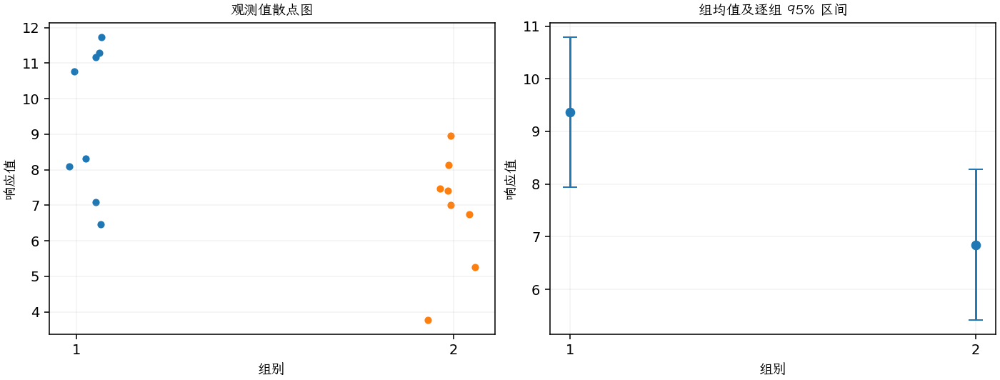
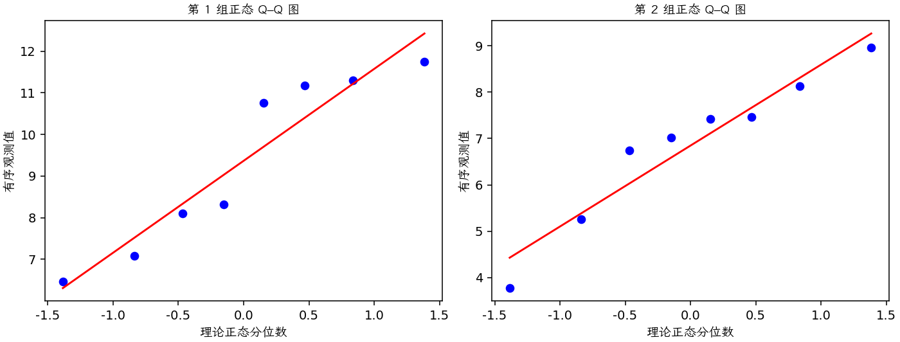
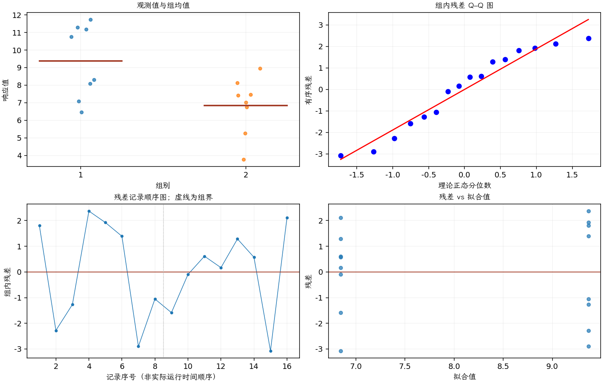

(exercise-2-31)=
# 习题 2.31：光刻胶烘烤温度

[习题与答案](../../index.md) / [第 2 章　简单比较试验](../chapter02.md)

第 9 版 · 第 2 章 · 原书章末习题见印刷页 55～63。

## 题目

光刻胶是一种涂覆在半导体晶圆上的感光材料，用于将电路图形成像到晶圆表面。涂覆后，需要烘烤晶圆以去除光刻胶混合物中的溶剂，并使光刻胶硬化。下表给出在两种不同温度下烘烤的晶圆的光刻胶厚度测量值，单位为 kÅ；每种温度各有 8 片晶圆。假定所有试验运行均以随机顺序进行，第 1、2 组分别对应 95°C、100°C。

| 组别／处理条件 | 观测值（同一行属于同一组） |
| --- | --- |
| 95°C | 11.176，7.089，8.097，11.739，11.291，10.759，6.467，8.315 |
| 100°C | 5.263，6.748，7.461，7.015，8.133，7.418，3.772，8.963 |

**（a）** 是否有证据支持“较高烘烤温度使晶圆的平均光刻胶厚度更低”这一主张？取 $\alpha=0.05$。

**（b）** 求第（a）问检验的 $P$ 值。

**（c）** 求两个总体均值之差的 95% 置信区间，并说明其实际意义。

**（d）** 绘制点图，以辅助解释本试验结果。

**（e）** 检查光刻胶厚度的正态性假定。

**（f）** 当真实均值差为 2.5 kÅ 时，求这个检验的功效。

**（g）** 若要以至少 0.9 的功效检出 1.5 kÅ 的真实均值差，需要多大的样本量？

## 答案与解析

### （a）高温是否降低厚度

第 1 组为 95°C，第 2 组为 100°C。独立正态、等方差条件下检验 $H_0:\mu_{95}-\mu_{100}\le0$ 对 $H_1:\mu_{95}-\mu_{100}>0$。

**估计量公式**：$\hat\Delta=\bar y_1-\bar y_2$，$s_p^2=\dfrac{(n_1-1)s_1^2+(n_2-1)s_2^2}{n_1+n_2-2}$，$SE=s_p\sqrt{1/n_1+1/n_2}$，$\nu=n_1+n_2-2$。

**计算结果**：两组均值为 9.36662、6.84662；差估计为 2.52，标准误为 0.942017。

检验统计量 $t_0=(\hat\Delta-\Delta_0)/SE=2.67511$，按自由度 14 的 t 分布取右侧尾概率，$P=0.00905898$。

在 0.05 水平拒绝，支持 100°C 的平均光刻胶厚度更低。表格同一行不构成配对依据。

### （b）P 值

$P=0.00905898$。

### （c）均值差置信区间

**估计量公式**：$\hat\Delta=\bar y_1-\bar y_2$，$s_p^2=\dfrac{(n_1-1)s_1^2+(n_2-1)s_2^2}{n_1+n_2-2}$，$SE=s_p\sqrt{1/n_1+1/n_2}$，$\nu=n_1+n_2-2$。

**计算结果**：两组均值为 9.36662、6.84662；差估计为 2.52，标准误为 0.942017。

**区间公式**：$\hat\Delta\pm t_{1-\alpha/2,\nu}SE$。

**结果**：均值差的 95% 双侧置信区间为 $(0.499574, 4.54043)$。

以 95°C 减 100°C 为差，高温下平均降低约 0.50～4.54 kÅ。

### （d）点图

图中均值估计量为 $\bar y_i$，误差条为 $\bar y_i\pm t_{0.975,N-a}\sqrt{MS_E/n_i}$；均值区间的重叠情况不能直接代替均值差检验。

左图为全部观测的点图；高温组整体厚度更低，但两组仍有重叠。

### （e）正态性与模型诊断

**残差定义**：$\hat y_{ij}=\bar y_i$，$e_{ij}=y_{ij}-\bar y_i$。变换分析时使用相应变换尺度的响应。

**三项诊断**：Q–Q 图用于检查尾部、偏态及异常残差；残差记录顺序图用于展示原表记录的相邻变化；残差 vs 拟合值图用于观察方差是否随处理均值变化。

**时序资料的限制**：原题只提供分组观测，没有实际运行时间和随机运行次序。左下图按原表组内记录顺序排列，虚线表示组界，**不是实际残差时序图**；组界附近的变化不能解释为时间效应。若要完成真正的时序诊断，须取得原始运行顺序后按该顺序重画。当前不能仅凭此图断言误差在时间上独立。单样本或配对差的拟合值为常数时，残差 vs 拟合值图也不能检验复杂均值结构。

未见严重非正态或强烈漏斗形。原表没有实际随机运行顺序，记录图不能验证时间独立性。

### （f）检出 2.5 kÅ 差值的功效

方差规划估计量为 $s_p^2=[(n_1-1)s_1^2+(n_2-1)s_2^2]/(n_1+n_2-2)=3.54958$。令 $\lambda=\delta/[s_p\sqrt{2/n}]$，右侧功效为 $P\{T_{2n-2}(\lambda)>t_{0.95,2n-2}\}$。代入 $n=8,\delta=2.5$，结果为 **0.80989**。

### （g）检出 1.5 kÅ 所需样本量

保持同一方差规划值，逐个整数 $n\ge2$ 搜索上式功效达到 0.90 的最小值，得到每温度 **28 片**，总数 56。样本方差有估计误差，应结合更大方差的规划情景。

---

**答案来源**：参考：`ch02.pdf`，原题 2.27；本页按第 9 版编号。

← [上一题 2.30](./exercise-2-30.md) · [本章题目目录](../chapter02.md) · [下一题 2.32](./exercise-2-32.md) →
