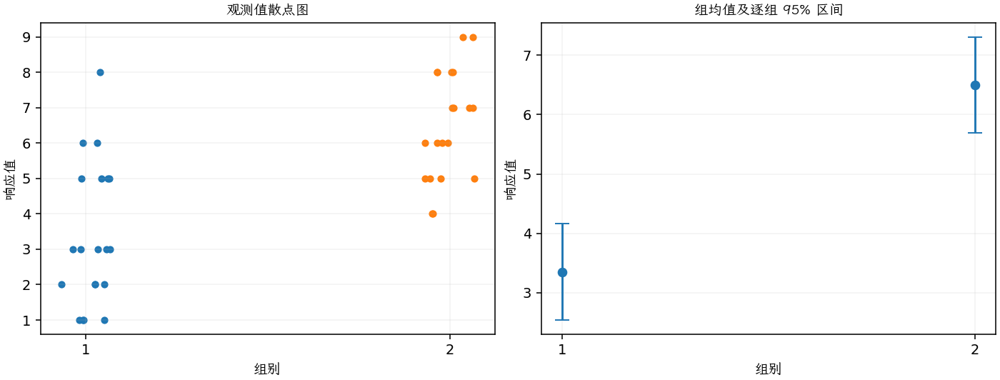
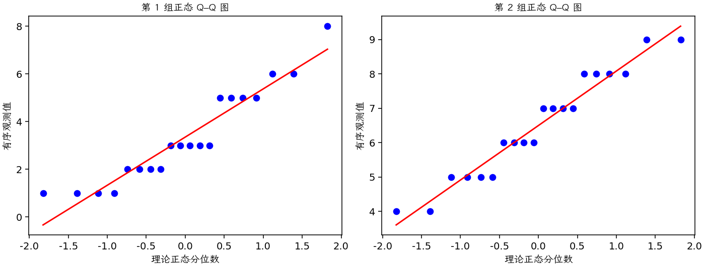

(exercise-2-32)=
# 习题 2.32：冷却时间与手机壳外观

[习题与答案](../../index.md) / [第 2 章　简单比较试验](../chapter02.md)

第 9 版 · 第 2 章 · 原书章末习题见印刷页 55～63。

## 题目

手机前壳由注塑工艺制造。人们认为，零件在模具中冷却后再取出的等待时间，会影响成品上一种很难处理的外观缺陷——流痕。制造后对前壳进行目视检查，根据外观给出 1～10 分，其中 10 分表示完美零件，1 分表示完全不合格的零件。

试验比较 10 秒和 20 秒两种冷却时间，每个时间水平评价 20 个前壳。全部 40 次观测按随机顺序运行。数据中的第 1、2 组分别对应 10 秒、20 秒。

| 组别／处理条件 | 观测值（同一行属于同一组） |
| --- | --- |
| 10 秒 | 1，2，1，3，5，1，5，2，3，5，3，6，5，3，2，1，6，8，2，3 |
| 20 秒 | 7，8，5，9，5，8，6，4，6，7，6，9，5，7，4，6，8，5，8，7 |

**（a）** 是否有证据支持“更长的冷却时间会减少外观缺陷”的主张？取 $\alpha=0.05$。

**（b）** 求第（a）问检验的 $P$ 值。

**（c）** 求两个总体均值之差的 95% 置信区间，并说明实际意义。

**（d）** 绘制点图，以辅助解释试验结果。

**（e）** 检查这些数据的正态性假定。

## 答案与解析

### （a）冷却时间效应检验

第 1 组为 10 秒，第 2 组为 20 秒；评分越高越好。按独立同方差近似正态模型，检验 $H_0:\mu_{10}-\mu_{20}\ge0$ 对 $H_1:\mu_{10}-\mu_{20}<0$。

**估计量公式**：$\hat\Delta=\bar y_1-\bar y_2$，$s_p^2=\dfrac{(n_1-1)s_1^2+(n_2-1)s_2^2}{n_1+n_2-2}$，$SE=s_p\sqrt{1/n_1+1/n_2}$，$\nu=n_1+n_2-2$。

**计算结果**：两组均值为 3.35、6.5；差估计为 -3.15，标准误为 0.565569。

检验统计量 $t_0=(\hat\Delta-\Delta_0)/SE=-5.56961$，按自由度 38 的 t 分布取左侧尾概率，$P=1.10834e-06$。

在 0.05 水平拒绝，20 秒外观评分更高，支持缺陷减少。

### （b）P 值

$P=1.10834e-06$。

### （c）均值差区间

**估计量公式**：$\hat\Delta=\bar y_1-\bar y_2$，$s_p^2=\dfrac{(n_1-1)s_1^2+(n_2-1)s_2^2}{n_1+n_2-2}$，$SE=s_p\sqrt{1/n_1+1/n_2}$，$\nu=n_1+n_2-2$。

**计算结果**：两组均值为 3.35、6.5；差估计为 -3.15，标准误为 0.565569。

**区间公式**：$\hat\Delta\pm t_{1-\alpha/2,\nu}SE$。

**结果**：均值差的 95% 双侧置信区间为 $(-4.29493, -2.00507)$。

若改按 20 秒减 10 秒，区间为 $(2.0051,4.2949)$ 分。

### （d）点图

图中均值估计量为 $\bar y_i$，误差条为 $\bar y_i\pm t_{0.975,N-a}\sqrt{MS_E/n_i}$；均值区间的重叠情况不能直接代替均值差检验。

左图完整展示各评分，较长冷却组整体更高。

### （e）正态性与模型诊断

**残差定义**：$\hat y_{ij}=\bar y_i$，$e_{ij}=y_{ij}-\bar y_i$。变换分析时使用相应变换尺度的响应。

**三项诊断**：Q–Q 图用于检查尾部、偏态及异常残差；残差记录顺序图用于展示原表记录的相邻变化；残差 vs 拟合值图用于观察方差是否随处理均值变化。

**时序资料的限制**：原题只提供分组观测，没有实际运行时间和随机运行次序。左下图按原表组内记录顺序排列，虚线表示组界，**不是实际残差时序图**；组界附近的变化不能解释为时间效应。若要完成真正的时序诊断，须取得原始运行顺序后按该顺序重画。当前不能仅凭此图断言误差在时间上独立。单样本或配对差的拟合值为常数时，残差 vs 拟合值图也不能检验复杂均值结构。

评分是有界离散变量，正态误差只是近似；小样本形状和尾部应谨慎解释，可用秩方法作敏感性分析。没有实际运行时间，不能从记录顺序图证明独立性。

---

**答案来源**：参考：`ch02.pdf`，原题 2.28S；本页按第 9 版编号。

← [上一题 2.31](./exercise-2-31.md) · [本章题目目录](../chapter02.md) · [下一题 2.33](./exercise-2-33.md) →
