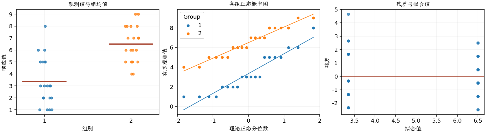

(exercise-2-32)=
# 习题 2.32：冷却时间与手机壳外观

[习题与答案](../../index.md) / [第 2 章　简单比较试验](../chapter02.md)

第 9 版 · 第 2 章 · 原书章末习题见印刷页 55～63。

## 题目

手机前壳由注塑工艺制造。人们认为，零件在模具中冷却后再取出的等待时间，会影响成品上一种很难处理的外观缺陷——流痕。制造后对前壳进行目视检查，根据外观给出 1～10 分，其中 10 分表示完美零件，1 分表示完全不合格的零件。

试验比较 10 秒和 20 秒两种冷却时间，每个时间水平评价 20 个前壳。全部 40 次观测按随机顺序运行。数据中的第 1、2 组分别对应 10 秒、20 秒。

| 组别／处理条件 | 观测值（同一行属于同一组） |
| --- | --- |
| 10 秒 | 1，2，1，3，5，1，5，2，3，5，3，6，5，3，2，1，6，8，2，3 |
| 20 秒 | 7，8，5，9，5，8，6，4，6，7，6，9，5，7，4，6，8，5，8，7 |

**（a）** 是否有证据支持“更长的冷却时间会减少外观缺陷”的主张？取 $\alpha=0.05$。

**（b）** 求第（a）问检验的 $P$ 值。

**（c）** 求两个总体均值之差的 95% 置信区间，并说明实际意义。

**（d）** 绘制点图，以辅助解释试验结果。

**（e）** 检查这些数据的正态性假定。

## 答案与解析

第 1 组为 10 秒，分数越高越好，故采用 $H_1:\mu_{10}<\mu_{20}$。

两组样本均值为 3.35、6.5；均值差（第 1 组减第 2 组）为 -3.15，标准误为 0.565569。检验统计量为 -5.56961，自由度为 38，$P=1.10834e-06$。均值差的 95% 双侧置信区间为 $(-4.29493, -2.00507)$。

20 秒平均分更高，支持缺陷减少。区间换成“20 秒减 10 秒”为 $(2.0051,4.2949)$ 分。

| 组别（配对时指差值） | Shapiro–Wilk 正态性检验 $P$ 值 |
| --- | --- |
| 1 | 0.0478805 |
| 2 | 0.237939 |

正态性检验不显著仅表示未发现明显偏离；须同时检查概率图、异常值及试验的独立性。

评分离散且有上下界，正态只是近似。可以把秩检验作为敏感性分析；随机化与独立的试验单位仍是推断基础。

---

**答案来源**：参考：`ch02.pdf`，原题 2.28S；本页按第 9 版编号。

← [上一题 2.31](./exercise-2-31.md) · [本章题目目录](../chapter02.md) · [下一题 2.33](./exercise-2-33.md) →
