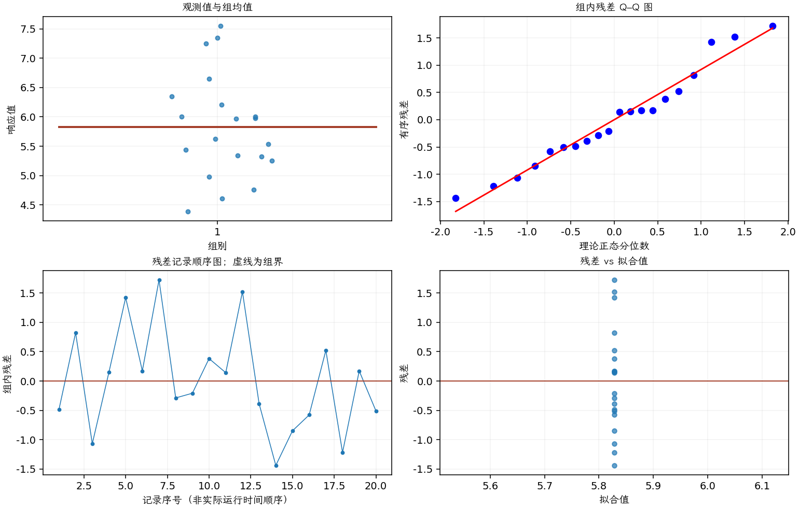

(exercise-2-33)=
# 习题 2.33：刻蚀均匀性的方差

[习题与答案](../../index.md) / [第 2 章　简单比较试验](../chapter02.md)

第 9 版 · 第 2 章 · 原书章末习题见印刷页 55～63。

## 题目

在对一台等离子体刻蚀设备进行资格确认的试验中，取得以下 20 个硅片刻蚀均匀性观测。

| 组别／处理条件 | 观测值（同一行属于同一组） |
| --- | --- |
| 1 | 5.34，6.65，4.76，5.98，7.25，6，7.55，5.54，5.62，6.21，5.97，7.35，5.44，4.39，4.98，5.25，6.35，4.61，6，5.32 |

**（a）** 构造总体方差 $\sigma^2$ 的 95% 置信区间。

**（b）** 取 $\alpha=0.05$，检验 $\sigma^2=1.0$ 的假设，并说明结论。

**（c）** 讨论正态性假定及其在本题中的作用。

**（d）** 绘制正态概率图检查正态性。你能得出什么结论？

## 答案与解析

### （a）总体方差区间

$\hat\sigma^2=s^2=\sum_i(y_i-\bar y)^2/(n-1)$，$s^2=0.790448$。

正态总体下，$CI_{0.95}(\sigma^2)=[(n-1)s^2/\chi^2_{0.975,n-1},(n-1)s^2/\chi^2_{0.025,n-1}]$，结果为 $(0.457152, 1.68624)$。

### （b）方差等于 1 的检验

$\hat\sigma^2=s^2=\sum_i(y_i-\bar y)^2/(n-1)$，$s^2=0.790448$。

$H_0:\sigma^2=1$ 对 $H_1:\sigma^2\ne1$；$\chi_0^2=(n-1)s^2/\sigma_0^2$，结果为 15.0185，自由度 19，双侧 $P=0.557161$。

在 0.05 水平不拒绝 $\sigma^2=1$。

### （c）正态性假定的作用

卡方枢轴 $(n-1)s^2/\sigma^2$ 的精确分布要求正态独立样本。方差推断对厚尾、异常值通常较敏感，不能仅凭均值检验的稳健性忽略。

### （d）Q–Q 图与其他诊断

**残差定义**：$\hat y_{ij}=\bar y_i$，$e_{ij}=y_{ij}-\bar y_i$。变换分析时使用相应变换尺度的响应。

**三项诊断**：Q–Q 图用于检查尾部、偏态及异常残差；残差记录顺序图用于展示原表记录的相邻变化；残差 vs 拟合值图用于观察方差是否随处理均值变化。

**时序资料的限制**：原题只提供分组观测，没有实际运行时间和随机运行次序。左下图按原表组内记录顺序排列，虚线表示组界，**不是实际残差时序图**；组界附近的变化不能解释为时间效应。若要完成真正的时序诊断，须取得原始运行顺序后按该顺序重画。当前不能仅凭此图断言误差在时间上独立。单样本或配对差的拟合值为常数时，残差 vs 拟合值图也不能检验复杂均值结构。

单样本均值模型下残差为 $y_i-\bar y$，其 Q–Q 图与原始观测图只差常数平移。未见严重非正态；实际采样时序未给出，记录图不代表真实时序。

---

**答案来源**：参考答案文件无直接对应题；解析由编者补充。

← [上一题 2.32](./exercise-2-32.md) · [本章题目目录](../chapter02.md) · [下一题 2.34](./exercise-2-34.md) →
