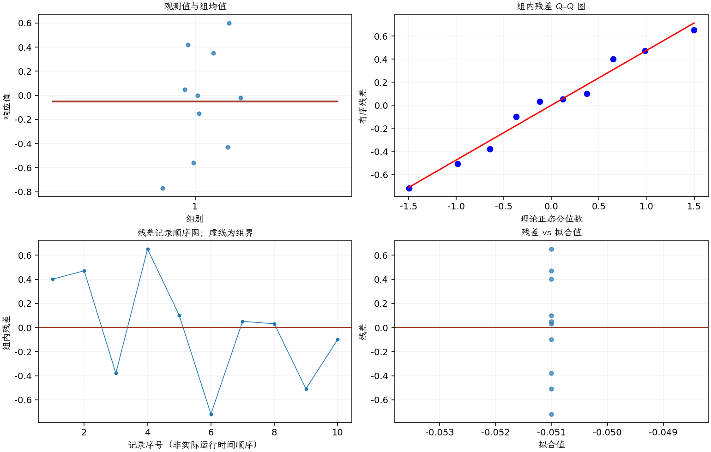

(exercise-2-35)=
# 习题 2.35：双胞胎出生顺序与得分

[习题与答案](../../index.md) / [第 2 章　简单比较试验](../chapter02.md)

第 9 版 · 第 2 章 · 原书章末习题见印刷页 55～63。

## 题目

《Neurology》1998 年第 50 卷、1246～1252 页的一篇文章指出，同卵双胞胎具有许多相同的生理、心理和病理特征。研究人员测量了 10 对双胞胎的某项智力得分。数据如下，第 1、2 组分别为每对中先出生和后出生者，观测顺序按同一对双胞胎对应。

| 双胞胎对 | 先出生 | 后出生 |
| --- | --- | --- |
| 1 | 6.08 | 5.73 |
| 2 | 6.22 | 5.8 |
| 3 | 7.99 | 8.42 |
| 4 | 7.44 | 6.84 |
| 5 | 6.48 | 6.43 |
| 6 | 7.99 | 8.76 |
| 7 | 6.32 | 6.32 |
| 8 | 7.6 | 7.62 |
| 9 | 6.03 | 6.59 |
| 10 | 7.52 | 7.67 |

**（a）** 假定一对双胞胎的得分差服从正态分布，是否合理？

**（b）** 求平均得分之差的 95% 置信区间。是否有证据表明平均得分依赖出生顺序？

**（c）** 建立并检验适当的假设，以判断平均得分是否不依赖出生顺序。

## 答案与解析

### （a）配对差的正态性

差值取先出生减后出生，模型为 $d_i=\mu_d+\eta_i$，各双胞胎对之间独立，$\eta_i\sim N(0,\sigma_d^2)$。

**残差定义**：对配对差 $d_i=y_{i1}-y_{i2}$ 拟合常数均值：$\hat d_i=\bar d$，$e_i=d_i-\bar d$。变换分析时使用相应变换尺度的响应。

**三项诊断**：Q–Q 图用于检查尾部、偏态及异常残差；残差记录顺序图用于展示原表记录的相邻变化；残差 vs 拟合值图用于观察方差是否随处理均值变化。

**时序资料的限制**：原题只提供分组观测，没有实际运行时间和随机运行次序。左下图按原表组内记录顺序排列，虚线表示组界，**不是实际残差时序图**；组界附近的变化不能解释为时间效应。若要完成真正的时序诊断，须取得原始运行顺序后按该顺序重画。当前不能仅凭此图断言误差在时间上独立。单样本或配对差的拟合值为常数时，残差 vs 拟合值图也不能检验复杂均值结构。

差值 Q–Q 图未见严重偏离。由于双胞胎对的实际调查时间未知，不能将对编号当成时间；拟合值为常数的图也不能检验复杂均值结构。

### （b）平均差及其区间

**估计量公式**：$d_i=y_{i1}-y_{i2}$，$\hat\Delta=\bar d$，$s_d^2=\sum_i(d_i-\bar d)^2/(n-1)$，$SE=s_d/\sqrt n$，$\nu=n-1$。

**计算结果**：两组均值为 6.967、7.018；差估计为 -0.051，标准误为 0.139431。

**区间公式**：$\hat\Delta\pm t_{1-\alpha/2,\nu}SE$。

**结果**：均值差的 95% 双侧置信区间为 $(-0.366415, 0.264415)$。

区间包含零，没有发现平均得分依赖出生顺序的证据。

### （c）配对 t 检验

$H_0:\mu_d=0$ 对 $H_1:\mu_d\ne0$。

**估计量公式**：$d_i=y_{i1}-y_{i2}$，$\hat\Delta=\bar d$，$s_d^2=\sum_i(d_i-\bar d)^2/(n-1)$，$SE=s_d/\sqrt n$，$\nu=n-1$。

**计算结果**：两组均值为 6.967、7.018；差估计为 -0.051，标准误为 0.139431。

检验统计量 $t_0=(\hat\Delta-\Delta_0)/SE=-0.365772$，按自由度 9 的 t 分布取双侧尾概率，$P=0.722984$。

在 0.05 水平不拒绝原假设。

---

**答案来源**：参考：`ch02.pdf`，原题 2.30；本页按第 9 版编号。

← [上一题 2.34](./exercise-2-34.md) · [本章题目目录](../chapter02.md) · [下一题 2.36](./exercise-2-36.md) →
