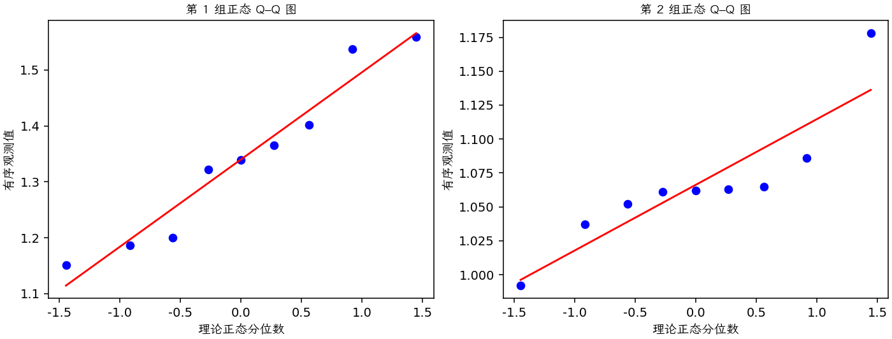
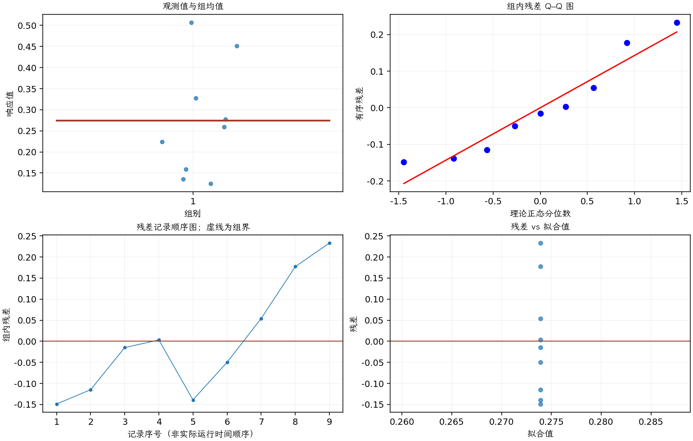

(exercise-2-36)=
# 习题 2.36：钢板梁强度预测方法

[习题与答案](../../index.md) / [第 2 章　简单比较试验](../chapter02.md)

第 9 版 · 第 2 章 · 原书章末习题见印刷页 55～63。

## 题目

《Journal of Strain Analysis》1983 年第 18 卷第 2 期的一篇文章比较了预测钢板梁抗剪强度的几种方法。以下数据来自同样 9 根梁，分别给出 Karlsruhe 法和 Lehigh 法所预测荷载与实际观测荷载之比。每根梁对应两个方法的一个观测；第 1、2 组分别为 Karlsruhe、Lehigh，顺序一一对应。

| 梁的顺序 | Karlsruhe 法 | Lehigh 法 |
| --- | --- | --- |
| 1 | 1.186 | 1.061 |
| 2 | 1.151 | 0.992 |
| 3 | 1.322 | 1.063 |
| 4 | 1.339 | 1.062 |
| 5 | 1.2 | 1.065 |
| 6 | 1.402 | 1.178 |
| 7 | 1.365 | 1.037 |
| 8 | 1.537 | 1.086 |
| 9 | 1.559 | 1.052 |

**（a）** 是否有证据支持两种方法的平均表现存在差异？取 $\alpha=0.05$。

**（b）** 求第（a）问检验的 $P$ 值。

**（c）** 构造两种方法“预测值与观测值之比”的总体均值之差的 95% 置信区间。

**（d）** 检查两个样本各自的正态性假定。

**（e）** 检查两种方法比值之差的正态性假定。

**（f）** 讨论正态性假定在配对 t 检验中的作用。

## 答案与解析

### （a）平均表现比较

同一根梁形成一对观测，取 $d_i=K_i-L_i$。假定各梁差值独立且近似正态，检验 $H_0:\mu_d=0$ 对双侧备择。

**估计量公式**：$d_i=y_{i1}-y_{i2}$，$\hat\Delta=\bar d$，$s_d^2=\sum_i(d_i-\bar d)^2/(n-1)$，$SE=s_d/\sqrt n$，$\nu=n-1$。

**计算结果**：两组均值为 1.34011、1.06622；差估计为 0.273889，标准误为 0.0450331。

检验统计量 $t_0=(\hat\Delta-\Delta_0)/SE=6.08194$，按自由度 8 的 t 分布取双侧尾概率，$P=0.000295295$。

在 0.05 水平拒绝，两种方法的平均比值有差异。

### （b）P 值

$P=0.000295295$。

### （c）平均比值差的区间

**估计量公式**：$d_i=y_{i1}-y_{i2}$，$\hat\Delta=\bar d$，$s_d^2=\sum_i(d_i-\bar d)^2/(n-1)$，$SE=s_d/\sqrt n$，$\nu=n-1$。

**计算结果**：两组均值为 1.34011、1.06622；差估计为 0.273889，标准误为 0.0450331。

**区间公式**：$\hat\Delta\pm t_{1-\alpha/2,\nu}SE$。

**结果**：均值差的 95% 双侧置信区间为 $(0.170042, 0.377736)$。

Karlsruhe 比值较高，但比值高不自动表示预测更准确，还应比较其与 1 的距离。

### （d）两个原始样本的正态性

样本量只有 9，应关注 Lehigh 列尾部观测；是否两列各自正态并非配对 t 检验的核心条件。

### （e）配对差的模型诊断

**残差定义**：对配对差 $d_i=y_{i1}-y_{i2}$ 拟合常数均值：$\hat d_i=\bar d$，$e_i=d_i-\bar d$。变换分析时使用相应变换尺度的响应。

**三项诊断**：Q–Q 图用于检查尾部、偏态及异常残差；残差记录顺序图用于展示原表记录的相邻变化；残差 vs 拟合值图用于观察方差是否随处理均值变化。

**时序资料的限制**：原题只提供分组观测，没有实际运行时间和随机运行次序。左下图按原表组内记录顺序排列，虚线表示组界，**不是实际残差时序图**；组界附近的变化不能解释为时间效应。若要完成真正的时序诊断，须取得原始运行顺序后按该顺序重画。当前不能仅凭此图断言误差在时间上独立。单样本或配对差的拟合值为常数时，残差 vs 拟合值图也不能检验复杂均值结构。

差值 Q–Q 图没有极端异常；梁编号是记录身份，不是实际试验时间，不能据其判断时间独立性。

### （f）正态性在配对检验中的作用

精确 t 分布要求独立的配对差近似正态，而不要求原始两列分别独立。同一梁内两方法的相关性通过取差处理；不同梁之间的独立性仍需设计依据。

---

**答案来源**：参考：`ch02.pdf`，原题 2.31S；本页按第 9 版编号。

← [上一题 2.35](./exercise-2-35.md) · [本章题目目录](../chapter02.md) · [下一题 2.37](./exercise-2-37.md) →
