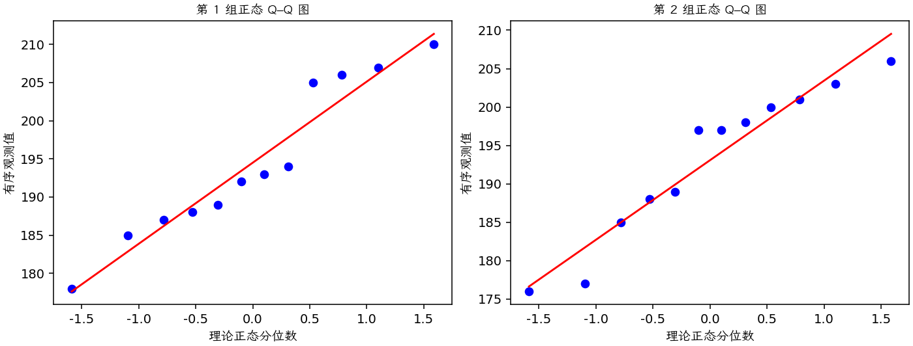
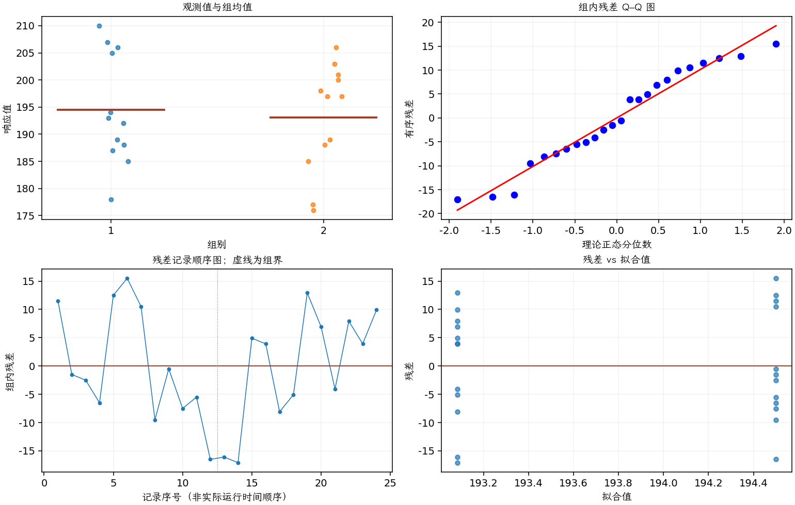

(exercise-2-37)=
# 习题 2.37：ABS 管材的负载变形温度

[习题与答案](../../index.md) / [第 2 章　简单比较试验](../chapter02.md)

第 9 版 · 第 2 章 · 原书章末习题见印刷页 55～63。

## 题目

现研究两种不同配方 ABS 塑料管在负载下的变形温度。每种配方分别制备 12 个试件，得到以下温度数据，单位为 °F。第 1、2 组对应配方 1、2。

| 组别／处理条件 | 观测值（同一行属于同一组） |
| --- | --- |
| 配方 1 | 206，193，192，188，207，210，205，185，194，187，189，178 |
| 配方 2 | 177，176，198，197，185，188，206，200，189，201，197，203 |

**（a）** 分别绘制两样本的正态概率图。这些图是否支持两个总体正态且方差相等的假定？

**（b）** 数据是否支持“配方 1 的平均负载变形温度高于配方 2”的主张？取 $\alpha=0.05$。

**（c）** 求该均值比较检验的 $P$ 值。原书此处写作第（a）问，按内容应为第（b）问。

## 答案与解析

### （a）正态性和方差结构

**残差定义**：$\hat y_{ij}=\bar y_i$，$e_{ij}=y_{ij}-\bar y_i$。变换分析时使用相应变换尺度的响应。

**三项诊断**：Q–Q 图用于检查尾部、偏态及异常残差；残差记录顺序图用于展示原表记录的相邻变化；残差 vs 拟合值图用于观察方差是否随处理均值变化。

**时序资料的限制**：原题只提供分组观测，没有实际运行时间和随机运行次序。左下图按原表组内记录顺序排列，虚线表示组界，**不是实际残差时序图**；组界附近的变化不能解释为时间效应。若要完成真正的时序诊断，须取得原始运行顺序后按该顺序重画。当前不能仅凭此图断言误差在时间上独立。单样本或配对差的拟合值为常数时，残差 vs 拟合值图也不能检验复杂均值结构。

两组散布相近，未见严重正态性偏离；小样本图形不能证明方差严格相同，实际运行时序也未给出。

### （b）配方 1 是否更高

采用独立正态、等方差模型，检验 $H_0:\mu_1-\mu_2\le0$ 对 $H_1:\mu_1-\mu_2>0$。

**估计量公式**：$\hat\Delta=\bar y_1-\bar y_2$，$s_p^2=\dfrac{(n_1-1)s_1^2+(n_2-1)s_2^2}{n_1+n_2-2}$，$SE=s_p\sqrt{1/n_1+1/n_2}$，$\nu=n_1+n_2-2$。

**计算结果**：两组均值为 194.5、193.083；差估计为 1.41667，标准误为 4.1083。

检验统计量 $t_0=(\hat\Delta-\Delta_0)/SE=0.34483$，按自由度 22 的 t 分布取右侧尾概率，$P=0.366748$。

在 0.05 水平不拒绝，不能支持配方 1 的平均变形温度更高。

### （c）P 值

$P=0.366748$。

原题此处交叉引用的（a）应理解为第（b）问的均值比较。

---

**答案来源**：参考：`ch02.pdf`，原题 2.32；本页按第 9 版编号。

← [上一题 2.36](./exercise-2-36.md) · [本章题目目录](../chapter02.md) · [下一题 2.38](./exercise-2-38.md) →
