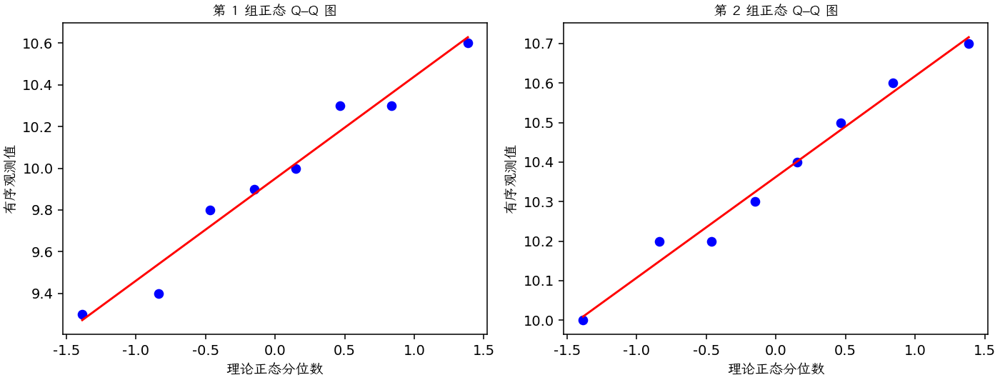

(exercise-2-39)=
# 习题 2.39：两种刻蚀液

[习题与答案](../../index.md) / [第 2 章　简单比较试验](../chapter02.md)

第 9 版 · 第 2 章 · 原书章末习题见印刷页 55～63。

## 题目

在半导体制造中，常在金属化之前使用湿法化学刻蚀去除晶圆背面的硅。刻蚀速率是这一工艺的重要特性。现评价两种不同的刻蚀液，每种溶液各用于 8 片随机选取的晶圆，观测到的刻蚀速率如下，单位为 mil/min。第 1、2 组分别对应溶液 1、2。

| 组别／处理条件 | 观测值（同一行属于同一组） |
| --- | --- |
| 溶液 1 | 9.9，9.4，10，10.3，10.6，10.3，9.3，9.8 |
| 溶液 2 | 10.2，10，10.7，10.5，10.6，10.2，10.4，10.3 |

**（a）** 取 $\alpha=0.05$，并假定两个总体方差相等，数据是否支持两种溶液平均刻蚀速率相同的主张？

**（b）** 求两个平均刻蚀速率之差的 95% 置信区间。

**（c）** 用正态概率图考察正态性和等方差假定是否合理。

## 答案与解析

### （a）平均刻蚀速率比较

采用题目指定的独立、等方差正态模型，检验 $H_0:\mu_1-\mu_2=0$ 对双侧备择。

**估计量公式**：$\hat\Delta=\bar y_1-\bar y_2$，$s_p^2=\dfrac{(n_1-1)s_1^2+(n_2-1)s_2^2}{n_1+n_2-2}$，$SE=s_p\sqrt{1/n_1+1/n_2}$，$\nu=n_1+n_2-2$。

**计算结果**：两组均值为 9.95、10.3625；差估计为 -0.4125，标准误为 0.179222。

检验统计量 $t_0=(\hat\Delta-\Delta_0)/SE=-2.30161$，按自由度 14 的 t 分布取双侧尾概率，$P=0.0372361$。

在 0.05 水平拒绝，溶液 2 的平均刻蚀速率更高。

### （b）均值差区间

**估计量公式**：$\hat\Delta=\bar y_1-\bar y_2$，$s_p^2=\dfrac{(n_1-1)s_1^2+(n_2-1)s_2^2}{n_1+n_2-2}$，$SE=s_p\sqrt{1/n_1+1/n_2}$，$\nu=n_1+n_2-2$。

**计算结果**：两组均值为 9.95、10.3625；差估计为 -0.4125，标准误为 0.179222。

**区间公式**：$\hat\Delta\pm t_{1-\alpha/2,\nu}SE$。

**结果**：均值差的 95% 双侧置信区间为 $(-0.796893, -0.028107)$。

差按溶液 1 减溶液 2 定义，故区间为负。

### （c）正态性与等方差诊断

**残差定义**：$\hat y_{ij}=\bar y_i$，$e_{ij}=y_{ij}-\bar y_i$。变换分析时使用相应变换尺度的响应。

**三项诊断**：Q–Q 图用于检查尾部、偏态及异常残差；残差记录顺序图用于展示原表记录的相邻变化；残差 vs 拟合值图用于观察方差是否随处理均值变化。

**时序资料的限制**：原题只提供分组观测，没有实际运行时间和随机运行次序。左下图按原表组内记录顺序排列，虚线表示组界，**不是实际残差时序图**；组界附近的变化不能解释为时间效应。若要完成真正的时序诊断，须取得原始运行顺序后按该顺序重画。当前不能仅凭此图断言误差在时间上独立。单样本或配对差的拟合值为常数时，残差 vs 拟合值图也不能检验复杂均值结构。

未见强烈非正态，但两组标准差有差异，各只有 8 个观测；可用 Welch 方法作敏感性检查。缺少实际运行顺序，无法仅据记录图验证时间独立性。

---

**答案来源**：参考：`ch02.pdf`，原题 2.34S；本页按第 9 版编号。

← [上一题 2.38](./exercise-2-38.md) · [本章题目目录](../chapter02.md) · [下一题 2.40](./exercise-2-40.md) →
