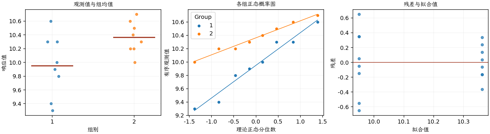

(exercise-2-39)=
# 习题 2.39：两种刻蚀液

[习题与答案](../../index.md) / [第 2 章　简单比较试验](../chapter02.md)

第 9 版 · 第 2 章 · 原书章末习题见印刷页 55～63。

## 题目

在半导体制造中，常在金属化之前使用湿法化学刻蚀去除晶圆背面的硅。刻蚀速率是这一工艺的重要特性。现评价两种不同的刻蚀液，每种溶液各用于 8 片随机选取的晶圆，观测到的刻蚀速率如下，单位为 mil/min。第 1、2 组分别对应溶液 1、2。

| 组别／处理条件 | 观测值（同一行属于同一组） |
| --- | --- |
| 溶液 1 | 9.9，9.4，10，10.3，10.6，10.3，9.3，9.8 |
| 溶液 2 | 10.2，10，10.7，10.5，10.6，10.2，10.4，10.3 |

**（a）** 取 $\alpha=0.05$，并假定两个总体方差相等，数据是否支持两种溶液平均刻蚀速率相同的主张？

**（b）** 求两个平均刻蚀速率之差的 95% 置信区间。

**（c）** 用正态概率图考察正态性和等方差假定是否合理。

## 答案与解析

两组样本均值为 9.95、10.3625；均值差（第 1 组减第 2 组）为 -0.4125，标准误为 0.179222。检验统计量为 -2.30161，自由度为 14，$P=0.0372361$。均值差的 95% 双侧置信区间为 $(-0.796893, -0.028107)$。

拒绝均值相等，溶液 2 的平均速率较高。区间对应第 1 种减第 2 种，故全为负值。

| 组别（配对时指差值） | Shapiro–Wilk 正态性检验 $P$ 值 |
| --- | --- |
| 1 | 0.760343 |
| 2 | 0.94536 |

正态性检验不显著仅表示未发现明显偏离；须同时检查概率图、异常值及试验的独立性。

未见强烈偏离正态；两组标准差有一定差异，只有各 8 个观测，应结合 Welch 检验作敏感性检查。

---

**答案来源**：参考：`ch02.pdf`，原题 2.34S；本页按第 9 版编号。

← [上一题 2.38](./exercise-2-38.md) · [本章题目目录](../chapter02.md) · [下一题 2.40](./exercise-2-40.md) →
