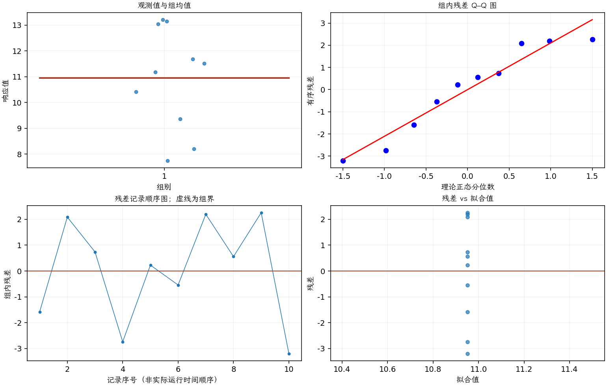

(exercise-2-8)=
# 习题 2.8：正态性与均值为 10 的检验

[习题与答案](../../index.md) / [第 2 章　简单比较试验](../chapter02.md)

第 9 版 · 第 2 章 · 原书章末习题见印刷页 55～63。

## 题目

以下随机样本来自正态总体的假定是否合理？数据是否支持总体均值为 10？

| 组别／处理条件 | 观测值（同一行属于同一组） |
| --- | --- |
| 1 | 9.37，13.04，11.69，8.21，11.18，10.41，13.15，11.51，13.21，7.75 |

## 答案与解析

**正态性与模型诊断**

模型为 $y_i=\mu+\epsilon_i$，独立误差 $\epsilon_i\sim N(0,\sigma^2)$；拟合值为样本均值。

**残差定义**：$\hat y_{ij}=\bar y_i$，$e_{ij}=y_{ij}-\bar y_i$。变换分析时使用相应变换尺度的响应。

**三项诊断**：Q–Q 图用于检查尾部、偏态及异常残差；残差记录顺序图用于展示原表记录的相邻变化；残差 vs 拟合值图用于观察方差是否随处理均值变化。

**时序资料的限制**：原题只提供分组观测，没有实际运行时间和随机运行次序。左下图按原表组内记录顺序排列，虚线表示组界，**不是实际残差时序图**；组界附近的变化不能解释为时间效应。若要完成真正的时序诊断，须取得原始运行顺序后按该顺序重画。当前不能仅凭此图断言误差在时间上独立。单样本或配对差的拟合值为常数时，残差 vs 拟合值图也不能检验复杂均值结构。

Q–Q 图没有严重异常。原答案的 Anderson–Darling 检验 $P=0.435$，只说明未发现明显非正态证据，不能证明正态。记录序号并非实际采样时间。

**均值是否为 10**

检验 $H_0:\mu=10$ 对 $H_1:\mu\ne10$。

$\hat\mu=\bar y=\sum_i y_i/n$，$s^2=\sum_i(y_i-\bar y)^2/(n-1)$，$SE=s/\sqrt n$。$n=10$，$\bar y=10.952$，$s=1.99347$。

正态独立样本下，$t_0=(\bar y-\mu_0)/(s/\sqrt n)$，在 $H_0$ 下服从 $t_{n-1}$。统计量 1.51017，自由度 9，双侧$P=0.165281$。

均值区间公式为 $\bar y\pm t_{1-\alpha/2,n-1}s/\sqrt n$。95% 双侧置信区间为 $(9.52596, 12.378)$。

在 0.05 水平未拒绝 $\mu=10$；区间包含 10 表示数据与 10 相容，不是证明总体均值恰为 10。

---

**答案来源**：参考：`ch02.pdf`，原题 2.7；本页按第 9 版编号。

← [上一题 2.7](./exercise-2-7.md) · [本章题目目录](../chapter02.md) · [下一题 2.9](./exercise-2-9.md) →
