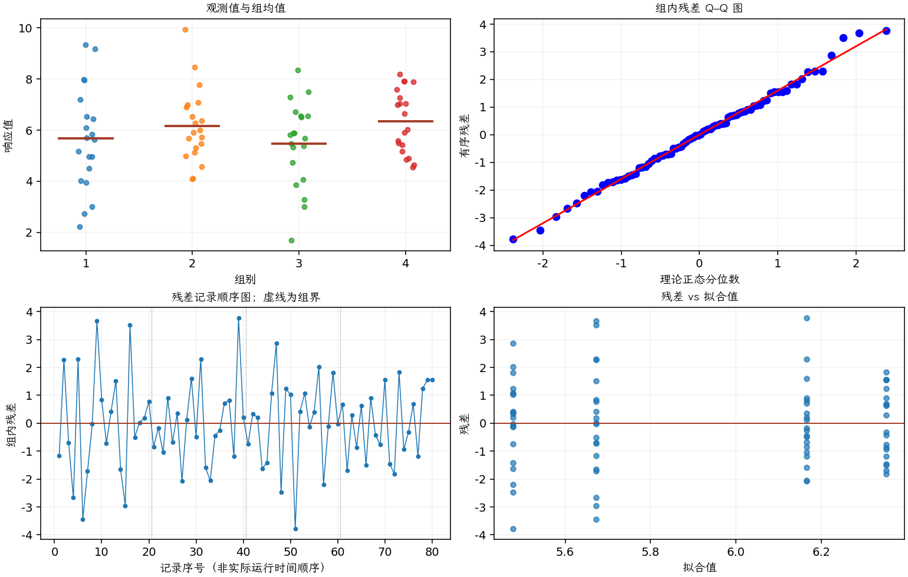

(exercise-3-10)=
# 习题 3.10：脉冲电磁场与骨密度损失

[习题与答案](../../index.md) / [第 3 章　单因子试验与方差分析](../chapter03.md)

第 9 版 · 第 3 章 · 原书章末习题见印刷页 125～134。

## 题目

《Bioelectromagnetics》第 32 卷（2011 年）、273～282 页的一篇文章“Electromagnetic Effects on Forearm Disuse Osteopenia: A Randomized, Double-Blind, Sham-Controlled Study”，描述了一项随机、双盲、假处理对照的可行性和剂量研究，目的是判断一种常用的脉冲电磁场（PEMF）处理能否减轻前臂废用后发生的明显骨量减少。

受试者因桡骨远端骨折或腕部手术而需要石膏固定，之后被随机分到 4 个组。拆除石膏时作为基线，从那时起的 8 周内，每天在前臂远端佩戴有源 PEMF 装置或外观相同的假装置 1、2 或 4 小时；在这段时间内骨密度仍会继续下降。研究使用双能 X 射线吸收测量法（DXA）和外周定量计算机断层扫描（pQCT），测量前臂远端的骨矿物质密度（BMD）及骨几何结构。

以下数据为 16 周时桡骨 BMD 测量值的损失百分比。第 1～4 组依次为假处理、PEMF 每日 1 小时、每日 2 小时、每日 4 小时。教材数据是根据论文图中读出的均值和标准差构造的。

| 组别／处理条件 | 观测值（同一行属于同一组） |
| --- | --- |
| 假处理 | 4.51，7.95，4.97，3，7.97，2.23，3.95，5.64，9.35，6.52，4.96，6.1，7.19，4.03，2.72，9.19，5.17，5.7，5.85，6.45 |
| PEMF 每日 1 小时 | 5.32，6，5.12，7.08，5.48，6.52，4.09，6.28，7.77，5.68，8.47，4.58，4.11，5.72，5.91，6.89，6.99，4.98，9.94，6.38 |
| PEMF 每日 2 小时 | 4.73，5.81，5.69，3.86，4.06，6.56，8.34，3.01，6.71，6.51，1.7，5.89，6.55，5.34，5.88，7.5，3.28，5.38，7.3，5.46 |
| PEMF 每日 4 小时 | 7.03，4.65，6.65，5.49，6.98，4.85，7.26，5.92，5.58，7.91，4.9，4.54，8.18，5.42，6.03，7.04，5.17，7.6，7.9，7.91 |

**（a）** 是否有证据支持 PEMF 使用情况会影响 BMD 损失的主张？如果有，进一步分析数据，找出造成差异的具体处理。

**（b）** 分析试验残差，并评价模型的基本假定和适合性。

## 答案与解析

### （a）检验 PEMF 处理效应

**模型与模型假设（固定效应）**：$y_{ij}=\mu_i+\epsilon_{ij}=\mu+\tau_i+\epsilon_{ij}$，$i=1,\ldots,a$，$j=1,\ldots,n_i$；$\epsilon_{ij}\overset{\mathrm{iid}}\sim N(0,\sigma^2)$。误差独立、正态且同方差，处理分配及抽样符合题意；不平衡设计使用实际 $n_i$。取 $\sum_i n_i\tau_i=0$ 识别参数；平衡时等价于 $\sum_i\tau_i=0$。

**原假设和备择假设**：$H_0:\mu_1=\cdots=\mu_a$；$H_1$：至少一个总体均值不同。

**平方和公式与检验统计量**：令 $N=\sum_i n_i$，$\bar y_i=\sum_jy_{ij}/n_i$，$\bar y_{\cdot\cdot}=\sum_i\sum_jy_{ij}/N$。

$$SS_A=\sum_i n_i(\bar y_i-\bar y_{\cdot\cdot})^2,\qquad SS_E=\sum_i\sum_j(y_{ij}-\bar y_i)^2,$$
$$SS_T=\sum_i\sum_j(y_{ij}-\bar y_{\cdot\cdot})^2=SS_A+SS_E,$$
$$MS_A=\frac{SS_A}{a-1},\quad MS_E=\frac{SS_E}{N-a},\quad F_0=\frac{MS_A}{MS_E}\overset{H_0}{\sim}F_{a-1,N-a}.$$

当 $F_0>F_{1-\alpha,a-1,N-a}$ 时拒绝 $H_0$，$P=P(F_{a-1,N-a}\ge F_0)$。本文分位数均为**下侧累积概率分位数**。

**点估计量**：$\hat\mu_i=\bar y_i$，$\hat\sigma^2=MS_E$；各组样本方差为 $s_i^2=\sum_j(y_{ij}-\bar y_i)^2/(n_i-1)$。以下为 ANOVA Table 与计算结果。

| 来源 | 自由度 | 平方和 | 均方 | $F$ | $P$ 值 |
| --- | --- | --- | --- | --- | --- |
| 处理 | 3 | 10.0435 | 3.34783 | 1.29794 | 0.281326 |
| 误差 | 76 | 196.03 | 2.57934 | — | — |
| 总计 | 79 | 206.074 | — | — | — |

| 组别 | 样本量 | 均值 | 样本标准差 |
| --- | --- | --- | --- |
| 1 | 20 | 5.6725 | 2.00242 |
| 2 | 20 | 6.1655 | 1.44394 |
| 3 | 20 | 5.478 | 1.64479 |
| 4 | 20 | 6.3505 | 1.23182 |

$P=0.281326>0.05$，不拒绝四组均值相等。不能按样本均值高低认定某处理有效，也没有依据在本题的后续比较中宣布特定组显著不同。

### （b）残差分析与模型评价

**残差定义**：$\hat y_{ij}=\bar y_i$，$e_{ij}=y_{ij}-\bar y_i$。变换分析时使用相应变换尺度的响应。

**三项诊断**：Q–Q 图用于检查尾部、偏态及异常残差；残差记录顺序图用于展示原表记录的相邻变化；残差 vs 拟合值图用于观察方差是否随处理均值变化。

**时序资料的限制**：原题只提供分组观测，没有实际运行时间和随机运行次序。左下图按原表组内记录顺序排列，虚线表示组界，**不是实际残差时序图**；组界附近的变化不能解释为时间效应。若要完成真正的时序诊断，须取得原始运行顺序后按该顺序重画。当前不能仅凭此图断言误差在时间上独立。单样本或配对差的拟合值为常数时，残差 vs 拟合值图也不能检验复杂均值结构。

Q–Q 图未见极端偏离，残差 vs 拟合值图没有明显漏斗形。实际受试者观测时间顺序未知，记录顺序图不能证明时间独立性。样本为教材按论文图中均值、标准差构造的数据，结论不替代原始临床数据的分析。

---

**答案来源**：参考答案文件无直接对应题；解析由编者补充。

← [上一题 3.9](./exercise-3-9.md) · [本章题目目录](../chapter03.md) · [下一题 3.11](./exercise-3-11.md) →
