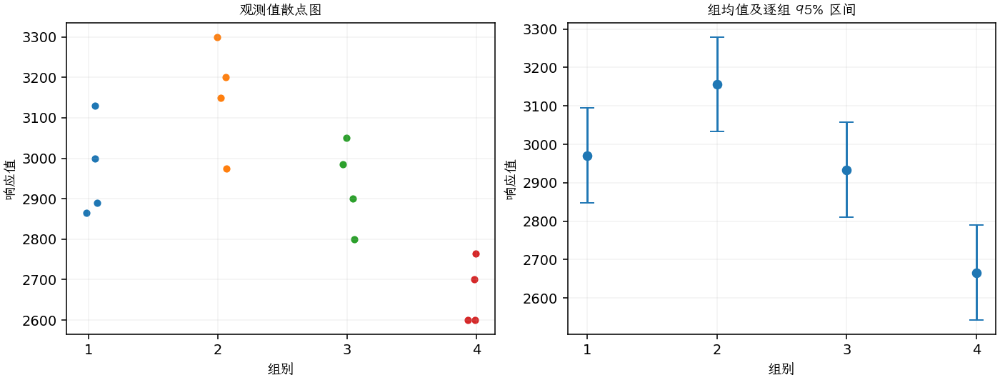
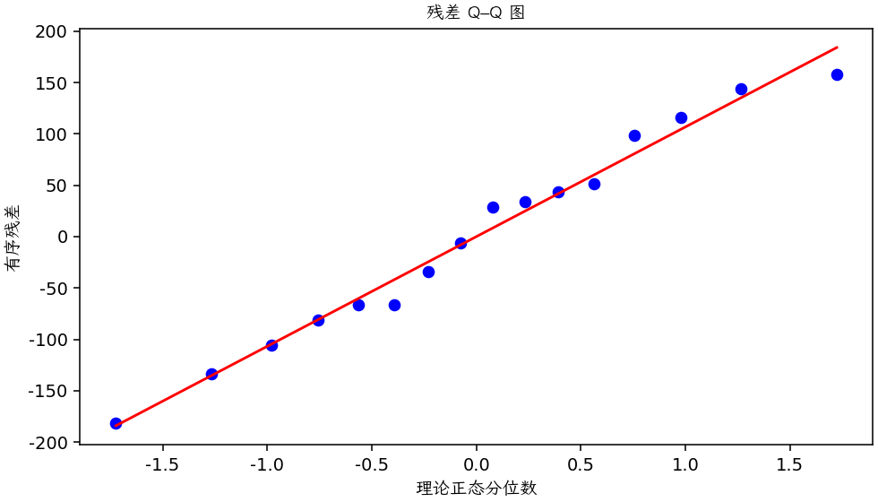
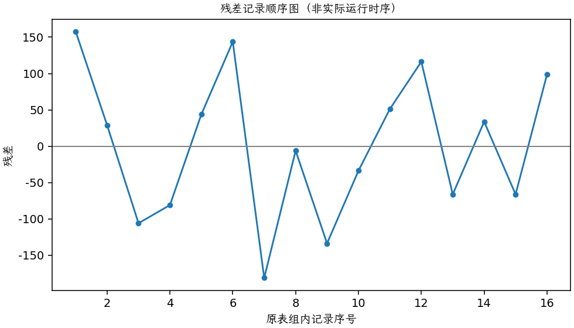
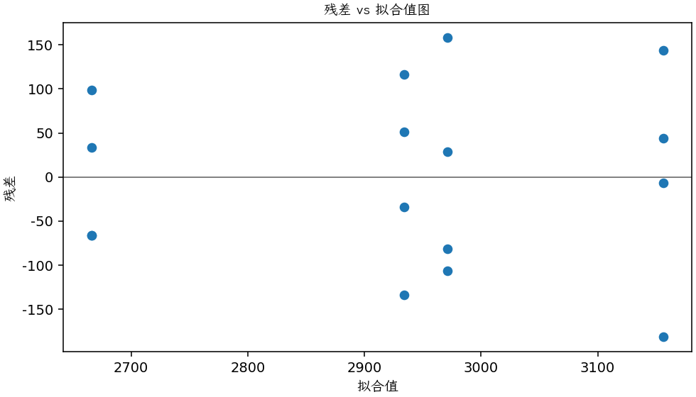

(exercise-3-11)=
# 习题 3.11：水泥混合方法

[习题与答案](../../index.md) / [第 3 章　单因子试验与方差分析](../chapter03.md)

第 9 版 · 第 3 章 · 原书章末习题见印刷页 125～134。

## 题目

现研究 Portland 水泥的抗拉强度。从经济性上看，可以采用 4 种不同的混合方法。研究人员实施了一个完全随机试验，得到以下强度数据，单位为 lb/in²；第 1～4 组对应混合方法 1～4。

| 组别／处理条件 | 观测值（同一行属于同一组） |
| --- | --- |
| 1 | 3129，3000，2865，2890 |
| 2 | 3200，3300，2975，3150 |
| 3 | 2800，2900，2985，3050 |
| 4 | 2600，2700，2600，2765 |

**（a）** 取 $\alpha=0.05$，检验混合方法是否影响水泥强度。

**（b）** 按照第 3.5.3 节的方法，构造图形比较四种混合方法的平均强度，并说明结论。

**（c）** 取 $\alpha=0.05$，用 Fisher LSD 方法比较所有均值对。

**（d）** 构造残差的正态概率图。你会对正态性假定的有效性得出什么结论？

**（e）** 绘制残差对预测抗拉强度的图，并作评价。

**（f）** 绘制试验结果散点图，以辅助解释试验结果。

## 答案与解析

### （a）混合方法的总体检验

**模型与模型假设（固定效应）**：$y_{ij}=\mu_i+\epsilon_{ij}=\mu+\tau_i+\epsilon_{ij}$，$i=1,\ldots,a$，$j=1,\ldots,n_i$；$\epsilon_{ij}\overset{\mathrm{iid}}\sim N(0,\sigma^2)$。误差独立、正态且同方差，处理分配及抽样符合题意；不平衡设计使用实际 $n_i$。取 $\sum_i n_i\tau_i=0$ 识别参数；平衡时等价于 $\sum_i\tau_i=0$。

**原假设和备择假设**：$H_0:\mu_1=\cdots=\mu_a$；$H_1$：至少一个总体均值不同。

**平方和公式与检验统计量**：令 $N=\sum_i n_i$，$\bar y_i=\sum_jy_{ij}/n_i$，$\bar y_{\cdot\cdot}=\sum_i\sum_jy_{ij}/N$。

$$SS_A=\sum_i n_i(\bar y_i-\bar y_{\cdot\cdot})^2,\qquad SS_E=\sum_i\sum_j(y_{ij}-\bar y_i)^2,$$
$$SS_T=\sum_i\sum_j(y_{ij}-\bar y_{\cdot\cdot})^2=SS_A+SS_E,$$
$$MS_A=\frac{SS_A}{a-1},\quad MS_E=\frac{SS_E}{N-a},\quad F_0=\frac{MS_A}{MS_E}\overset{H_0}{\sim}F_{a-1,N-a}.$$

当 $F_0>F_{1-\alpha,a-1,N-a}$ 时拒绝 $H_0$，$P=P(F_{a-1,N-a}\ge F_0)$。本文分位数均为**下侧累积概率分位数**。

**点估计量**：$\hat\mu_i=\bar y_i$，$\hat\sigma^2=MS_E$；各组样本方差为 $s_i^2=\sum_j(y_{ij}-\bar y_i)^2/(n_i-1)$。以下为 ANOVA Table 与计算结果。

| 来源 | 自由度 | 平方和 | 均方 | $F$ | $P$ 值 |
| --- | --- | --- | --- | --- | --- |
| 处理 | 3 | 489740 | 163247 | 12.7281 | 0.000488715 |
| 误差 | 12 | 153908 | 12825.7 | — | — |
| 总计 | 15 | 643648 | — | — | — |

| 组别 | 样本量 | 均值 | 样本标准差 |
| --- | --- | --- | --- |
| 1 | 4 | 2971 | 120.557 |
| 2 | 4 | 3156.25 | 135.976 |
| 3 | 4 | 2933.75 | 108.272 |
| 4 | 4 | 2666.25 | 80.9707 |

$P=0.000488715<0.05$，拒绝 $H_0$：混合方法对平均抗拉强度有显著影响。

### （b）图形比较处理均值

图中均值估计量为 $\bar y_i$，误差条为 $\bar y_i\pm t_{0.975,N-a}\sqrt{MS_E/n_i}$；均值区间的重叠情况不能直接代替均值差检验。

方法 2 的样本均值最高、方法 4 最低。图形是探索性比较，精确两两结论以第（c）问为准。

### （c）Fisher LSD 两两比较

**估计量与区间公式**：$\widehat{\mu_i-\mu_j}=\bar y_i-\bar y_j$，$SE_{ij}=\sqrt{MS_E(1/n_i+1/n_j)}$。 Fisher LSD 的逐对区间为 $(\bar y_i-\bar y_j)\pm t_{1-\alpha/2,N-a}SE_{ij}$；它不是全部比较的同时置信区间。

| 均值对 | 均值差 | 95% 区间 | 显著 |
| --- | --- | --- | --- |
| 1 − 2 | -185.25 | (-359.73, -10.7702) | 是 |
| 1 − 3 | 37.25 | (-137.23, 211.73) | 否 |
| 1 − 4 | 304.75 | (130.27, 479.23) | 是 |
| 2 − 3 | 222.5 | (48.0202, 396.98) | 是 |
| 2 − 4 | 490 | (315.52, 664.48) | 是 |
| 3 − 4 | 267.5 | (93.0202, 441.98) | 是 |

除 1 与 3 外，各对均显著；方法 2 显著高于 1、3、4，方法 4 显著低于其余三种。LSD 的逐对区间不是同时区间。

### （d）正态性与补充的顺序诊断

残差估计量为 $e_{ij}=y_{ij}-\bar y_i$，拟合值为 $\hat y_{ij}=\bar y_i$。

Q–Q 图总体接近直线，未显示严重正态性问题。

原资料未给实际运行时间和随机运行次序。本图仅按原表记录顺序绘制，**不能当作实际残差时序图**，也不能用来证明时间独立性；取得真实运行顺序后须重画。

### （e）残差 vs 预测抗拉强度

各拟合值处的残差散布没有明显随均值扩大的趋势，未发现强烈异方差信号；每组仅 4 次重复，仍应谨慎。

### （f）观测结果散点图

第（b）问左图即完整观测散点图。它显示方法 4 整体偏低、方法 2 偏高，1 与 3 重叠较多；散点图与 LSD 结果结合解释，不能仅凭均值排序认定所有差异显著。

---

**答案来源**：参考：`ch03.pdf`，原题 3.9；本页按第 9 版编号。

← [上一题 3.10](./exercise-3-10.md) · [本章题目目录](../chapter03.md) · [下一题 3.12](./exercise-3-12.md) →
