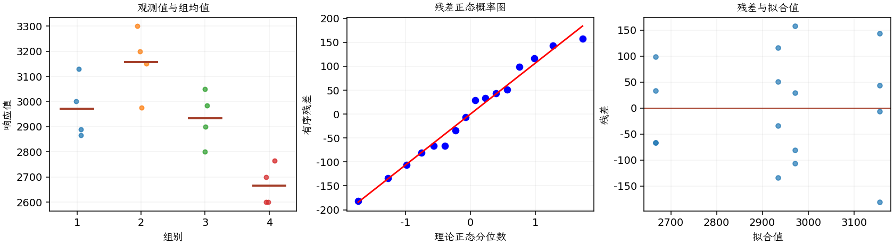

(exercise-3-11)=
# 习题 3.11：水泥混合方法

[习题与答案](../../index.md) / [第 3 章　单因子试验与方差分析](../chapter03.md)

第 9 版 · 第 3 章 · 原书章末习题见印刷页 125～134。

## 题目

现研究 Portland 水泥的抗拉强度。从经济性上看，可以采用 4 种不同的混合方法。研究人员实施了一个完全随机试验，得到以下强度数据，单位为 lb/in²；第 1～4 组对应混合方法 1～4。

| 组别／处理条件 | 观测值（同一行属于同一组） |
| --- | --- |
| 1 | 3129，3000，2865，2890 |
| 2 | 3200，3300，2975，3150 |
| 3 | 2800，2900，2985，3050 |
| 4 | 2600，2700，2600，2765 |

**（a）** 取 $\alpha=0.05$，检验混合方法是否影响水泥强度。

**（b）** 按照第 3.5.3 节的方法，构造图形比较四种混合方法的平均强度，并说明结论。

**（c）** 取 $\alpha=0.05$，用 Fisher LSD 方法比较所有均值对。

**（d）** 构造残差的正态概率图。你会对正态性假定的有效性得出什么结论？

**（e）** 绘制残差对预测抗拉强度的图，并作评价。

**（f）** 绘制试验结果散点图，以辅助解释试验结果。

## 答案与解析

| 来源 | 自由度 | 平方和 | 均方 | $F$ | $P$ 值 |
| --- | --- | --- | --- | --- | --- |
| 处理 | 3 | 489740 | 163247 | 12.7281 | 0.000488715 |
| 误差 | 12 | 153908 | 12825.7 | — | — |
| 总计 | 15 | 643648 | — | — | — |

| 组别 | 样本量 | 均值 | 样本标准差 |
| --- | --- | --- | --- |
| 1 | 4 | 2971 | 120.557 |
| 2 | 4 | 3156.25 | 135.976 |
| 3 | 4 | 2933.75 | 108.272 |
| 4 | 4 | 2666.25 | 80.9707 |

均值存在显著差异。方法 2 的样本均值最高，方法 4 最低。LSD 结果如下，每个区间针对单一均值对，不保证所有区间同时达到 95% 覆盖率：

| 均值对 | 均值差 | 95% 区间 | 显著 |
| --- | --- | --- | --- |
| 1 − 2 | -185.25 | (-359.73, -10.7702) | 是 |
| 1 − 3 | 37.25 | (-137.23, 211.73) | 否 |
| 1 − 4 | 304.75 | (130.27, 479.23) | 是 |
| 2 − 3 | 222.5 | (48.0202, 396.98) | 是 |
| 2 − 4 | 490 | (315.52, 664.48) | 是 |
| 3 − 4 | 267.5 | (93.0202, 441.98) | 是 |

方法 4 与其余三种均有显著差异，方法 2 也显著高于 1、3；1 与 3 不显著。概率图与残差图未显示严重异常，不能据此证明假定完全成立。

---

**答案来源**：参考：`ch03.pdf`，原题 3.9；本页按第 9 版编号。

← [上一题 3.10](./exercise-3-10.md) · [本章题目目录](../chapter03.md) · [下一题 3.12](./exercise-3-12.md) →
