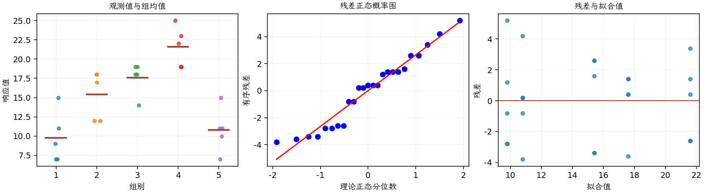

(exercise-3-14)=
# 习题 3.14：棉含量与纤维强度

[习题与答案](../../index.md) / [第 3 章　单因子试验与方差分析](../chapter03.md)

第 9 版 · 第 3 章 · 原书章末习题见印刷页 125～134。

## 题目

某产品开发人员正在研究一种新型合成纤维的抗拉强度，该纤维将用于制作男士衬衫的布料。纤维强度通常会受混合材料中棉含量百分比的影响。工程师实施一个完全随机试验，棉含量取 5 个水平，每个水平重复 5 次。棉的重量百分比分别为 15%、20%、25%、30%、35%，对应第 1～5 组数据。

| 组别／处理条件 | 观测值（同一行属于同一组） |
| --- | --- |
| 15% | 7，7，15，11，9 |
| 20% | 12，17，12，18，18 |
| 25% | 14，19，19，18，18 |
| 30% | 19，25，22，19，23 |
| 35% | 7，10，11，15，11 |

**（a）** 是否有证据支持棉含量会影响平均抗拉强度的主张？取 $\alpha=0.05$。

**（b）** 使用 Fisher LSD 方法比较所有均值对，并说明结论。

**（c）** 分析试验残差，评价模型适合性。

## 答案与解析

| 来源 | 自由度 | 平方和 | 均方 | $F$ | $P$ 值 |
| --- | --- | --- | --- | --- | --- |
| 处理 | 4 | 475.76 | 118.94 | 14.7568 | 9.12794e-06 |
| 误差 | 20 | 161.2 | 8.06 | — | — |
| 总计 | 24 | 636.96 | — | — | — |

| 组别 | 样本量 | 均值 | 样本标准差 |
| --- | --- | --- | --- |
| 1 | 5 | 9.8 | 3.34664 |
| 2 | 5 | 15.4 | 3.1305 |
| 3 | 5 | 17.6 | 2.07364 |
| 4 | 5 | 21.6 | 2.60768 |
| 5 | 5 | 10.8 | 2.86356 |

平均强度显著受棉含量影响，30% 组样本均值最高；高到 35% 时均值下降，不能简单视为单调关系。

| 均值对 | 均值差 | 95% 区间 | 显著 |
| --- | --- | --- | --- |
| 1 − 2 | -5.6 | (-9.34545, -1.85455) | 是 |
| 1 − 3 | -7.8 | (-11.5455, -4.05455) | 是 |
| 1 − 4 | -11.8 | (-15.5455, -8.05455) | 是 |
| 1 − 5 | -1 | (-4.74545, 2.74545) | 否 |
| 2 − 3 | -2.2 | (-5.94545, 1.54545) | 否 |
| 2 − 4 | -6.2 | (-9.94545, -2.45455) | 是 |
| 2 − 5 | 4.6 | (0.854548, 8.34545) | 是 |
| 3 − 4 | -4 | (-7.74545, -0.254548) | 是 |
| 3 − 5 | 6.8 | (3.05455, 10.5455) | 是 |
| 4 − 5 | 10.8 | (7.05455, 14.5455) | 是 |

残差未见强烈方差趋势。第 1～5 组对应上述五个棉含量；若要选择实际工艺，还应结合加工成本与独立确认试验。

---

**答案来源**：参考：`ch03.pdf`，原题 3.12；本页按第 9 版编号。

← [上一题 3.13](./exercise-3-13.md) · [本章题目目录](../chapter03.md) · [下一题 3.15](./exercise-3-15.md) →
