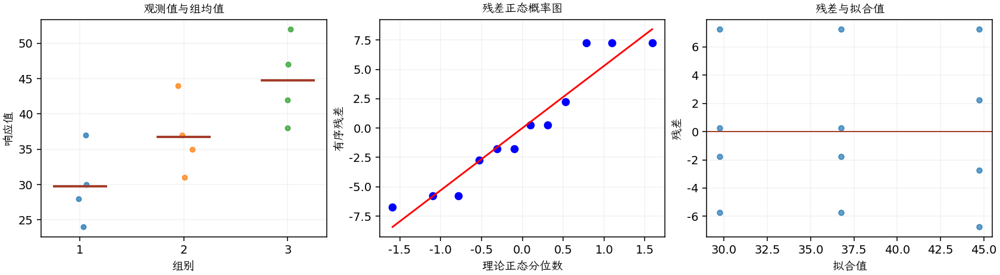

(exercise-3-16)=
# 习题 3.16：剂量与药物生物活性

[习题与答案](../../index.md) / [第 3 章　单因子试验与方差分析](../chapter03.md)

第 9 版 · 第 3 章 · 原书章末习题见印刷页 125～134。

## 题目

一家制药企业希望研究一种新药的生物活性。研究人员开展了一个完全随机单因子试验，使用 3 个剂量水平 20、30、40 g，得到以下结果，第 1～3 组分别对应这三个剂量。

| 组别／处理条件 | 观测值（同一行属于同一组） |
| --- | --- |
| 20 g | 24，28，37，30 |
| 30 g | 37，44，31，35 |
| 40 g | 42，47，52，38 |

**（a）** 是否有证据表明剂量水平影响生物活性？取 $\alpha=0.05$。

**（b）** 如果适合进行均值对比较，请实施比较。可以得出什么结论？

**（c）** 分析试验残差，并评价模型适合性。

## 答案与解析

| 来源 | 自由度 | 平方和 | 均方 | $F$ | $P$ 值 |
| --- | --- | --- | --- | --- | --- |
| 处理 | 2 | 450.667 | 225.333 | 7.03556 | 0.0144638 |
| 误差 | 9 | 288.25 | 32.0278 | — | — |
| 总计 | 11 | 738.917 | — | — | — |

| 组别 | 样本量 | 均值 | 样本标准差 |
| --- | --- | --- | --- |
| 1 | 4 | 29.75 | 5.43906 |
| 2 | 4 | 36.75 | 5.43906 |
| 3 | 4 | 44.75 | 6.07591 |

拒绝均值相等。用 Tukey 控制两两比较：

| 均值对 | 均值差 | 95% 区间 | 显著 |
| --- | --- | --- | --- |
| 1 − 2 | -7 | (-18.1729, 4.17287) | 否 |
| 1 − 3 | -15 | (-26.1729, -3.82713) | 是 |
| 2 − 3 | -8 | (-19.1729, 3.17287) | 否 |

20 与 40 g 有显著差异，其余两对不显著。残差没有明显的漏斗形或强烈异常，但每组只有 4 个试验单位。

---

**答案来源**：参考：`ch03.pdf`，原题 3.14S；本页按第 9 版编号。

← [上一题 3.15](./exercise-3-15.md) · [本章题目目录](../chapter03.md) · [下一题 3.17](./exercise-3-17.md) →
