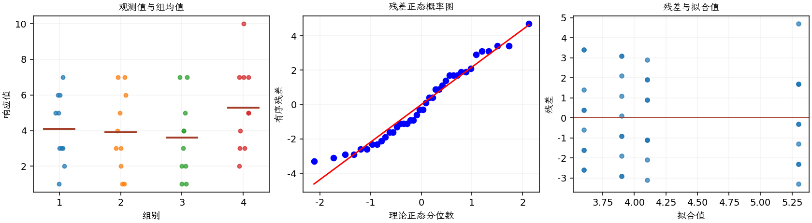

(exercise-3-17)=
# 习题 3.17：车型与租期

[习题与答案](../../index.md) / [第 3 章　单因子试验与方差分析](../chapter03.md)

第 9 版 · 第 3 章 · 原书章末习题见印刷页 125～134。

## 题目

一家租车公司希望研究所租车辆的类型是否会影响租赁期限。在某一营业地点实施为期一周的研究，每种车型随机选取 10 份租赁合同。第 1～4 组分别为微型车、小型车、中型车和全尺寸车，租期观测如下。

| 组别／处理条件 | 观测值（同一行属于同一组） |
| --- | --- |
| 微型车 | 3，5，3，7，6，5，3，2，1，6 |
| 小型车 | 1，3，4，7，5，6，3，2，1，7 |
| 中型车 | 4，1，3，5，7，1，2，4，2，7 |
| 全尺寸车 | 3，5，7，5，10，3，4，7，2，7 |

**（a）** 是否有证据支持车型影响租赁合同期限的主张？取 $\alpha=0.05$。如果有，哪些车型造成了差异？

**（b）** 分析试验残差，并评价模型适合性。

**（c）** 注意本题的响应是计数。这是否会引起对 ANOVA 有效性的潜在疑虑？

## 答案与解析

| 来源 | 自由度 | 平方和 | 均方 | $F$ | $P$ 值 |
| --- | --- | --- | --- | --- | --- |
| 处理 | 3 | 16.675 | 5.55833 | 1.10982 | 0.357824 |
| 误差 | 36 | 180.3 | 5.00833 | — | — |
| 总计 | 39 | 196.975 | — | — | — |

| 组别 | 样本量 | 均值 | 样本标准差 |
| --- | --- | --- | --- |
| 1 | 10 | 4.1 | 1.96921 |
| 2 | 10 | 3.9 | 2.28279 |
| 3 | 10 | 3.6 | 2.22111 |
| 4 | 10 | 5.3 | 2.45176 |

在 0.05 水平未发现车型均值差异，无需继续据两两检验挑选“显著”车型。租期是正整数，小值较多；正态误差只是一种近似，应检查离散性和方差随均值变化的情况，可用计数模型作敏感性分析。合同随机抽取不等于车型被随机分配，因果结论还受客户选择车型等因素限制。

---

**答案来源**：参考：`ch03.pdf`，原题 3.15；本页按第 9 版编号。

← [上一题 3.16](./exercise-3-16.md) · [本章题目目录](../chapter03.md) · [下一题 3.18](./exercise-3-18.md) →
