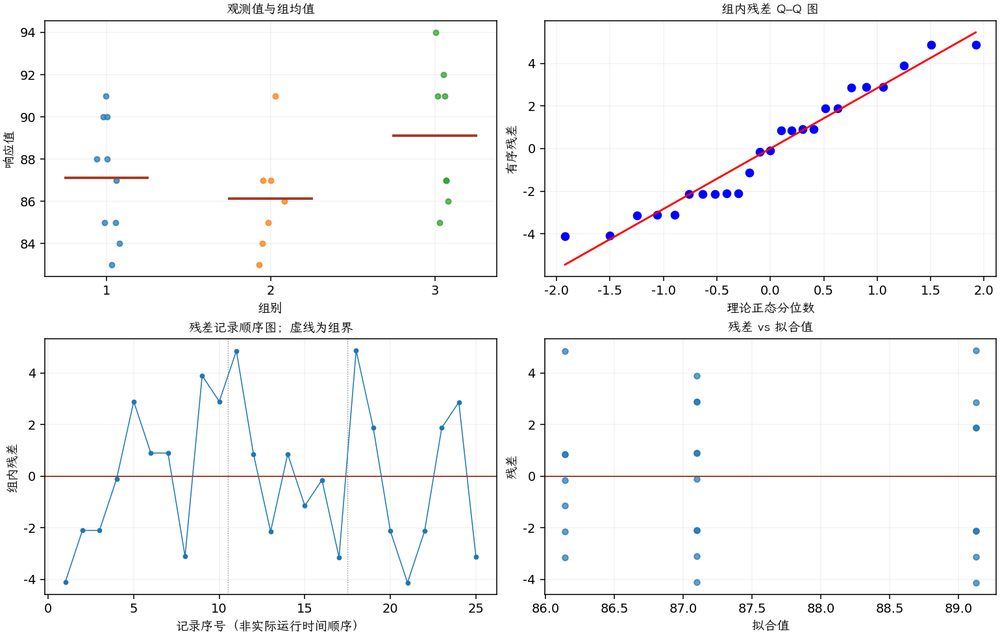

(exercise-3-18)=
# 习题 3.18：季节与高尔夫成绩

[习题与答案](../../index.md) / [第 3 章　单因子试验与方差分析](../chapter03.md)

第 9 版 · 第 3 章 · 原书章末习题见印刷页 125～134。

## 题目

我在住处附近的一家高尔夫俱乐部打球，把一年分为 3 个高尔夫季节：夏季（6～9 月）、冬季（11 月～次年 3 月）和过渡季（10 月、4 月、5 月）。我认为自己在夏季和过渡季打得最好，因为夏季有更多时间且球场不拥挤，过渡季球场也不拥挤；冬季则打得最差，因为季节性居民回来后，球场拥挤、打球速度慢，我容易感到沮丧。以下为上一年的成绩，第 1～3 组依次为夏季、过渡季、冬季。

| 组别／处理条件 | 观测值（同一行属于同一组） |
| --- | --- |
| 夏季 | 83，85，85，87，90，88，88，84，91，90 |
| 过渡季 | 91，87，84，87，85，86，83 |
| 冬季 | 94，91，87，85，87，91，92，86 |

**（a）** 取 $\alpha=0.05$，这些数据是否表明我的看法正确？

**（b）** 分析试验残差，评价模型适合性。

## 答案与解析

### （a）检验季节差异

**模型与模型假设（固定效应）**：$y_{ij}=\mu_i+\epsilon_{ij}=\mu+\tau_i+\epsilon_{ij}$，$i=1,\ldots,a$，$j=1,\ldots,n_i$；$\epsilon_{ij}\overset{\mathrm{iid}}\sim N(0,\sigma^2)$。误差独立、正态且同方差，处理分配及抽样符合题意；不平衡设计使用实际 $n_i$。取 $\sum_i n_i\tau_i=0$ 识别参数；平衡时等价于 $\sum_i\tau_i=0$。

**原假设和备择假设**：$H_0:\mu_1=\cdots=\mu_a$；$H_1$：至少一个总体均值不同。

**平方和公式与检验统计量**：令 $N=\sum_i n_i$，$\bar y_i=\sum_jy_{ij}/n_i$，$\bar y_{\cdot\cdot}=\sum_i\sum_jy_{ij}/N$。

$$SS_A=\sum_i n_i(\bar y_i-\bar y_{\cdot\cdot})^2,\qquad SS_E=\sum_i\sum_j(y_{ij}-\bar y_i)^2,$$
$$SS_T=\sum_i\sum_j(y_{ij}-\bar y_{\cdot\cdot})^2=SS_A+SS_E,$$
$$MS_A=\frac{SS_A}{a-1},\quad MS_E=\frac{SS_E}{N-a},\quad F_0=\frac{MS_A}{MS_E}\overset{H_0}{\sim}F_{a-1,N-a}.$$

当 $F_0>F_{1-\alpha,a-1,N-a}$ 时拒绝 $H_0$，$P=P(F_{a-1,N-a}\ge F_0)$。本文分位数均为**下侧累积概率分位数**。

**点估计量**：$\hat\mu_i=\bar y_i$，$\hat\sigma^2=MS_E$；各组样本方差为 $s_i^2=\sum_j(y_{ij}-\bar y_i)^2/(n_i-1)$。以下为 ANOVA Table 与计算结果。

| 来源 | 自由度 | 平方和 | 均方 | $F$ | $P$ 值 |
| --- | --- | --- | --- | --- | --- |
| 处理 | 2 | 35.6079 | 17.8039 | 2.12144 | 0.143722 |
| 误差 | 22 | 184.632 | 8.39237 | — | — |
| 总计 | 24 | 220.24 | — | — | — |

| 组别 | 样本量 | 均值 | 样本标准差 |
| --- | --- | --- | --- |
| 1 | 10 | 87.1 | 2.76687 |
| 2 | 7 | 86.1429 | 2.60951 |
| 3 | 8 | 89.125 | 3.27054 |

高尔夫杆数越低越好。虽然冬季样本均值较高，$P=0.143722>0.05$，数据不足以确认季节均值差异，更不能证明球场拥挤造成成绩变化。

### （b）残差分析

**残差定义**：$\hat y_{ij}=\bar y_i$，$e_{ij}=y_{ij}-\bar y_i$。变换分析时使用相应变换尺度的响应。

**三项诊断**：Q–Q 图用于检查尾部、偏态及异常残差；残差记录顺序图用于展示原表记录的相邻变化；残差 vs 拟合值图用于观察方差是否随处理均值变化。

**时序资料的限制**：原题只提供分组观测，没有实际运行时间和随机运行次序。左下图按原表组内记录顺序排列，虚线表示组界，**不是实际残差时序图**；组界附近的变化不能解释为时间效应。若要完成真正的时序诊断，须取得原始运行顺序后按该顺序重画。当前不能仅凭此图断言误差在时间上独立。单样本或配对差的拟合值为常数时，残差 vs 拟合值图也不能检验复杂均值结构。

残差未见严重异常或强烈异方差。季节、日期本身有自然时间结构，但原表未给各场次日期，必须取得真实日期后重新画残差时序图。

---

**答案来源**：参考：`ch03.pdf`，原题 3.16S；本页按第 9 版编号。

← [上一题 3.17](./exercise-3-17.md) · [本章题目目录](../chapter03.md) · [下一题 3.19](./exercise-3-19.md) →
