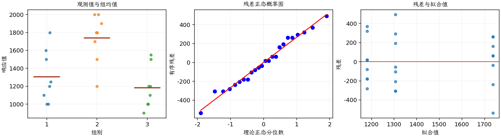

(exercise-3-19)=
# 习题 3.19：募捐方式

[习题与答案](../../index.md) / [第 3 章　单因子试验与方差分析](../chapter03.md)

第 9 版 · 第 3 章 · 原书章末习题见印刷页 125～134。

## 题目

一家地区歌剧公司尝试 3 种不同的方式，向 24 名潜在赞助者募集捐款。24 人被随机分成 3 组，每组 8 人，每组采用一种募捐方式。所得捐款金额如下，单位为美元。

| 组别／处理条件 | 观测值（同一行属于同一组） |
| --- | --- |
| 1 | 1000，1500，1200，1800，1600，1100，1000，1250 |
| 2 | 1500，1800，2000，1200，2000，1700，1800，1900 |
| 3 | 900，1000，1200，1500，1200，1550，1000，1100 |

**（a）** 数据是否表明三种募捐方式的结果存在差异？取 $\alpha=0.05$。

**（b）** 分析试验残差，评价模型适合性。

## 答案与解析

| 来源 | 自由度 | 平方和 | 均方 | $F$ | $P$ 值 |
| --- | --- | --- | --- | --- | --- |
| 处理 | 2 | 1.36271e+06 | 681354 | 9.40958 | 0.00120875 |
| 误差 | 21 | 1.52062e+06 | 72410.7 | — | — |
| 总计 | 23 | 2.88333e+06 | — | — | — |

| 组别 | 样本量 | 均值 | 样本标准差 |
| --- | --- | --- | --- |
| 1 | 8 | 1306.25 | 295.729 |
| 2 | 8 | 1737.5 | 272.226 |
| 3 | 8 | 1181.25 | 235.944 |

三组均值有显著差异，方式 2 的均值最高。残差散布相近，未见严重异常；金额响应在更大人群中可能偏态，应注意本例的样本范围。

---

**答案来源**：参考：`ch03.pdf`，原题 3.17；本页按第 9 版编号。

← [上一题 3.18](./exercise-3-18.md) · [本章题目目录](../chapter03.md) · [下一题 3.20](./exercise-3-20.md) →
