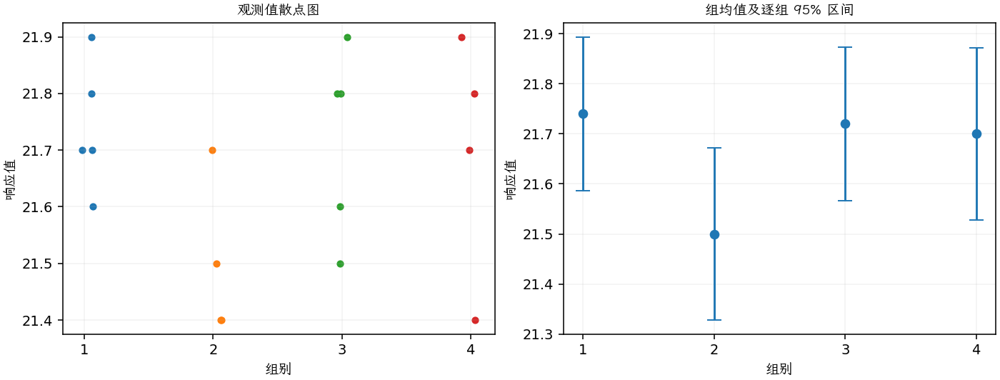

(exercise-3-20)=
# 习题 3.20：烧制温度与砖密度

[习题与答案](../../index.md) / [第 3 章　单因子试验与方差分析](../chapter03.md)

第 9 版 · 第 3 章 · 原书章末习题见印刷页 125～134。

## 题目

研究人员实施试验，以确定 4 个指定烧制温度是否会影响某种砖的密度。完全随机试验得到以下结果，温度分别为 100、125、150、175，对应第 1～4 组；各组样本量并不相同。

| 组别／处理条件 | 观测值（同一行属于同一组） |
| --- | --- |
| 100 | 21.8，21.9，21.7，21.6，21.7 |
| 125 | 21.7，21.4，21.5，21.4 |
| 150 | 21.9，21.8，21.8，21.6，21.5 |
| 175 | 21.9，21.7，21.8，21.4 |

**（a）** 烧制温度是否影响砖的密度？取 $\alpha=0.05$。

**（b）** 在这个试验中，是否适合采用 Fisher LSD 等方法比较各处理均值？

**（c）** 分析试验残差。方差分析的各项假定是否满足？

**（d）** 按第 3.5.3 节的方法构造处理均值的图形比较。该图是否充分概括了第（a）问的 ANOVA 结果？

## 答案与解析

### （a）烧制温度效应

**模型与模型假设（固定效应）**：$y_{ij}=\mu_i+\epsilon_{ij}=\mu+\tau_i+\epsilon_{ij}$，$i=1,\ldots,a$，$j=1,\ldots,n_i$；$\epsilon_{ij}\overset{\mathrm{iid}}\sim N(0,\sigma^2)$。误差独立、正态且同方差，处理分配及抽样符合题意；不平衡设计使用实际 $n_i$。取 $\sum_i n_i\tau_i=0$ 识别参数；平衡时等价于 $\sum_i\tau_i=0$。

**原假设和备择假设**：$H_0:\mu_1=\cdots=\mu_a$；$H_1$：至少一个总体均值不同。

**平方和公式与检验统计量**：令 $N=\sum_i n_i$，$\bar y_i=\sum_jy_{ij}/n_i$，$\bar y_{\cdot\cdot}=\sum_i\sum_jy_{ij}/N$。

$$SS_A=\sum_i n_i(\bar y_i-\bar y_{\cdot\cdot})^2,\qquad SS_E=\sum_i\sum_j(y_{ij}-\bar y_i)^2,$$
$$SS_T=\sum_i\sum_j(y_{ij}-\bar y_{\cdot\cdot})^2=SS_A+SS_E,$$
$$MS_A=\frac{SS_A}{a-1},\quad MS_E=\frac{SS_E}{N-a},\quad F_0=\frac{MS_A}{MS_E}\overset{H_0}{\sim}F_{a-1,N-a}.$$

当 $F_0>F_{1-\alpha,a-1,N-a}$ 时拒绝 $H_0$，$P=P(F_{a-1,N-a}\ge F_0)$。本文分位数均为**下侧累积概率分位数**。

**点估计量**：$\hat\mu_i=\bar y_i$，$\hat\sigma^2=MS_E$；各组样本方差为 $s_i^2=\sum_j(y_{ij}-\bar y_i)^2/(n_i-1)$。以下为 ANOVA Table 与计算结果。

| 来源 | 自由度 | 平方和 | 均方 | $F$ | $P$ 值 |
| --- | --- | --- | --- | --- | --- |
| 处理 | 3 | 0.156111 | 0.052037 | 2.02366 | 0.156875 |
| 误差 | 14 | 0.36 | 0.0257143 | — | — |
| 总计 | 17 | 0.516111 | — | — | — |

| 组别 | 样本量 | 均值 | 样本标准差 |
| --- | --- | --- | --- |
| 1 | 5 | 21.74 | 0.114018 |
| 2 | 4 | 21.5 | 0.141421 |
| 3 | 5 | 21.72 | 0.164317 |
| 4 | 4 | 21.7 | 0.216025 |

取 $\alpha=0.05$，未拒绝均值相等，不能认为烧制温度显著影响平均密度。

### （b）是否继续使用 Fisher LSD

若采用先做总体检验的受保护 LSD 程序，由于总体检验不显著，不继续作事后 LSD 宣告差异。预先规定的科学对比另当别论。

### （c）残差与假定

**残差定义**：$\hat y_{ij}=\bar y_i$，$e_{ij}=y_{ij}-\bar y_i$。变换分析时使用相应变换尺度的响应。

**三项诊断**：Q–Q 图用于检查尾部、偏态及异常残差；残差记录顺序图用于展示原表记录的相邻变化；残差 vs 拟合值图用于观察方差是否随处理均值变化。

**时序资料的限制**：原题只提供分组观测，没有实际运行时间和随机运行次序。左下图按原表组内记录顺序排列，虚线表示组界，**不是实际残差时序图**；组界附近的变化不能解释为时间效应。若要完成真正的时序诊断，须取得原始运行顺序后按该顺序重画。当前不能仅凭此图断言误差在时间上独立。单样本或配对差的拟合值为常数时，残差 vs 拟合值图也不能检验复杂均值结构。

密度记录存在舍入造成的离散性；未见严重正态性偏离或明显异方差。原表顺序不等于随机运行顺序，独立性仍需实际设计记录支持。

### （d）处理均值图

图中均值估计量为 $\bar y_i$，误差条为 $\bar y_i\pm t_{0.975,N-a}\sqrt{MS_E/n_i}$；均值区间的重叠情况不能直接代替均值差检验。

各组分布与区间明显重叠，图示与总体未显著的结果相容；不能据此证明各真实均值完全相等。

---

**答案来源**：参考：`ch03.pdf`，原题 3.18；本页按第 9 版编号。

← [上一题 3.19](./exercise-3-19.md) · [本章题目目录](../chapter03.md) · [下一题 3.21](./exercise-3-21.md) →
