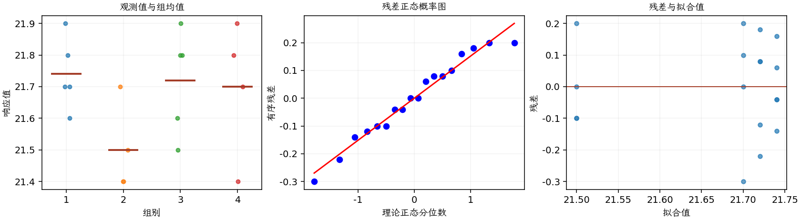

(exercise-3-20)=
# 习题 3.20：烧制温度与砖密度

[习题与答案](../../index.md) / [第 3 章　单因子试验与方差分析](../chapter03.md)

第 9 版 · 第 3 章 · 原书章末习题见印刷页 125～134。

## 题目

研究人员实施试验，以确定 4 个指定烧制温度是否会影响某种砖的密度。完全随机试验得到以下结果，温度分别为 100、125、150、175，对应第 1～4 组；各组样本量并不相同。

| 组别／处理条件 | 观测值（同一行属于同一组） |
| --- | --- |
| 100 | 21.8，21.9，21.7，21.6，21.7 |
| 125 | 21.7，21.4，21.5，21.4 |
| 150 | 21.9，21.8，21.8，21.6，21.5 |
| 175 | 21.9，21.7，21.8，21.4 |

**（a）** 烧制温度是否影响砖的密度？取 $\alpha=0.05$。

**（b）** 在这个试验中，是否适合采用 Fisher LSD 等方法比较各处理均值？

**（c）** 分析试验残差。方差分析的各项假定是否满足？

**（d）** 按第 3.5.3 节的方法构造处理均值的图形比较。该图是否充分概括了第（a）问的 ANOVA 结果？

## 答案与解析

| 来源 | 自由度 | 平方和 | 均方 | $F$ | $P$ 值 |
| --- | --- | --- | --- | --- | --- |
| 处理 | 3 | 0.156111 | 0.052037 | 2.02366 | 0.156875 |
| 误差 | 14 | 0.36 | 0.0257143 | — | — |
| 总计 | 17 | 0.516111 | — | — | — |

| 组别 | 样本量 | 均值 | 样本标准差 |
| --- | --- | --- | --- |
| 1 | 5 | 21.74 | 0.114018 |
| 2 | 4 | 21.5 | 0.141421 |
| 3 | 5 | 21.72 | 0.164317 |
| 4 | 4 | 21.7 | 0.216025 |

未发现温度显著影响平均密度；均值图显示各组分布明显重叠。若采用“先总体检验、后 LSD”的程序，当前不应开展受保护 LSD 比较。残差没有严重异常，密度取值有明显舍入离散性。

---

**答案来源**：参考：`ch03.pdf`，原题 3.18；本页按第 9 版编号。

← [上一题 3.19](./exercise-3-19.md) · [本章题目目录](../chapter03.md) · [下一题 3.21](./exercise-3-21.md) →
