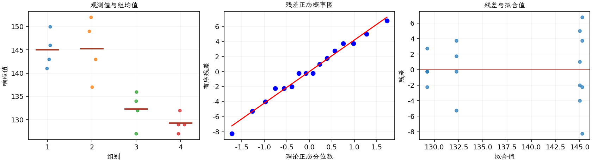

(exercise-3-22)=
# 习题 3.22：涂层与显像管导电性

[习题与答案](../../index.md) / [第 3 章　单因子试验与方差分析](../chapter03.md)

第 9 版 · 第 3 章 · 原书章末习题见印刷页 125～134。

## 题目

一家电视机制造商关心彩色显像管的 4 种不同涂层材料对管子导电性的影响。完全随机试验得到以下导电性数据，第 1～4 组分别对应涂层 1～4。

| 组别／处理条件 | 观测值（同一行属于同一组） |
| --- | --- |
| 1 | 143，141，150，146 |
| 2 | 152，149，137，143 |
| 3 | 134，136，132，127 |
| 4 | 129，127，132，129 |

**（a）** 导电性是否因涂层类型而不同？取 $\alpha=0.05$。

**（b）** 估计总均值和各处理效应。

**（c）** 求涂层 4 的总体平均导电性的 95% 置信区间；求涂层 1 与 4 的总体均值之差的 99% 置信区间。

**（d）** 使用 Fisher LSD 方法在 $\alpha=0.05$ 水平检验所有均值对。

**（e）** 用第 3.5.3 节中的图形方法比较均值。哪种涂层给出的导电性最高？

**（f）** 假定当前使用的是涂层 4，而目标是使导电性尽可能低，你会向制造商提出什么建议？

## 答案与解析

| 来源 | 自由度 | 平方和 | 均方 | $F$ | $P$ 值 |
| --- | --- | --- | --- | --- | --- |
| 处理 | 3 | 844.688 | 281.562 | 14.3016 | 0.000288124 |
| 误差 | 12 | 236.25 | 19.6875 | — | — |
| 总计 | 15 | 1080.94 | — | — | — |

| 组别 | 样本量 | 均值 | 样本标准差 |
| --- | --- | --- | --- |
| 1 | 4 | 145 | 3.91578 |
| 2 | 4 | 145.25 | 6.65207 |
| 3 | 4 | 132.25 | 3.86221 |
| 4 | 4 | 129.25 | 2.06155 |

有显著涂层效应。$\hat\mu=137.9375$，$\hat\tau=(7.0625,7.3125,-5.6875,-8.6875)$。第 4 种均值 95% 区间由 $129.25\pm t_{0.975,12}\sqrt{MS_E/4}$ 计算；第 1 与第 4 种差值为 15.75，用 $t_{0.995,12}\sqrt{MS_E/2}$ 构造 99% 区间。

| 组别 | 95% 均值置信区间（逐个区间） |
| --- | --- |
| 1 | (140.166, 149.834) |
| 2 | (140.416, 150.084) |
| 3 | (127.416, 137.084) |
| 4 | (124.416, 134.084) |

| 均值对 | 均值差 | 99% 区间 | 显著 |
| --- | --- | --- | --- |
| 1 − 2 | -0.25 | (-9.83354, 9.33354) | 否 |
| 1 − 3 | 12.75 | (3.16646, 22.3335) | 是 |
| 1 − 4 | 15.75 | (6.16646, 25.3335) | 是 |
| 2 − 3 | 13 | (3.41646, 22.5835) | 是 |
| 2 − 4 | 16 | (6.41646, 25.5835) | 是 |
| 3 − 4 | 3 | (-6.58354, 12.5835) | 否 |

上表给出了各均值差的 99% 单独区间，其中“1 − 4”即所求。0.05 水平 LSD 结果为：

| 均值对 | 均值差 | 95% 区间 | 显著 |
| --- | --- | --- | --- |
| 1 − 2 | -0.25 | (-7.08597, 6.58597) | 否 |
| 1 − 3 | 12.75 | (5.91403, 19.586) | 是 |
| 1 − 4 | 15.75 | (8.91403, 22.586) | 是 |
| 2 − 3 | 13 | (6.16403, 19.836) | 是 |
| 2 − 4 | 16 | (9.16403, 22.836) | 是 |
| 3 − 4 | 3 | (-3.83597, 9.83597) | 否 |

1、2 组导电性较高，3、4 组较低；第 4 种样本均值最低，且未发现优于它的更低均值，继续使用第 4 种合理。残差方差问题另见 [3.23](./exercise-3-23.md)。

---

**答案来源**：参考：`ch03.pdf`，原题 3.20；本页按第 9 版编号。

← [上一题 3.21](./exercise-3-21.md) · [本章题目目录](../chapter03.md) · [下一题 3.23](./exercise-3-23.md) →
