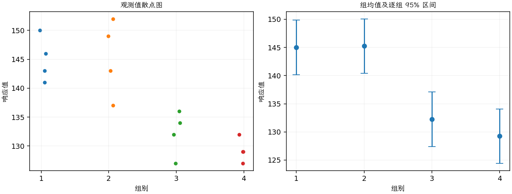

(exercise-3-22)=
# 习题 3.22：涂层与显像管导电性

[习题与答案](../../index.md) / [第 3 章　单因子试验与方差分析](../chapter03.md)

第 9 版 · 第 3 章 · 原书章末习题见印刷页 125～134。

## 题目

一家电视机制造商关心彩色显像管的 4 种不同涂层材料对管子导电性的影响。完全随机试验得到以下导电性数据，第 1～4 组分别对应涂层 1～4。

| 组别／处理条件 | 观测值（同一行属于同一组） |
| --- | --- |
| 1 | 143，141，150，146 |
| 2 | 152，149，137，143 |
| 3 | 134，136，132，127 |
| 4 | 129，127，132，129 |

**（a）** 导电性是否因涂层类型而不同？取 $\alpha=0.05$。

**（b）** 估计总均值和各处理效应。

**（c）** 求涂层 4 的总体平均导电性的 95% 置信区间；求涂层 1 与 4 的总体均值之差的 99% 置信区间。

**（d）** 使用 Fisher LSD 方法在 $\alpha=0.05$ 水平检验所有均值对。

**（e）** 用第 3.5.3 节中的图形方法比较均值。哪种涂层给出的导电性最高？

**（f）** 假定当前使用的是涂层 4，而目标是使导电性尽可能低，你会向制造商提出什么建议？

## 答案与解析

### （a）涂层效应的 ANOVA

**模型与模型假设（固定效应）**：$y_{ij}=\mu_i+\epsilon_{ij}=\mu+\tau_i+\epsilon_{ij}$，$i=1,\ldots,a$，$j=1,\ldots,n_i$；$\epsilon_{ij}\overset{\mathrm{iid}}\sim N(0,\sigma^2)$。误差独立、正态且同方差，处理分配及抽样符合题意；不平衡设计使用实际 $n_i$。取 $\sum_i n_i\tau_i=0$ 识别参数；平衡时等价于 $\sum_i\tau_i=0$。

**原假设和备择假设**：$H_0:\mu_1=\cdots=\mu_a$；$H_1$：至少一个总体均值不同。

**平方和公式与检验统计量**：令 $N=\sum_i n_i$，$\bar y_i=\sum_jy_{ij}/n_i$，$\bar y_{\cdot\cdot}=\sum_i\sum_jy_{ij}/N$。

$$SS_A=\sum_i n_i(\bar y_i-\bar y_{\cdot\cdot})^2,\qquad SS_E=\sum_i\sum_j(y_{ij}-\bar y_i)^2,$$
$$SS_T=\sum_i\sum_j(y_{ij}-\bar y_{\cdot\cdot})^2=SS_A+SS_E,$$
$$MS_A=\frac{SS_A}{a-1},\quad MS_E=\frac{SS_E}{N-a},\quad F_0=\frac{MS_A}{MS_E}\overset{H_0}{\sim}F_{a-1,N-a}.$$

当 $F_0>F_{1-\alpha,a-1,N-a}$ 时拒绝 $H_0$，$P=P(F_{a-1,N-a}\ge F_0)$。本文分位数均为**下侧累积概率分位数**。

**点估计量**：$\hat\mu_i=\bar y_i$，$\hat\sigma^2=MS_E$；各组样本方差为 $s_i^2=\sum_j(y_{ij}-\bar y_i)^2/(n_i-1)$。以下为 ANOVA Table 与计算结果。

| 来源 | 自由度 | 平方和 | 均方 | $F$ | $P$ 值 |
| --- | --- | --- | --- | --- | --- |
| 处理 | 3 | 844.688 | 281.562 | 14.3016 | 0.000288124 |
| 误差 | 12 | 236.25 | 19.6875 | — | — |
| 总计 | 15 | 1080.94 | — | — | — |

| 组别 | 样本量 | 均值 | 样本标准差 |
| --- | --- | --- | --- |
| 1 | 4 | 145 | 3.91578 |
| 2 | 4 | 145.25 | 6.65207 |
| 3 | 4 | 132.25 | 3.86221 |
| 4 | 4 | 129.25 | 2.06155 |

$P=0.000288124<0.05$，拒绝四均值相等。

### （b）总均值和处理效应的点估计

在平衡设计、约束 $\sum_i\tau_i=0$ 下，$\hat\mu=\bar y_{\cdot\cdot}$，$\hat\tau_i=\bar y_i-\bar y_{\cdot\cdot}$。结果为

$$\hat\mu=137.9375,\qquad\hat\tau=(7.0625,7.3125,-5.6875,-8.6875).$$

### （c）均值与均值差的区间

涂层 4 的均值区间按下式计算，下表第 4 行为所求。

**估计量与区间公式**：$\hat\mu_i=\bar y_i$，$\widehat{SE}(\bar y_i)=\sqrt{MS_E/n_i}$，区间为 $\bar y_i\pm t_{1-\alpha/2,N-a}\sqrt{MS_E/n_i}$。以下各区间均为逐个区间。

| 组别 | 均值点估计 | 估计标准误 | 95% 均值置信区间（逐个区间） |
| --- | --- | --- | --- |
| 1 | 145 | 2.21853 | (140.166, 149.834) |
| 2 | 145.25 | 2.21853 | (140.416, 150.084) |
| 3 | 132.25 | 2.21853 | (127.416, 137.084) |
| 4 | 129.25 | 2.21853 | (124.416, 134.084) |

涂层 1 减涂层 4 的 99% 区间为：

$\widehat{\mu_i-\mu_j}=\bar y_i-\bar y_j$，$SE=\sqrt{MS_E(1/n_i+1/n_j)}$，区间为 $(\bar y_i-\bar y_j)\pm t_{1-\alpha/2,N-a}SE$。

对第 1 组减第 4 组，点估计 15.75，标准误 3.13748；99% 区间为 $(6.16646, 25.3335)$。

### （d）Fisher LSD 两两比较

**估计量与区间公式**：$\widehat{\mu_i-\mu_j}=\bar y_i-\bar y_j$，$SE_{ij}=\sqrt{MS_E(1/n_i+1/n_j)}$。 Fisher LSD 的逐对区间为 $(\bar y_i-\bar y_j)\pm t_{1-\alpha/2,N-a}SE_{ij}$；它不是全部比较的同时置信区间。

| 均值对 | 均值差 | 95% 区间 | 显著 |
| --- | --- | --- | --- |
| 1 − 2 | -0.25 | (-7.08597, 6.58597) | 否 |
| 1 − 3 | 12.75 | (5.91403, 19.586) | 是 |
| 1 − 4 | 15.75 | (8.91403, 22.586) | 是 |
| 2 − 3 | 13 | (6.16403, 19.836) | 是 |
| 2 − 4 | 16 | (9.16403, 22.836) | 是 |
| 3 − 4 | 3 | (-3.83597, 9.83597) | 否 |

1 与 2、3 与 4 不显著，其余四对显著。

### （e）图形比较

图中均值估计量为 $\bar y_i$，误差条为 $\bar y_i\pm t_{0.975,N-a}\sqrt{MS_E/n_i}$；均值区间的重叠情况不能直接代替均值差检验。

涂层 2 的样本均值 145.25 最高，但与涂层 1 的 145 无显著差异。

### （f）以低导电性为目标的建议

涂层 4 的样本均值 129.25 最低，涂层 3 与其差异不显著。没有证据支持其他涂层有更低均值，可继续使用 4；等方差方面的疑虑见习题 [3.23](./exercise-3-23.md)，实际选择还应结合成本。

---

**答案来源**：参考：`ch03.pdf`，原题 3.20；本页按第 9 版编号。

← [上一题 3.21](./exercise-3-21.md) · [本章题目目录](../chapter03.md) · [下一题 3.23](./exercise-3-23.md) →
