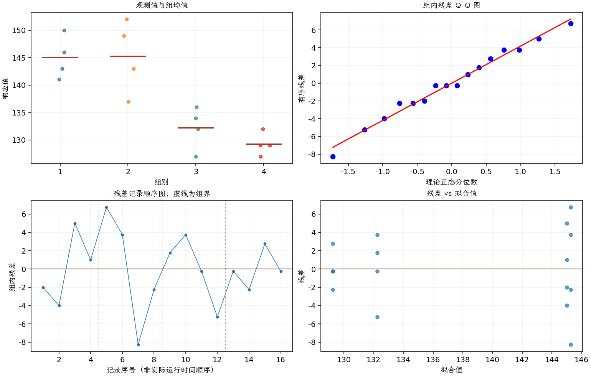

(exercise-3-23)=
# 习题 3.23：涂层试验的残差

[习题与答案](../../index.md) / [第 3 章　单因子试验与方差分析](../chapter03.md)

第 9 版 · 第 3 章 · 原书章末习题见印刷页 125～134。

## 题目

重新考虑习题 [3.22](./exercise-3-22.md) 的显像管涂层试验。分析残差，并就模型适合性得出结论。

**所用数据（来自习题 [3.22](./exercise-3-22.md)）**

| 组别／处理条件 | 观测值（同一行属于同一组） |
| --- | --- |
| 1 | 143，141，150，146 |
| 2 | 152，149，137，143 |
| 3 | 134，136，132，127 |
| 4 | 129，127，132，129 |

## 答案与解析

采用 $\hat y_{ij}=\bar y_i$ 和 $e_{ij}=y_{ij}-\bar y_i$ 检查组内误差。

**残差定义**：$\hat y_{ij}=\bar y_i$，$e_{ij}=y_{ij}-\bar y_i$。变换分析时使用相应变换尺度的响应。

**三项诊断**：Q–Q 图用于检查尾部、偏态及异常残差；残差记录顺序图用于展示原表记录的相邻变化；残差 vs 拟合值图用于观察方差是否随处理均值变化。

**时序资料的限制**：原题只提供分组观测，没有实际运行时间和随机运行次序。左下图按原表组内记录顺序排列，虚线表示组界，**不是实际残差时序图**；组界附近的变化不能解释为时间效应。若要完成真正的时序诊断，须取得原始运行顺序后按该顺序重画。当前不能仅凭此图断言误差在时间上独立。单样本或配对差的拟合值为常数时，残差 vs 拟合值图也不能检验复杂均值结构。

Q–Q 图没有极端异常，但高均值组尤其涂层 2 的残差散布更大，存在异方差疑虑。不能用每组仅 4 个观测的非显著方差检验消除这种疑虑，可进一步考虑变换或 Welch ANOVA。实际随机运行顺序未知，不能完成真正的时序独立性检查。

---

**答案来源**：参考：`ch03.pdf`，原题 3.21S；本页按第 9 版编号。

**关联题目**：[3.22](./exercise-3-22.md)

← [上一题 3.22](./exercise-3-22.md) · [本章题目目录](../chapter03.md) · [下一题 3.24](./exercise-3-24.md) →
