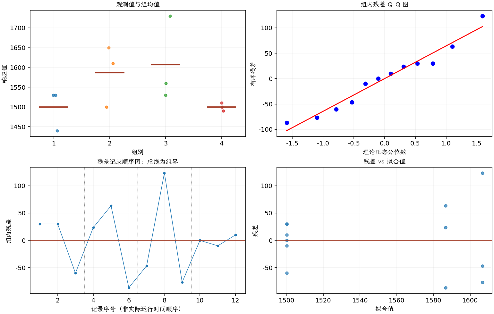
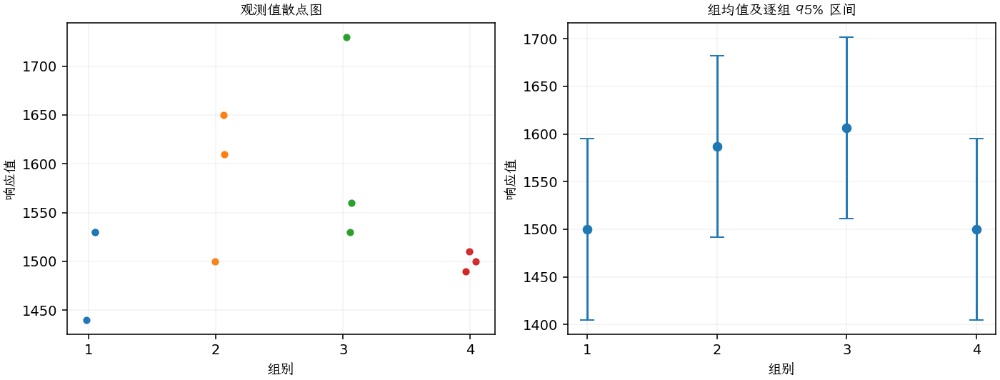

(exercise-3-24)=
# 习题 3.24：混凝土插捣次数

[习题与答案](../../index.md) / [第 3 章　单因子试验与方差分析](../chapter03.md)

第 9 版 · 第 3 章 · 原书章末习题见印刷页 125～134。

## 题目

《ACI Materials Journal》1987 年第 84 卷、213～216 页的一篇文章介绍了几项混凝土插捣试验，目的是通过插捣排除内部滞留空气。试验使用直径 3 英寸、高 6 英寸的圆柱试件，设计变量为插捣次数，响应为混凝土试件的抗压强度。插捣水平 10、15、20、25 对应第 1～4 组，数据如下。

| 组别／处理条件 | 观测值（同一行属于同一组） |
| --- | --- |
| 插捣 10 次 | 1530，1530，1440 |
| 插捣 15 次 | 1610，1650，1500 |
| 插捣 20 次 | 1560，1730，1530 |
| 插捣 25 次 | 1500，1490，1510 |

**（a）** 抗压强度是否随插捣水平不同而有差异？取 $\alpha=0.05$。

**（b）** 求第（a）问 F 统计量的 $P$ 值。

**（c）** 分析试验残差。对模型的基本假定可以得出什么结论？

**（d）** 按第 3.5.3 节的方法构造图形，比较各处理均值。

## 答案与解析

### （a）插捣次数的总体检验

**模型与模型假设（固定效应）**：$y_{ij}=\mu_i+\epsilon_{ij}=\mu+\tau_i+\epsilon_{ij}$，$i=1,\ldots,a$，$j=1,\ldots,n_i$；$\epsilon_{ij}\overset{\mathrm{iid}}\sim N(0,\sigma^2)$。误差独立、正态且同方差，处理分配及抽样符合题意；不平衡设计使用实际 $n_i$。取 $\sum_i n_i\tau_i=0$ 识别参数；平衡时等价于 $\sum_i\tau_i=0$。

**原假设和备择假设**：$H_0:\mu_1=\cdots=\mu_a$；$H_1$：至少一个总体均值不同。

**平方和公式与检验统计量**：令 $N=\sum_i n_i$，$\bar y_i=\sum_jy_{ij}/n_i$，$\bar y_{\cdot\cdot}=\sum_i\sum_jy_{ij}/N$。

$$SS_A=\sum_i n_i(\bar y_i-\bar y_{\cdot\cdot})^2,\qquad SS_E=\sum_i\sum_j(y_{ij}-\bar y_i)^2,$$
$$SS_T=\sum_i\sum_j(y_{ij}-\bar y_{\cdot\cdot})^2=SS_A+SS_E,$$
$$MS_A=\frac{SS_A}{a-1},\quad MS_E=\frac{SS_E}{N-a},\quad F_0=\frac{MS_A}{MS_E}\overset{H_0}{\sim}F_{a-1,N-a}.$$

当 $F_0>F_{1-\alpha,a-1,N-a}$ 时拒绝 $H_0$，$P=P(F_{a-1,N-a}\ge F_0)$。本文分位数均为**下侧累积概率分位数**。

**点估计量**：$\hat\mu_i=\bar y_i$，$\hat\sigma^2=MS_E$；各组样本方差为 $s_i^2=\sum_j(y_{ij}-\bar y_i)^2/(n_i-1)$。以下为 ANOVA Table 与计算结果。

| 来源 | 自由度 | 平方和 | 均方 | $F$ | $P$ 值 |
| --- | --- | --- | --- | --- | --- |
| 处理 | 3 | 28633.3 | 9544.44 | 1.86536 | 0.213781 |
| 误差 | 8 | 40933.3 | 5116.67 | — | — |
| 总计 | 11 | 69566.7 | — | — | — |

| 组别 | 样本量 | 均值 | 样本标准差 |
| --- | --- | --- | --- |
| 1 | 3 | 1500 | 51.9615 |
| 2 | 3 | 1586.67 | 77.6745 |
| 3 | 3 | 1606.67 | 107.858 |
| 4 | 3 | 1500 | 10 |

在 0.05 水平不拒绝各均值相等，没有充分证据认定插捣次数影响平均抗压强度。

### （b）F 统计量的 P 值

$P=P(F_{3,8}\ge1.86536)=0.213781$。

按同一自由度取右尾概率，不是双侧加倍。

### （c）残差与模型假定

**残差定义**：$\hat y_{ij}=\bar y_i$，$e_{ij}=y_{ij}-\bar y_i$。变换分析时使用相应变换尺度的响应。

**三项诊断**：Q–Q 图用于检查尾部、偏态及异常残差；残差记录顺序图用于展示原表记录的相邻变化；残差 vs 拟合值图用于观察方差是否随处理均值变化。

**时序资料的限制**：原题只提供分组观测，没有实际运行时间和随机运行次序。左下图按原表组内记录顺序排列，虚线表示组界，**不是实际残差时序图**；组界附近的变化不能解释为时间效应。若要完成真正的时序诊断，须取得原始运行顺序后按该顺序重画。当前不能仅凭此图断言误差在时间上独立。单样本或配对差的拟合值为常数时，残差 vs 拟合值图也不能检验复杂均值结构。

20 次组散布较大、25 次组很小，等方差值得关注；每组仅 3 个观测，正态性及方差检验能力均有限。实际运行时序未给出。

### （d）均值比较图

图中均值估计量为 $\bar y_i$，误差条为 $\bar y_i\pm t_{0.975,N-a}\sqrt{MS_E/n_i}$；均值区间的重叠情况不能直接代替均值差检验。

不能据均值排序选出已被统计证实的最优插捣次数；图形须结合样本量及异方差疑虑解释。

---

**答案来源**：参考答案文件无直接对应题；解析由编者补充。

← [上一题 3.23](./exercise-3-23.md) · [本章题目目录](../chapter03.md) · [下一题 3.25](./exercise-3-25.md) →
