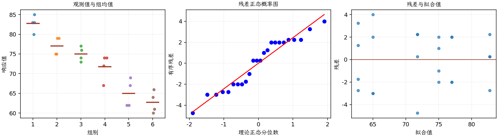

(exercise-3-25)=
# 习题 3.25：淋浴喷孔与氡释放

[习题与答案](../../index.md) / [第 3 章　单因子试验与方差分析](../chapter03.md)

第 9 版 · 第 3 章 · 原书章末习题见印刷页 125～134。

## 题目

《Environment International》第 18 卷第 4 期（1992 年）的一篇文章介绍了一个研究淋浴时氡释放量的试验。研究使用富含氡的水，比较淋浴喷头的 6 种不同喷孔直径。第 1～6 组孔径依次为 0.37、0.51、0.71、1.02、1.40、1.99，响应为氡释放百分比，试验数据如下。

| 组别／处理条件 | 观测值（同一行属于同一组） |
| --- | --- |
| 0.37 | 80，83，83，85 |
| 0.51 | 75，75，79，79 |
| 0.71 | 74，73，76，77 |
| 1.02 | 67，72，74，74 |
| 1.40 | 62，62，67，69 |
| 1.99 | 60，61，64，66 |

**（a）** 喷孔大小是否影响平均氡释放百分比？取 $\alpha=0.05$。

**（b）** 求第（a）问 F 统计量的 $P$ 值。

**（c）** 分析试验残差。

**（d）** 求孔径为 1.40 时平均氡释放百分比的 95% 置信区间。

**（e）** 按第 3.5.3 节的方法绘制处理均值比较图。你能得出什么结论？

## 答案与解析

| 来源 | 自由度 | 平方和 | 均方 | $F$ | $P$ 值 |
| --- | --- | --- | --- | --- | --- |
| 处理 | 5 | 1133.38 | 226.675 | 30.8518 | 3.15951e-08 |
| 误差 | 18 | 132.25 | 7.34722 | — | — |
| 总计 | 23 | 1265.62 | — | — | — |

| 组别 | 样本量 | 均值 | 样本标准差 |
| --- | --- | --- | --- |
| 1 | 4 | 82.75 | 2.06155 |
| 2 | 4 | 77 | 2.3094 |
| 3 | 4 | 75 | 1.82574 |
| 4 | 4 | 71.75 | 3.30404 |
| 5 | 4 | 65 | 3.55903 |
| 6 | 4 | 62.75 | 2.75379 |

孔径影响显著，样本均值随直径增加而下降。残差散布总体相近。第 5 组对应直径 1.40，其区间为：

| 组别 | 95% 均值置信区间（逐个区间） |
| --- | --- |
| 1 | (79.9026, 85.5974) |
| 2 | (74.1526, 79.8474) |
| 3 | (72.1526, 77.8474) |
| 4 | (68.9026, 74.5974) |
| 5 | (62.1526, 67.8474) |
| 6 | (59.9026, 65.5974) |

第 5 行即所求；这些是逐组均值区间，不是全部均值的同时置信区间。

---

**答案来源**：参考：`ch03.pdf`，原题 3.22S；本页按第 9 版编号。

← [上一题 3.24](./exercise-3-24.md) · [本章题目目录](../chapter03.md) · [下一题 3.26](./exercise-3-26.md) →
