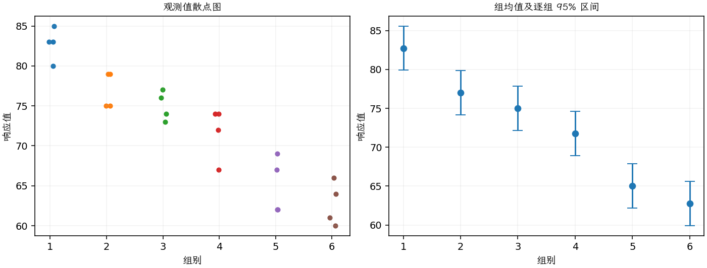

(exercise-3-25)=
# 习题 3.25：淋浴喷孔与氡释放

[习题与答案](../../index.md) / [第 3 章　单因子试验与方差分析](../chapter03.md)

第 9 版 · 第 3 章 · 原书章末习题见印刷页 125～134。

## 题目

《Environment International》第 18 卷第 4 期（1992 年）的一篇文章介绍了一个研究淋浴时氡释放量的试验。研究使用富含氡的水，比较淋浴喷头的 6 种不同喷孔直径。第 1～6 组孔径依次为 0.37、0.51、0.71、1.02、1.40、1.99，响应为氡释放百分比，试验数据如下。

| 组别／处理条件 | 观测值（同一行属于同一组） |
| --- | --- |
| 0.37 | 80，83，83，85 |
| 0.51 | 75，75，79，79 |
| 0.71 | 74，73，76，77 |
| 1.02 | 67，72，74，74 |
| 1.40 | 62，62，67，69 |
| 1.99 | 60，61，64，66 |

**（a）** 喷孔大小是否影响平均氡释放百分比？取 $\alpha=0.05$。

**（b）** 求第（a）问 F 统计量的 $P$ 值。

**（c）** 分析试验残差。

**（d）** 求孔径为 1.40 时平均氡释放百分比的 95% 置信区间。

**（e）** 按第 3.5.3 节的方法绘制处理均值比较图。你能得出什么结论？

## 答案与解析

### （a）喷孔大小的 ANOVA

**模型与模型假设（固定效应）**：$y_{ij}=\mu_i+\epsilon_{ij}=\mu+\tau_i+\epsilon_{ij}$，$i=1,\ldots,a$，$j=1,\ldots,n_i$；$\epsilon_{ij}\overset{\mathrm{iid}}\sim N(0,\sigma^2)$。误差独立、正态且同方差，处理分配及抽样符合题意；不平衡设计使用实际 $n_i$。取 $\sum_i n_i\tau_i=0$ 识别参数；平衡时等价于 $\sum_i\tau_i=0$。

**原假设和备择假设**：$H_0:\mu_1=\cdots=\mu_a$；$H_1$：至少一个总体均值不同。

**平方和公式与检验统计量**：令 $N=\sum_i n_i$，$\bar y_i=\sum_jy_{ij}/n_i$，$\bar y_{\cdot\cdot}=\sum_i\sum_jy_{ij}/N$。

$$SS_A=\sum_i n_i(\bar y_i-\bar y_{\cdot\cdot})^2,\qquad SS_E=\sum_i\sum_j(y_{ij}-\bar y_i)^2,$$
$$SS_T=\sum_i\sum_j(y_{ij}-\bar y_{\cdot\cdot})^2=SS_A+SS_E,$$
$$MS_A=\frac{SS_A}{a-1},\quad MS_E=\frac{SS_E}{N-a},\quad F_0=\frac{MS_A}{MS_E}\overset{H_0}{\sim}F_{a-1,N-a}.$$

当 $F_0>F_{1-\alpha,a-1,N-a}$ 时拒绝 $H_0$，$P=P(F_{a-1,N-a}\ge F_0)$。本文分位数均为**下侧累积概率分位数**。

**点估计量**：$\hat\mu_i=\bar y_i$，$\hat\sigma^2=MS_E$；各组样本方差为 $s_i^2=\sum_j(y_{ij}-\bar y_i)^2/(n_i-1)$。以下为 ANOVA Table 与计算结果。

| 来源 | 自由度 | 平方和 | 均方 | $F$ | $P$ 值 |
| --- | --- | --- | --- | --- | --- |
| 处理 | 5 | 1133.38 | 226.675 | 30.8518 | 3.15951e-08 |
| 误差 | 18 | 132.25 | 7.34722 | — | — |
| 总计 | 23 | 1265.62 | — | — | — |

| 组别 | 样本量 | 均值 | 样本标准差 |
| --- | --- | --- | --- |
| 1 | 4 | 82.75 | 2.06155 |
| 2 | 4 | 77 | 2.3094 |
| 3 | 4 | 75 | 1.82574 |
| 4 | 4 | 71.75 | 3.30404 |
| 5 | 4 | 65 | 3.55903 |
| 6 | 4 | 62.75 | 2.75379 |

在 0.05 水平拒绝各均值相等，孔径影响平均氡释放百分比。

### （b）P 值

$P=P(F_{5,18}\ge30.8518)=3.15951e-08$。

按 $F_{5,18}$ 分布取右尾概率，远小于 0.05。

### （c）残差分析

**残差定义**：$\hat y_{ij}=\bar y_i$，$e_{ij}=y_{ij}-\bar y_i$。变换分析时使用相应变换尺度的响应。

**三项诊断**：Q–Q 图用于检查尾部、偏态及异常残差；残差记录顺序图用于展示原表记录的相邻变化；残差 vs 拟合值图用于观察方差是否随处理均值变化。

**时序资料的限制**：原题只提供分组观测，没有实际运行时间和随机运行次序。左下图按原表组内记录顺序排列，虚线表示组界，**不是实际残差时序图**；组界附近的变化不能解释为时间效应。若要完成真正的时序诊断，须取得原始运行顺序后按该顺序重画。当前不能仅凭此图断言误差在时间上独立。单样本或配对差的拟合值为常数时，残差 vs 拟合值图也不能检验复杂均值结构。

残差散布总体相近，没有严重正态性问题；实际运行顺序未提供，不能从记录顺序推断时间独立性。

### （d）孔径 1.40 的平均释放比例区间

孔径 1.40 对应第 5 组，估计量为 $\bar y_5=65$，95% 区间为 $\bar y_5\pm t_{0.975,18}\sqrt{MS_E/4}$，结果为 **$(62.1526,67.8474)$**，单位为百分点。

### （e）处理均值图与结论

图中均值估计量为 $\bar y_i$，误差条为 $\bar y_i\pm t_{0.975,N-a}\sqrt{MS_E/n_i}$；均值区间的重叠情况不能直接代替均值差检验。

样本均值随喷孔增大而下降；该图展示趋势，但没有自动证明任意两个相邻孔径之间都显著不同。

---

**答案来源**：参考：`ch03.pdf`，原题 3.22S；本页按第 9 版编号。

← [上一题 3.24](./exercise-3-24.md) · [本章题目目录](../chapter03.md) · [下一题 3.26](./exercise-3-26.md) →
