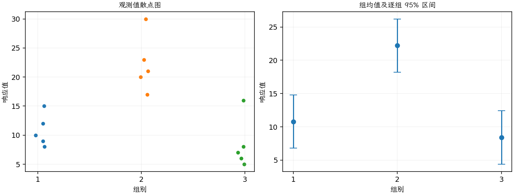
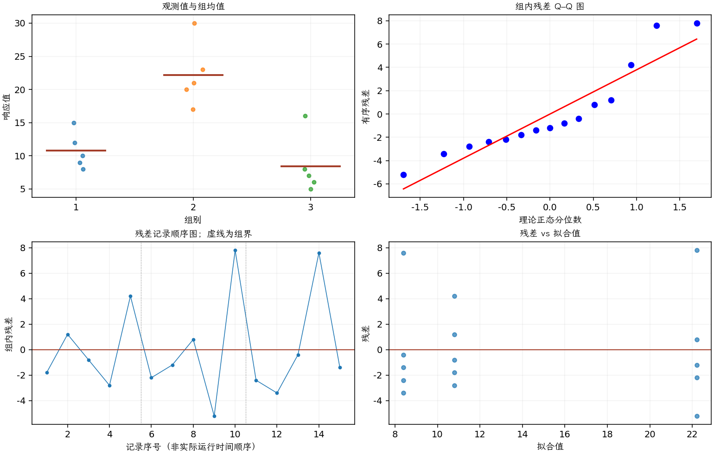

(exercise-3-26)=
# 习题 3.26：自动阀门电路响应时间

[习题与答案](../../index.md) / [第 3 章　单因子试验与方差分析](../chapter03.md)

第 9 版 · 第 3 章 · 原书章末习题见印刷页 125～134。

## 题目

自动阀门关闭机构可使用三种不同类型的电路。一个完全随机试验测定了这三种电路的响应时间，单位为毫秒，结果如下。

| 组别／处理条件 | 观测值（同一行属于同一组） |
| --- | --- |
| 1 | 9，12，10，8，15 |
| 2 | 20，21，23，17，30 |
| 3 | 6，5，8，16，7 |

**（a）** 取 $\alpha=0.01$，检验三种电路的平均响应时间相同的假设。

**（b）** 取 $\alpha=0.01$，用 Tukey 检验比较所有均值对。

**（c）** 使用第 3.5.3 节的图形方法比较处理均值。结论如何？它们与第（b）问相比如何？

**（d）** 假定在试验开始前已怀疑电路 2 的平均响应时间不同于另外两种，构造一组有意义的正交对比。

**（e）** 如果你是设计工程师，希望响应时间尽可能短，会选择哪种电路？

**（f）** 分析残差。ANOVA 的基本假定是否满足？

## 答案与解析

### （a）电路响应时间的总体检验

**模型与模型假设（固定效应）**：$y_{ij}=\mu_i+\epsilon_{ij}=\mu+\tau_i+\epsilon_{ij}$，$i=1,\ldots,a$，$j=1,\ldots,n_i$；$\epsilon_{ij}\overset{\mathrm{iid}}\sim N(0,\sigma^2)$。误差独立、正态且同方差，处理分配及抽样符合题意；不平衡设计使用实际 $n_i$。取 $\sum_i n_i\tau_i=0$ 识别参数；平衡时等价于 $\sum_i\tau_i=0$。

**原假设和备择假设**：$H_0:\mu_1=\cdots=\mu_a$；$H_1$：至少一个总体均值不同。

**平方和公式与检验统计量**：令 $N=\sum_i n_i$，$\bar y_i=\sum_jy_{ij}/n_i$，$\bar y_{\cdot\cdot}=\sum_i\sum_jy_{ij}/N$。

$$SS_A=\sum_i n_i(\bar y_i-\bar y_{\cdot\cdot})^2,\qquad SS_E=\sum_i\sum_j(y_{ij}-\bar y_i)^2,$$
$$SS_T=\sum_i\sum_j(y_{ij}-\bar y_{\cdot\cdot})^2=SS_A+SS_E,$$
$$MS_A=\frac{SS_A}{a-1},\quad MS_E=\frac{SS_E}{N-a},\quad F_0=\frac{MS_A}{MS_E}\overset{H_0}{\sim}F_{a-1,N-a}.$$

当 $F_0>F_{1-\alpha,a-1,N-a}$ 时拒绝 $H_0$，$P=P(F_{a-1,N-a}\ge F_0)$。本文分位数均为**下侧累积概率分位数**。

**点估计量**：$\hat\mu_i=\bar y_i$，$\hat\sigma^2=MS_E$；各组样本方差为 $s_i^2=\sum_j(y_{ij}-\bar y_i)^2/(n_i-1)$。以下为 ANOVA Table 与计算结果。

| 来源 | 自由度 | 平方和 | 均方 | $F$ | $P$ 值 |
| --- | --- | --- | --- | --- | --- |
| 处理 | 2 | 543.6 | 271.8 | 16.0828 | 0.000402326 |
| 误差 | 12 | 202.8 | 16.9 | — | — |
| 总计 | 14 | 746.4 | — | — | — |

| 组别 | 样本量 | 均值 | 样本标准差 |
| --- | --- | --- | --- |
| 1 | 5 | 10.8 | 2.77489 |
| 2 | 5 | 22.2 | 4.86826 |
| 3 | 5 | 8.4 | 4.39318 |

$P=0.000402326<0.01$，拒绝三均值相等。

### （b）Tukey 两两比较

**估计量与区间公式**：$\widehat{\mu_i-\mu_j}=\bar y_i-\bar y_j$，$SE_{ij}=\sqrt{MS_E(1/n_i+1/n_j)}$。 Tukey–Kramer 同时区间为 $(\bar y_i-\bar y_j)\pm q_{1-\alpha,a,N-a}SE_{ij}/\sqrt2$；区间不含零则相应均值对显著，控制全部两两比较的家族错误率。

| 均值对 | 均值差 | 99% 区间 | 显著 |
| --- | --- | --- | --- |
| 1 − 2 | -11.4 | (-20.6768, -2.12316) | 是 |
| 1 − 3 | 2.4 | (-6.87684, 11.6768) | 否 |
| 2 − 3 | 13.8 | (4.52316, 23.0768) | 是 |

电路 2 显著慢于 1、3；1 与 3 不显著。

### （c）图形比较

图中均值估计量为 $\bar y_i$，误差条为 $\bar y_i\pm t_{0.975,N-a}\sqrt{MS_E/n_i}$；均值区间的重叠情况不能直接代替均值差检验。

图示 2 的响应时间明显较长，与 Tukey 结论相容；1 与 3 的均值接近。

### （d）预设正交对比

取 $C_1=2\mu_2-\mu_1-\mu_3$、$C_2=\mu_1-\mu_3$，系数 $(-1,2,-1)$ 与 $(1,0,-1)$ 内积为零。估计量为 $\hat C=\sum_i c_i\bar y_i$，单自由度平方和为 $SS_C=\hat C^2/(\sum_i c_i^2/n_i)$。结果 $\hat C_1=25.2$、$SS_{C_1}=529.2$，$\hat C_2=2.4$、$SS_{C_2}=14.4$；二者之和 543.6 等于 $SS_A$。

### （e）电路选择

电路 3 的样本均值 8.4 ms 最短，可作为候选，但未证明其比 1 更快；成本和可靠性相同时可进一步确认 1、3 的差异。

### （f）残差分析

**残差定义**：$\hat y_{ij}=\bar y_i$，$e_{ij}=y_{ij}-\bar y_i$。变换分析时使用相应变换尺度的响应。

**三项诊断**：Q–Q 图用于检查尾部、偏态及异常残差；残差记录顺序图用于展示原表记录的相邻变化；残差 vs 拟合值图用于观察方差是否随处理均值变化。

**时序资料的限制**：原题只提供分组观测，没有实际运行时间和随机运行次序。左下图按原表组内记录顺序排列，虚线表示组界，**不是实际残差时序图**；组界附近的变化不能解释为时间效应。若要完成真正的时序诊断，须取得原始运行顺序后按该顺序重画。当前不能仅凭此图断言误差在时间上独立。单样本或配对差的拟合值为常数时，残差 vs 拟合值图也不能检验复杂均值结构。

未见严重偏态或强烈异方差，样本量每组 5 个仍较少；缺少实际运行顺序，时间独立性尚不能由图验证。

---

**答案来源**：参考：`ch03.pdf`，原题 3.23；本页按第 9 版编号。

← [上一题 3.25](./exercise-3-25.md) · [本章题目目录](../chapter03.md) · [下一题 3.27](./exercise-3-27.md) →
