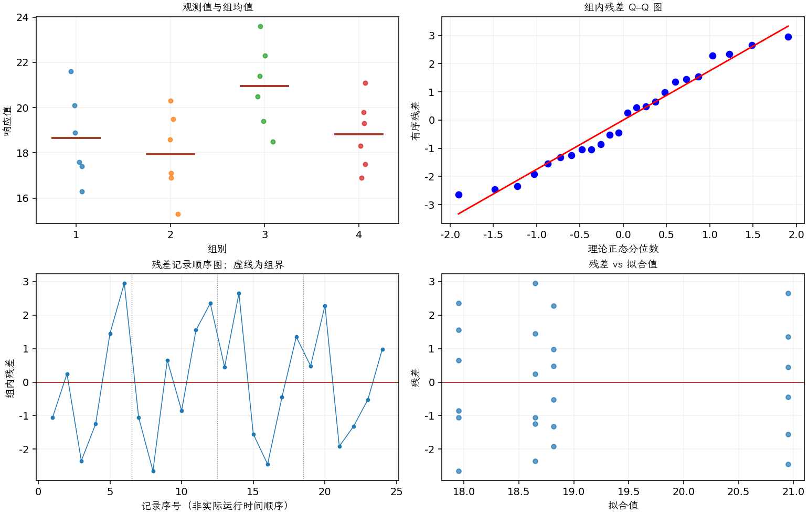

(exercise-3-27)=
# 习题 3.27：绝缘液寿命

[习题与答案](../../index.md) / [第 3 章　单因子试验与方差分析](../chapter03.md)

第 9 版 · 第 3 章 · 原书章末习题见印刷页 125～134。

## 题目

现研究绝缘液在 35 kV 加速负载下的有效寿命。通过完全随机试验，取得 4 种绝缘液的测试数据，寿命单位为小时。

| 组别／处理条件 | 观测值（同一行属于同一组） |
| --- | --- |
| 1 | 17.6，18.9，16.3，17.4，20.1，21.6 |
| 2 | 16.9，15.3，18.6，17.1，19.5，20.3 |
| 3 | 21.4，23.6，19.4，18.5，20.5，22.3 |
| 4 | 19.3，21.1，16.9，17.5，18.3，19.8 |

**（a）** 是否有迹象表明这些绝缘液存在差异？取 $\alpha=0.05$。

**（b）** 如果目标是寿命长，你会选择哪一种液体？

**（c）** 分析试验残差。方差分析的基本假定是否满足？

## 答案与解析

### （a）绝缘液平均寿命的总体比较

**模型与模型假设（固定效应）**：$y_{ij}=\mu_i+\epsilon_{ij}=\mu+\tau_i+\epsilon_{ij}$，$i=1,\ldots,a$，$j=1,\ldots,n_i$；$\epsilon_{ij}\overset{\mathrm{iid}}\sim N(0,\sigma^2)$。误差独立、正态且同方差，处理分配及抽样符合题意；不平衡设计使用实际 $n_i$。取 $\sum_i n_i\tau_i=0$ 识别参数；平衡时等价于 $\sum_i\tau_i=0$。

**原假设和备择假设**：$H_0:\mu_1=\cdots=\mu_a$；$H_1$：至少一个总体均值不同。

**平方和公式与检验统计量**：令 $N=\sum_i n_i$，$\bar y_i=\sum_jy_{ij}/n_i$，$\bar y_{\cdot\cdot}=\sum_i\sum_jy_{ij}/N$。

$$SS_A=\sum_i n_i(\bar y_i-\bar y_{\cdot\cdot})^2,\qquad SS_E=\sum_i\sum_j(y_{ij}-\bar y_i)^2,$$
$$SS_T=\sum_i\sum_j(y_{ij}-\bar y_{\cdot\cdot})^2=SS_A+SS_E,$$
$$MS_A=\frac{SS_A}{a-1},\quad MS_E=\frac{SS_E}{N-a},\quad F_0=\frac{MS_A}{MS_E}\overset{H_0}{\sim}F_{a-1,N-a}.$$

当 $F_0>F_{1-\alpha,a-1,N-a}$ 时拒绝 $H_0$，$P=P(F_{a-1,N-a}\ge F_0)$。本文分位数均为**下侧累积概率分位数**。

**点估计量**：$\hat\mu_i=\bar y_i$，$\hat\sigma^2=MS_E$；各组样本方差为 $s_i^2=\sum_j(y_{ij}-\bar y_i)^2/(n_i-1)$。以下为 ANOVA Table 与计算结果。

| 来源 | 自由度 | 平方和 | 均方 | $F$ | $P$ 值 |
| --- | --- | --- | --- | --- | --- |
| 处理 | 3 | 30.165 | 10.055 | 3.04728 | 0.0524632 |
| 误差 | 20 | 65.9933 | 3.29967 | — | — |
| 总计 | 23 | 96.1583 | — | — | — |

| 组别 | 样本量 | 均值 | 样本标准差 |
| --- | --- | --- | --- |
| 1 | 6 | 18.65 | 1.95218 |
| 2 | 6 | 17.95 | 1.85445 |
| 3 | 6 | 20.95 | 1.8791 |
| 4 | 6 | 18.8167 | 1.55488 |

$P\approx0.0525>0.05$，按预定水平不拒绝均值相等，不能事后提高阈值宣布显著。

### （b）选择建议

第 3 种液体样本均值最长，可以作为后续试验候选；当前未证明它显著优于其他液体。

### （c）残差分析

**残差定义**：$\hat y_{ij}=\bar y_i$，$e_{ij}=y_{ij}-\bar y_i$。变换分析时使用相应变换尺度的响应。

**三项诊断**：Q–Q 图用于检查尾部、偏态及异常残差；残差记录顺序图用于展示原表记录的相邻变化；残差 vs 拟合值图用于观察方差是否随处理均值变化。

**时序资料的限制**：原题只提供分组观测，没有实际运行时间和随机运行次序。左下图按原表组内记录顺序排列，虚线表示组界，**不是实际残差时序图**；组界附近的变化不能解释为时间效应。若要完成真正的时序诊断，须取得原始运行顺序后按该顺序重画。当前不能仅凭此图断言误差在时间上独立。单样本或配对差的拟合值为常数时，残差 vs 拟合值图也不能检验复杂均值结构。

未发现严重正态性或等方差问题；实际运行时间顺序未知。秩方法的敏感性分析见习题 [3.59](./exercise-3-59.md)。

---

**答案来源**：参考：`ch03.pdf`，原题 3.24S；本页按第 9 版编号。

← [上一题 3.26](./exercise-3-26.md) · [本章题目目录](../chapter03.md) · [下一题 3.28](./exercise-3-28.md) →
