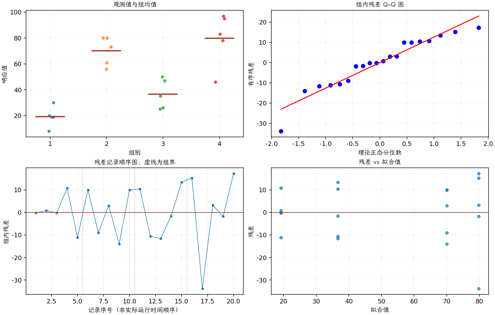

(exercise-3-28)=
# 习题 3.28：数字电路噪声

[习题与答案](../../index.md) / [第 3 章　单因子试验与方差分析](../chapter03.md)

第 9 版 · 第 3 章 · 原书章末习题见印刷页 125～134。

## 题目

现研究一种数字计算机电路的 4 种不同设计，希望比较电路中存在的噪声量。观测数据如下。

| 组别／处理条件 | 观测值（同一行属于同一组） |
| --- | --- |
| 1 | 19，20，19，30，8 |
| 2 | 80，61，73，56，80 |
| 3 | 47，26，25，35，50 |
| 4 | 95，46，83，78，97 |

**（a）** 四种设计的平均噪声是否相同？取 $\alpha=0.05$。

**（b）** 分析试验残差。方差分析的假定是否满足？

**（c）** 噪声越低越好，你会选择哪种电路设计？

## 答案与解析

### （a）数字电路噪声的 ANOVA

**模型与模型假设（固定效应）**：$y_{ij}=\mu_i+\epsilon_{ij}=\mu+\tau_i+\epsilon_{ij}$，$i=1,\ldots,a$，$j=1,\ldots,n_i$；$\epsilon_{ij}\overset{\mathrm{iid}}\sim N(0,\sigma^2)$。误差独立、正态且同方差，处理分配及抽样符合题意；不平衡设计使用实际 $n_i$。取 $\sum_i n_i\tau_i=0$ 识别参数；平衡时等价于 $\sum_i\tau_i=0$。

**原假设和备择假设**：$H_0:\mu_1=\cdots=\mu_a$；$H_1$：至少一个总体均值不同。

**平方和公式与检验统计量**：令 $N=\sum_i n_i$，$\bar y_i=\sum_jy_{ij}/n_i$，$\bar y_{\cdot\cdot}=\sum_i\sum_jy_{ij}/N$。

$$SS_A=\sum_i n_i(\bar y_i-\bar y_{\cdot\cdot})^2,\qquad SS_E=\sum_i\sum_j(y_{ij}-\bar y_i)^2,$$
$$SS_T=\sum_i\sum_j(y_{ij}-\bar y_{\cdot\cdot})^2=SS_A+SS_E,$$
$$MS_A=\frac{SS_A}{a-1},\quad MS_E=\frac{SS_E}{N-a},\quad F_0=\frac{MS_A}{MS_E}\overset{H_0}{\sim}F_{a-1,N-a}.$$

当 $F_0>F_{1-\alpha,a-1,N-a}$ 时拒绝 $H_0$，$P=P(F_{a-1,N-a}\ge F_0)$。本文分位数均为**下侧累积概率分位数**。

**点估计量**：$\hat\mu_i=\bar y_i$，$\hat\sigma^2=MS_E$；各组样本方差为 $s_i^2=\sum_j(y_{ij}-\bar y_i)^2/(n_i-1)$。以下为 ANOVA Table 与计算结果。

| 来源 | 自由度 | 平方和 | 均方 | $F$ | $P$ 值 |
| --- | --- | --- | --- | --- | --- |
| 处理 | 3 | 12042 | 4014 | 21.7797 | 6.79748e-06 |
| 误差 | 16 | 2948.8 | 184.3 | — | — |
| 总计 | 19 | 14990.8 | — | — | — |

| 组别 | 样本量 | 均值 | 样本标准差 |
| --- | --- | --- | --- |
| 1 | 5 | 19.2 | 7.79102 |
| 2 | 5 | 70 | 11.0227 |
| 3 | 5 | 36.6 | 11.5888 |
| 4 | 5 | 79.8 | 20.511 |

在 0.05 水平拒绝四种设计平均噪声相同。

### （b）模型诊断

**残差定义**：$\hat y_{ij}=\bar y_i$，$e_{ij}=y_{ij}-\bar y_i$。变换分析时使用相应变换尺度的响应。

**三项诊断**：Q–Q 图用于检查尾部、偏态及异常残差；残差记录顺序图用于展示原表记录的相邻变化；残差 vs 拟合值图用于观察方差是否随处理均值变化。

**时序资料的限制**：原题只提供分组观测，没有实际运行时间和随机运行次序。左下图按原表组内记录顺序排列，虚线表示组界，**不是实际残差时序图**；组界附近的变化不能解释为时间效应。若要完成真正的时序诊断，须取得原始运行顺序后按该顺序重画。当前不能仅凭此图断言误差在时间上独立。单样本或配对差的拟合值为常数时，残差 vs 拟合值图也不能检验复杂均值结构。

第 4 组残差散布较大，等方差有疑虑；正态图也应留意尾部。记录顺序图不是真实时序，无法检验时间漂移；秩检验见习题 [3.60](./exercise-3-60.md)。

### （c）设计选择

设计 1 的样本平均噪声最低，选为候选。该选择还需可靠性与后续确认，不能仅凭最低样本均值宣称总体最优。

---

**答案来源**：参考：`ch03.pdf`，原题 3.25；本页按第 9 版编号。

← [上一题 3.27](./exercise-3-27.md) · [本章题目目录](../chapter03.md) · [下一题 3.29](./exercise-3-29.md) →
