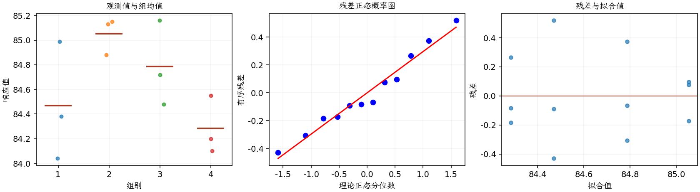

(exercise-3-29)=
# 习题 3.29：化学分析员的测定结果

[习题与答案](../../index.md) / [第 3 章　单因子试验与方差分析](../chapter03.md)

第 9 版 · 第 3 章 · 原书章末习题见印刷页 125～134。

## 题目

请 4 名化学分析员测定某化合物中的甲醇百分比，每人独立测定 3 次，结果如下。

| 组别／处理条件 | 观测值（同一行属于同一组） |
| --- | --- |
| 1 | 84.99，84.04，84.38 |
| 2 | 85.15，85.13，84.88 |
| 3 | 84.72，84.48，85.16 |
| 4 | 84.2，84.1，84.55 |

**（a）** 分析员之间是否有显著差异？取 $\alpha=0.05$。

**（b）** 分析试验残差。

**（c）** 假定分析员 2 是新员工，构造一组在试验开始前就可能有用且有实际意义的正交对比。

## 答案与解析

| 来源 | 自由度 | 平方和 | 均方 | $F$ | $P$ 值 |
| --- | --- | --- | --- | --- | --- |
| 处理 | 3 | 1.04457 | 0.348189 | 3.24576 | 0.0812898 |
| 误差 | 8 | 0.8582 | 0.107275 | — | — |
| 总计 | 11 | 1.90277 | — | — | — |

| 组别 | 样本量 | 均值 | 样本标准差 |
| --- | --- | --- | --- |
| 1 | 3 | 84.47 | 0.481352 |
| 2 | 3 | 85.0533 | 0.150444 |
| 3 | 3 | 84.7867 | 0.344867 |
| 4 | 3 | 84.2833 | 0.236291 |

在 0.05 水平未拒绝均值相等。可取系数 $(-1,3,-1,-1)$ 比较新员工与其余三人的平均值，再取 $(1,0,-1,0)$、$(1,0,1,-2)$ 比较老员工内部差异；三组系数两两内积为零且各自和为零。

每人仅 3 次测定，残差图很难充分诊断尾部行为。测定顺序与样品制备方式也应核对，以确认误差模型适用。

---

**答案来源**：参考：`ch03.pdf`，原题 3.26；本页按第 9 版编号。

← [上一题 3.28](./exercise-3-28.md) · [本章题目目录](../chapter03.md) · [下一题 3.30](./exercise-3-30.md) →
