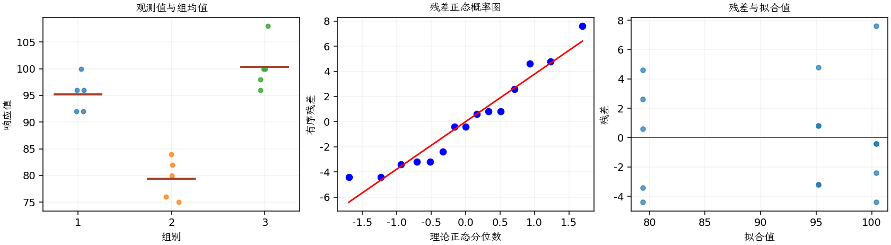

(exercise-3-30)=
# 习题 3.30：电池品牌寿命

[习题与答案](../../index.md) / [第 3 章　单因子试验与方差分析](../chapter03.md)

第 9 版 · 第 3 章 · 原书章末习题见印刷页 125～134。

## 题目

现研究三个品牌的电池，怀疑其寿命不同。每个品牌随机选取 5 节电池进行测试，得到以下寿命结果，单位为周。

| 组别／处理条件 | 观测值（同一行属于同一组） |
| --- | --- |
| 1 | 100，96，92，96，92 |
| 2 | 76，80，75，84，82 |
| 3 | 108，100，96，98，100 |

**（a）** 这些品牌电池的平均寿命是否不同？

**（b）** 分析试验残差。

**（c）** 构造品牌 2 平均寿命的 95% 置信区间；构造品牌 2 与品牌 3 平均寿命之差的 99% 置信区间。

**（d）** 你会选择哪个品牌？如果制造商对寿命不足 85 周便失效的电池免费更换，预计需要更换的比例是多少？

## 答案与解析

| 来源 | 自由度 | 平方和 | 均方 | $F$ | $P$ 值 |
| --- | --- | --- | --- | --- | --- |
| 处理 | 2 | 1196.13 | 598.067 | 38.3376 | 6.14149e-06 |
| 误差 | 12 | 187.2 | 15.6 | — | — |
| 总计 | 14 | 1383.33 | — | — | — |

| 组别 | 样本量 | 均值 | 样本标准差 |
| --- | --- | --- | --- |
| 1 | 5 | 95.2 | 3.34664 |
| 2 | 5 | 79.4 | 3.84708 |
| 3 | 5 | 100.4 | 4.5607 |

均值显著不同，品牌 2 最短，品牌 3 样本均值最长。品牌 2 的 95% 均值区间见第 2 行：

| 组别 | 95% 均值置信区间（逐个区间） |
| --- | --- |
| 1 | (91.3514, 99.0486) |
| 2 | (75.5514, 83.2486) |
| 3 | (96.5514, 104.249) |

99% 均值差区间见“2 − 3”行：

| 均值对 | 均值差 | 99% 区间 | 显著 |
| --- | --- | --- | --- |
| 1 − 2 | 15.8 | (8.16976, 23.4302) | 是 |
| 1 − 3 | -5.2 | (-12.8302, 2.43024) | 否 |
| 2 − 3 | -21 | (-28.6302, -13.3698) | 是 |

选择品牌 3 作为候选。按正态、共同方差 $MS_E=15.6$ 的拟合模型，预计免费更换率为 $\Phi[(85-100.4)/\sqrt{15.6}]=\mathbf{0.00004829}$，约 **0.00483%**。这是对远尾概率的模型外推，小样本不能可靠验证如此低的实际失效率。残差方差检验见 [3.47](./exercise-3-47.md)、3.48。

---

**答案来源**：参考：`ch03.pdf`，原题 3.27S；本页按第 9 版编号。

← [上一题 3.29](./exercise-3-29.md) · [本章题目目录](../chapter03.md) · [下一题 3.31](./exercise-3-31.md) →
