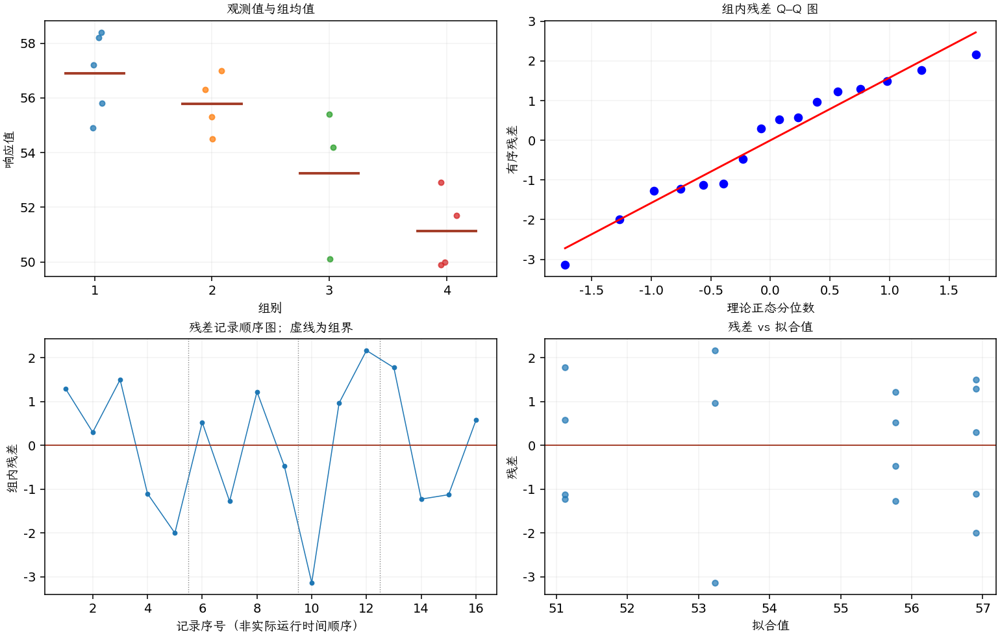

(exercise-3-31)=
# 习题 3.31：催化剂与组分浓度

[习题与答案](../../index.md) / [第 3 章　单因子试验与方差分析](../chapter03.md)

第 9 版 · 第 3 章 · 原书章末习题见印刷页 125～134。

## 题目

现考察可能影响一种三组分液体混合物中某一组分浓度的 4 种催化剂。完全随机试验取得以下浓度观测，各催化剂的观测数不完全相同。

| 组别／处理条件 | 观测值（同一行属于同一组） |
| --- | --- |
| 1 | 58.2，57.2，58.4，55.8，54.9 |
| 2 | 56.3，54.5，57，55.3 |
| 3 | 50.1，54.2，55.4 |
| 4 | 52.9，49.9，50，51.7 |

**（a）** 4 种催化剂对该浓度的影响是否相同？

**（b）** 分析试验残差。

**（c）** 构造催化剂 1 的总体平均响应的 99% 置信区间。

## 答案与解析

### （a）催化剂效应的 ANOVA

**模型与模型假设（固定效应）**：$y_{ij}=\mu_i+\epsilon_{ij}=\mu+\tau_i+\epsilon_{ij}$，$i=1,\ldots,a$，$j=1,\ldots,n_i$；$\epsilon_{ij}\overset{\mathrm{iid}}\sim N(0,\sigma^2)$。误差独立、正态且同方差，处理分配及抽样符合题意；不平衡设计使用实际 $n_i$。取 $\sum_i n_i\tau_i=0$ 识别参数；平衡时等价于 $\sum_i\tau_i=0$。

**原假设和备择假设**：$H_0:\mu_1=\cdots=\mu_a$；$H_1$：至少一个总体均值不同。

**平方和公式与检验统计量**：令 $N=\sum_i n_i$，$\bar y_i=\sum_jy_{ij}/n_i$，$\bar y_{\cdot\cdot}=\sum_i\sum_jy_{ij}/N$。

$$SS_A=\sum_i n_i(\bar y_i-\bar y_{\cdot\cdot})^2,\qquad SS_E=\sum_i\sum_j(y_{ij}-\bar y_i)^2,$$
$$SS_T=\sum_i\sum_j(y_{ij}-\bar y_{\cdot\cdot})^2=SS_A+SS_E,$$
$$MS_A=\frac{SS_A}{a-1},\quad MS_E=\frac{SS_E}{N-a},\quad F_0=\frac{MS_A}{MS_E}\overset{H_0}{\sim}F_{a-1,N-a}.$$

当 $F_0>F_{1-\alpha,a-1,N-a}$ 时拒绝 $H_0$，$P=P(F_{a-1,N-a}\ge F_0)$。本文分位数均为**下侧累积概率分位数**。

**点估计量**：$\hat\mu_i=\bar y_i$，$\hat\sigma^2=MS_E$；各组样本方差为 $s_i^2=\sum_j(y_{ij}-\bar y_i)^2/(n_i-1)$。以下为 ANOVA Table 与计算结果。

| 来源 | 自由度 | 平方和 | 均方 | $F$ | $P$ 值 |
| --- | --- | --- | --- | --- | --- |
| 处理 | 3 | 85.6758 | 28.5586 | 9.91571 | 0.00143563 |
| 误差 | 12 | 34.5617 | 2.88014 | — | — |
| 总计 | 15 | 120.237 | — | — | — |

| 组别 | 样本量 | 均值 | 样本标准差 |
| --- | --- | --- | --- |
| 1 | 5 | 56.9 | 1.51987 |
| 2 | 4 | 55.775 | 1.09962 |
| 3 | 3 | 53.2333 | 2.77909 |
| 4 | 4 | 51.125 | 1.44309 |

拒绝四种催化剂平均浓度相等。

### （b）残差分析

**残差定义**：$\hat y_{ij}=\bar y_i$，$e_{ij}=y_{ij}-\bar y_i$。变换分析时使用相应变换尺度的响应。

**三项诊断**：Q–Q 图用于检查尾部、偏态及异常残差；残差记录顺序图用于展示原表记录的相邻变化；残差 vs 拟合值图用于观察方差是否随处理均值变化。

**时序资料的限制**：原题只提供分组观测，没有实际运行时间和随机运行次序。左下图按原表组内记录顺序排列，虚线表示组界，**不是实际残差时序图**；组界附近的变化不能解释为时间效应。若要完成真正的时序诊断，须取得原始运行顺序后按该顺序重画。当前不能仅凭此图断言误差在时间上独立。单样本或配对差的拟合值为常数时，残差 vs 拟合值图也不能检验复杂均值结构。

未见严重残差异常，必须使用各组实际样本量。原资料没有实际运行时间顺序，时间独立性需额外记录。

### （c）催化剂 1 的均值区间

**估计量与区间公式**：$\hat\mu_i=\bar y_i$，$\widehat{SE}(\bar y_i)=\sqrt{MS_E/n_i}$，区间为 $\bar y_i\pm t_{1-\alpha/2,N-a}\sqrt{MS_E/n_i}$。以下各区间均为逐个区间。

| 组别 | 均值点估计 | 估计标准误 | 99% 均值置信区间（逐个区间） |
| --- | --- | --- | --- |
| 1 | 56.9 | 0.758965 | (54.5817, 59.2183) |
| 2 | 55.775 | 0.848549 | (53.1831, 58.3669) |
| 3 | 53.2333 | 0.97982 | (50.2404, 56.2262) |
| 4 | 51.125 | 0.848549 | (48.5331, 53.7169) |

第 1 行即所求，点估计为第 1 组均值；本表是逐组 99% 区间，不是全部均值的同时区间。

---

**答案来源**：参考：`ch03.pdf`，原题 3.28；本页按第 9 版编号。

← [上一题 3.30](./exercise-3-30.md) · [本章题目目录](../chapter03.md) · [下一题 3.32](./exercise-3-32.md) →
