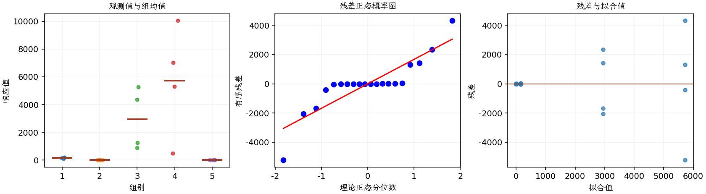
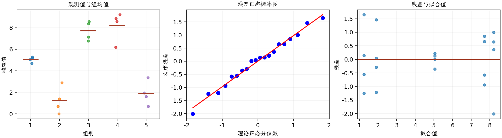

(exercise-3-32)=
# 习题 3.32：五种绝缘材料失效时间

[习题与答案](../../index.md) / [第 3 章　单因子试验与方差分析](../chapter03.md)

第 9 版 · 第 3 章 · 原书章末习题见印刷页 125～134。

## 题目

为研究 5 种绝缘材料的效果，实施了一个试验。每种材料取 4 个试样，在较高电压下测试，以加快失效过程。以下为失效时间，单位为分钟。

| 组别／处理条件 | 观测值（同一行属于同一组） |
| --- | --- |
| 1 | 110，157，194，178 |
| 2 | 1，2，4，18 |
| 3 | 880，1256，5276，4355 |
| 4 | 495，7040，5307，10050 |
| 5 | 7，5，29，2 |

**（a）** 五种材料的平均失效时间是否相同？

**（b）** 绘制残差对预测响应的图，并构造残差正态概率图。这些图传达了什么信息？

**（c）** 根据第（b）问的发现，对失效时间数据重新开展一次分析，并给出适当结论。

## 答案与解析

| 来源 | 自由度 | 平方和 | 均方 | $F$ | $P$ 值 |
| --- | --- | --- | --- | --- | --- |
| 处理 | 4 | 1.03191e+08 | 2.57979e+07 | 6.19093 | 0.00378596 |
| 误差 | 15 | 6.25057e+07 | 4.16704e+06 | — | — |
| 总计 | 19 | 1.65697e+08 | — | — | — |

| 组别 | 样本量 | 均值 | 样本标准差 |
| --- | --- | --- | --- |
| 1 | 4 | 159.75 | 36.4635 |
| 2 | 4 | 6.25 | 7.932 |
| 3 | 4 | 2941.75 | 2201.41 |
| 4 | 4 | 5723 | 3998.44 |
| 5 | 4 | 10.75 | 12.339 |

组间尺度相差巨大，长寿命材料的散布显著更大，原始尺度 ANOVA 的等方差与正态误差假定不合适。取自然对数后重新分析：

| 来源 | 自由度 | 平方和 | 均方 | $F$ | $P$ 值 |
| --- | --- | --- | --- | --- | --- |
| 处理 | 4 | 165.056 | 41.2641 | 37.6569 | 1.17609e-07 |
| 误差 | 15 | 16.4369 | 1.09579 | — | — |
| 总计 | 19 | 181.493 | — | — | — |

| 组别 | 样本量 | 均值 | 样本标准差 |
| --- | --- | --- | --- |
| 1 | 4 | 5.05159 | 0.249681 |
| 2 | 4 | 1.24245 | 1.23582 |
| 3 | 4 | 7.7164 | 0.891361 |
| 4 | 4 | 8.21401 | 1.36487 |
| 5 | 4 | 1.90395 | 1.10994 |

对数尺度仍显示显著材料效应，且散布的量级更接近；材料 3、4 寿命明显较长。对数分析针对平均对数寿命，反变换对应几何均值，不能直接把它称为算术平均寿命。本题在答案文件中无直接对应题，解析为补充。

---

**答案来源**：参考答案文件无直接对应题；解析由编者补充。

← [上一题 3.31](./exercise-3-31.md) · [本章题目目录](../chapter03.md) · [下一题 3.33](./exercise-3-33.md) →
