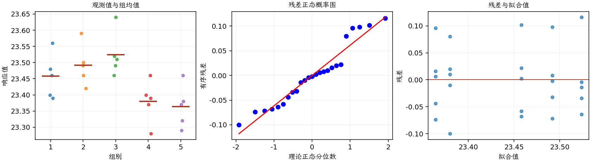

(exercise-3-34)=
# 习题 3.34：原料批次中的钙含量

[习题与答案](../../index.md) / [第 3 章　单因子试验与方差分析](../chapter03.md)

第 9 版 · 第 3 章 · 原书章末习题见印刷页 125～134。

## 题目

一家制造商怀疑，供应商提供的不同原料批次在钙含量上有显著差异。仓库中现有大量批次，从中随机抽取 5 批。化学分析员对每批测定 5 次，得到以下数据。

| 组别／处理条件 | 观测值（同一行属于同一组） |
| --- | --- |
| 1 | 23.46，23.48，23.56，23.39，23.4 |
| 2 | 23.59，23.46，23.42，23.49，23.5 |
| 3 | 23.51，23.64，23.46，23.52，23.49 |
| 4 | 23.28，23.4，23.37，23.46，23.39 |
| 5 | 23.29，23.46，23.37，23.32，23.38 |

**（a）** 批次间钙含量是否存在显著变异？取 $\alpha=0.05$。

**（b）** 估计方差分量。

**（c）** 求 $\sigma_\tau^2/(\sigma_\tau^2+\sigma^2)$ 的 95% 置信区间。

**（d）** 分析残差。方差分析的各项假定是否满足？

**（e）** 使用 REML 方法分析这些数据，并将 REML 的误差方差 95% 置信区间与精确卡方区间比较。

## 答案与解析

批次是从大量批次中随机抽取，使用随机效应模型。检验 $H_0:\sigma_\tau^2=0$：

| 来源 | 自由度 | 平方和 | 均方 | $F$ | $P$ 值 |
| --- | --- | --- | --- | --- | --- |
| 处理 | 4 | 0.096976 | 0.024244 | 5.53516 | 0.00362615 |
| 误差 | 20 | 0.0876 | 0.00438 | — | — |
| 总计 | 24 | 0.184576 | — | — | — |

| 组别 | 样本量 | 均值 | 样本标准差 |
| --- | --- | --- | --- |
| 1 | 5 | 23.458 | 0.0687023 |
| 2 | 5 | 23.492 | 0.0630079 |
| 3 | 5 | 23.524 | 0.068775 |
| 4 | 5 | 23.38 | 0.065192 |
| 5 | 5 | 23.364 | 0.0650385 |

$n_0=5$，矩估计为 $\hat\sigma^2=0.00438$，$\hat\sigma_\tau^2=0.0039728$。总方差为 0.0083528，组间方差占比为 47.56%。组内相关系数的 95% 置信区间（截断到参数空间）为 $(0.103117, 0.902687)$。误差方差的精确 95% 卡方区间为 $(0.00256368, 0.00913377)$。

平衡设计且方差分量为正时，REML 点估计与上述 ANOVA 矩估计相同。作为明确的近似比较，误差方差的正态 Wald 区间为 $\hat\sigma^2\pm1.959964\hat\sigma^2\sqrt{2/(N-a)}$，得 $(0.0016653, 0.0070947)$。它与精确卡方区间不同，且小样本覆盖率可能较差；软件若使用轮廓似然区间，也会得到不同端点。

残差图未见严重异常，但同一批次内测定是否包含独立取样、还是仅重复测同一份样品，决定了误差分量的实际含义。本题为补充解析；精确卡方区间使用组内残差自由度 20。

---

**答案来源**：参考答案文件无直接对应题；解析由编者补充。

← [上一题 3.33](./exercise-3-33.md) · [本章题目目录](../chapter03.md) · [下一题 3.35](./exercise-3-35.md) →
