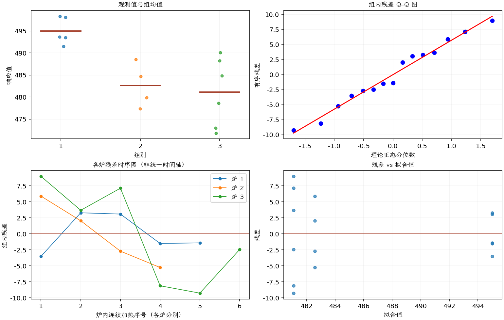

(exercise-3-35)=
# 习题 3.35：随机选择的加热炉

[习题与答案](../../index.md) / [第 3 章　单因子试验与方差分析](../chapter03.md)

第 9 版 · 第 3 章 · 原书章末习题见印刷页 125～134。

## 题目

一家金属加工车间用多台加热炉加热金属试件。所有炉子本应工作在相同温度，但人们怀疑事实并非如此。随机选取 3 台炉子，记录连续多次加热时的温度，数据如下。三台炉子的观测数分别为 5、4、6。

| 组别／处理条件 | 观测值（同一行属于同一组） |
| --- | --- |
| 1 | 491.5，498.3，498.1，493.5，493.6 |
| 2 | 488.5，484.65，479.9，477.35 |
| 3 | 490.1，484.8，488.25，473，471.85，478.65 |

**（a）** 炉间温度是否存在显著变异？取 $\alpha=0.05$。

**（b）** 估计该模型的方差分量。

**（c）** 分析残差，评价模型适合性。

## 答案与解析

### （a）随机炉间差异检验

**模型与模型假设（随机效应）**：$y_{ij}=\mu+u_i+\epsilon_{ij}$，$u_i\overset{\mathrm{iid}}\sim N(0,\sigma_\tau^2)$，$\epsilon_{ij}\overset{\mathrm{iid}}\sim N(0,\sigma^2)$；随机效应与误差相互独立，抽取的水平代表目标水平总体。不同组独立，同组观测的边际协方差为 $\sigma_\tau^2$，不能把同组观测的边际独立性当作假设。

**原假设和备择假设**：$H_0:\sigma_\tau^2=0$；$H_1:\sigma_\tau^2>0$。

**平方和公式与检验统计量**：令 $N=\sum_i n_i$，$\bar y_i=\sum_jy_{ij}/n_i$，$\bar y_{\cdot\cdot}=\sum_i\sum_jy_{ij}/N$。

$$SS_A=\sum_i n_i(\bar y_i-\bar y_{\cdot\cdot})^2,\qquad SS_E=\sum_i\sum_j(y_{ij}-\bar y_i)^2,$$
$$SS_T=\sum_i\sum_j(y_{ij}-\bar y_{\cdot\cdot})^2=SS_A+SS_E,$$
$$MS_A=\frac{SS_A}{a-1},\quad MS_E=\frac{SS_E}{N-a},\quad F_0=\frac{MS_A}{MS_E}\overset{H_0}{\sim}F_{a-1,N-a}.$$

当 $F_0>F_{1-\alpha,a-1,N-a}$ 时拒绝 $H_0$，$P=P(F_{a-1,N-a}\ge F_0)$。本文分位数均为**下侧累积概率分位数**。

**方差分量估计量**：$\hat\sigma^2=MS_E$，$\hat\sigma_\tau^2=(MS_A-MS_E)/n_0$，其中 $n_0=[N-\sum_i n_i^2/N]/(a-1)$，平衡时 $n_0=n$。表中组样本均值仅作描述，不是随机效应的 BLUP；各组样本方差为 $s_i^2=\sum_j(y_{ij}-\bar y_i)^2/(n_i-1)$。以下为 ANOVA Table 与计算结果。

| 来源 | 自由度 | 平方和 | 均方 | $F$ | $P$ 值 |
| --- | --- | --- | --- | --- | --- |
| 处理 | 2 | 594.53 | 297.265 | 8.62029 | 0.00477717 |
| 误差 | 12 | 413.812 | 34.4843 | — | — |
| 总计 | 14 | 1008.34 | — | — | — |

| 组别 | 样本量 | 均值 | 样本标准差 |
| --- | --- | --- | --- |
| 1 | 5 | 495 | 3.03974 |
| 2 | 4 | 482.6 | 4.96202 |
| 3 | 6 | 481.108 | 7.78443 |

拒绝炉间方差为零，有显著炉间温度差异。

### （b）不平衡设计的方差分量

$\hat\sigma_\tau^2=(MS_A-MS_E)/n_0$，其中 $n_0=[N-\sum_i n_i^2/N]/(a-1)$；$n_0=4.93333$，结果为 $\hat\sigma_\tau^2=53.2664$。

$\hat\sigma^2=MS_E=SS_E/(N-a)$，结果为 $\hat\sigma^2=34.4843$。

这里使用 ANOVA 矩估计；不平衡情形下它不必等于 REML。

### （c）残差分析

**残差定义**：$\hat y_{ij}=\bar y_i$，$e_{ij}=y_{ij}-\bar y_i$。随机效应题这里采用组内中心化残差检查组内误差；组均值是诊断基准，不冒充 REML 的 BLUP 拟合值。

**三项诊断**：右上为组内残差 Q–Q 图，左下按各炉连续加热序号分别画残差时序，右下为残差 vs 拟合值图。题干明确了各炉内部的连续加热先后，因此可检查炉内随顺序的变化；没有跨炉统一运行时间，不能把三炉拼成真实的共同时间轴，也不能据此验证跨炉时间关系。

第 3 台炉子的残差散布较大，需要关注异方差。第 2 炉残差随连续加热序号下降，第 3 炉也有下降迹象，提示恒定均值和误差独立性可能有问题，不能只凭一次 ANOVA 宣布模型有效。题干给出了各炉内部的先后次序，故按炉分别检查；没有跨炉统一时间，不把三条曲线拼成一条共同时间序列。

---

**答案来源**：参考：`ch03.pdf`，原题 3.30S；本页按第 9 版编号。

← [上一题 3.34](./exercise-3-34.md) · [本章题目目录](../chapter03.md) · [下一题 3.36](./exercise-3-36.md) →
