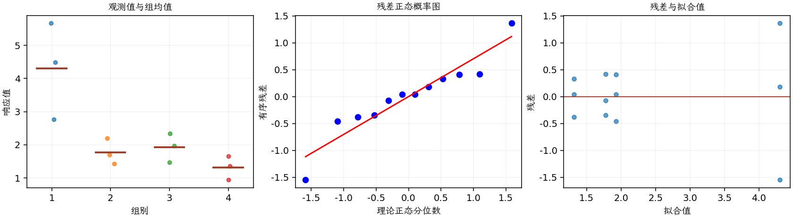

(exercise-3-36)=
# 习题 3.36：反应器晶圆位置

[习题与答案](../../index.md) / [第 3 章　单因子试验与方差分析](../chapter03.md)

第 9 版 · 第 3 章 · 原书章末习题见印刷页 125～134。

## 题目

《Journal of the Electrochemical Society》第 139 卷第 2 期（1992 年）、524～532 页的一篇文章，介绍了一项多晶硅低压气相沉积试验。试验在德克萨斯州奥斯汀 Sematech 的大型反应器内实施。反应器有多个晶圆位置，从中随机选取 4 个位置。响应变量为薄膜厚度均匀性，每位置重复 3 次，结果如下。

| 组别／处理条件 | 观测值（同一行属于同一组） |
| --- | --- |
| 1 | 2.76，5.67，4.49 |
| 2 | 1.43，1.7，2.19 |
| 3 | 2.34，1.97，1.47 |
| 4 | 0.94，1.36，1.65 |

**（a）** 各晶圆位置是否存在差异？取 $\alpha=0.05$。

**（b）** 估计晶圆位置所引起的变异。

**（c）** 估计随机误差分量。

**（d）** 分析残差，评价模型适合性。

## 答案与解析

| 来源 | 自由度 | 平方和 | 均方 | $F$ | $P$ 值 |
| --- | --- | --- | --- | --- | --- |
| 处理 | 3 | 16.2198 | 5.40661 | 8.29001 | 0.00774654 |
| 误差 | 8 | 5.21747 | 0.652183 | — | — |
| 总计 | 11 | 21.4373 | — | — | — |

| 组别 | 样本量 | 均值 | 样本标准差 |
| --- | --- | --- | --- |
| 1 | 3 | 4.30667 | 1.46364 |
| 2 | 3 | 1.77333 | 0.38527 |
| 3 | 3 | 1.92667 | 0.436616 |
| 4 | 3 | 1.31667 | 0.356978 |

$n_0=3$，矩估计为 $\hat\sigma^2=0.652183$，$\hat\sigma_\tau^2=1.58481$。总方差为 2.23699，组间方差占比为 70.85%。组内相关系数的 95% 置信区间（截断到参数空间）为 $(0.150301, 0.975517)$。误差方差的精确 95% 卡方区间为 $(0.297554, 2.39363)$。

位置方差显著。第 1 个位置的残差散布比其他位置大，等方差假定应进一步检查；仅各 3 次重复时，方差分量和区间仍不稳定。

---

**答案来源**：参考：`ch03.pdf`，原题 3.31；本页按第 9 版编号。

← [上一题 3.35](./exercise-3-35.md) · [本章题目目录](../chapter03.md) · [下一题 3.37](./exercise-3-37.md) →
