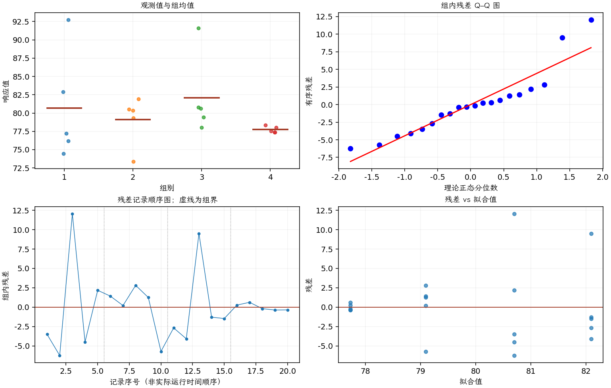

(exercise-3-42)=
# 习题 3.42：漂白化学品与纸浆亮度

[习题与答案](../../index.md) / [第 3 章　单因子试验与方差分析](../chapter03.md)

第 9 版 · 第 3 章 · 原书章末习题见印刷页 125～134。

## 题目

《Journal of Quality Technology》第 13 卷第 2 期（1981 年）、111～114 页的一篇文章，介绍了研究四种漂白化学品对纸浆亮度影响的试验。这四种化学品是从大量候选漂白剂中随机抽取的。数据如下。原书表头误写成“炉子”和“温度”，本页按研究背景标为化学品与亮度。

| 组别／处理条件 | 观测值（同一行属于同一组） |
| --- | --- |
| 1 | 77.199，74.466，92.746，76.208，82.876 |
| 2 | 80.522，79.306，81.914，80.346，73.385 |
| 3 | 79.417，78.017，91.596，80.802，80.626 |
| 4 | 78.001，78.358，77.544，77.364，77.386 |

**（a）** 不同化学品是否存在差异？取 $\alpha=0.05$。

**（b）** 估计化学品类型所引起的变异。

**（c）** 估计随机误差所引起的变异。

**（d）** 分析试验残差，评价模型适合性。

## 答案与解析

### （a）随机化学品效应的检验

**模型与模型假设（随机效应）**：$y_{ij}=\mu+u_i+\epsilon_{ij}$，$u_i\overset{\mathrm{iid}}\sim N(0,\sigma_\tau^2)$，$\epsilon_{ij}\overset{\mathrm{iid}}\sim N(0,\sigma^2)$；随机效应与误差相互独立，抽取的水平代表目标水平总体。不同组独立，同组观测的边际协方差为 $\sigma_\tau^2$，不能把同组观测的边际独立性当作假设。

**原假设和备择假设**：$H_0:\sigma_\tau^2=0$；$H_1:\sigma_\tau^2>0$。

**平方和公式与检验统计量**：令 $N=\sum_i n_i$，$\bar y_i=\sum_jy_{ij}/n_i$，$\bar y_{\cdot\cdot}=\sum_i\sum_jy_{ij}/N$。

$$SS_A=\sum_i n_i(\bar y_i-\bar y_{\cdot\cdot})^2,\qquad SS_E=\sum_i\sum_j(y_{ij}-\bar y_i)^2,$$
$$SS_T=\sum_i\sum_j(y_{ij}-\bar y_{\cdot\cdot})^2=SS_A+SS_E,$$
$$MS_A=\frac{SS_A}{a-1},\quad MS_E=\frac{SS_E}{N-a},\quad F_0=\frac{MS_A}{MS_E}\overset{H_0}{\sim}F_{a-1,N-a}.$$

当 $F_0>F_{1-\alpha,a-1,N-a}$ 时拒绝 $H_0$，$P=P(F_{a-1,N-a}\ge F_0)$。本文分位数均为**下侧累积概率分位数**。

**方差分量估计量**：$\hat\sigma^2=MS_E$，$\hat\sigma_\tau^2=(MS_A-MS_E)/n_0$，其中 $n_0=[N-\sum_i n_i^2/N]/(a-1)$，平衡时 $n_0=n$。表中组样本均值仅作描述，不是随机效应的 BLUP；各组样本方差为 $s_i^2=\sum_j(y_{ij}-\bar y_i)^2/(n_i-1)$。以下为 ANOVA Table 与计算结果。

| 来源 | 自由度 | 平方和 | 均方 | $F$ | $P$ 值 |
| --- | --- | --- | --- | --- | --- |
| 处理 | 3 | 53.9821 | 17.994 | 0.749769 | 0.538278 |
| 误差 | 16 | 383.991 | 23.9994 | — | — |
| 总计 | 19 | 437.973 | — | — | — |

| 组别 | 样本量 | 均值 | 样本标准差 |
| --- | --- | --- | --- |
| 1 | 5 | 80.699 | 7.43537 |
| 2 | 5 | 79.0946 | 3.32403 |
| 3 | 5 | 82.0916 | 5.4291 |
| 4 | 5 | 77.7306 | 0.434371 |

在 0.05 水平不拒绝化学品间方差为零。

### （b）化学品方差分量

$\hat\sigma_\tau^2=(MS_A-MS_E)/n_0$，其中 $n_0=[N-\sum_i n_i^2/N]/(a-1)$；$n_0=5$，结果为 $\hat\sigma_\tau^2=-1.20108$。无约束估计为负，应限制在非负参数空间中重新估计，不能解释为负的实际方差。

约束 REML 的化学品方差为 0。负的矩估计仅提示组间信号不足，不代表存在负的实际变异。

### （c）误差方差估计

$\hat\sigma^2=MS_E=SS_E/(N-a)$，结果为 $\hat\sigma^2=23.9994$。

这是 ANOVA 矩估计；若采用化学品分量为零的约束 REML，$\hat\sigma^2=SS_T/(N-1)=23.05121$，估计方法不同应标明。

### （d）残差分析

**残差定义**：$\hat y_{ij}=\bar y_i$，$e_{ij}=y_{ij}-\bar y_i$。变换分析时使用相应变换尺度的响应。随机效应题这里采用组内中心化残差检查组内误差；组均值是诊断基准，不冒充 REML 的 BLUP 拟合值。

**三项诊断**：Q–Q 图用于检查尾部、偏态及异常残差；残差记录顺序图用于展示原表记录的相邻变化；残差 vs 拟合值图用于观察方差是否随处理均值变化。

**时序资料的限制**：原题只提供分组观测，没有实际运行时间和随机运行次序。左下图按原表组内记录顺序排列，虚线表示组界，**不是实际残差时序图**；组界附近的变化不能解释为时间效应。若要完成真正的时序诊断，须取得原始运行顺序后按该顺序重画。当前不能仅凭此图断言误差在时间上独立。单样本或配对差的拟合值为常数时，残差 vs 拟合值图也不能检验复杂均值结构。

第 1、3 组各有较大的观测，Q–Q 尾部及异方差需要关注。真实运行时序未知，不能由分组记录顺序推断时间独立性。

---

**答案来源**：参考答案文件无直接对应题；解析由编者补充。

← [上一题 3.41](./exercise-3-41.md) · [本章题目目录](../chapter03.md) · [下一题 3.43](./exercise-3-43.md) →
