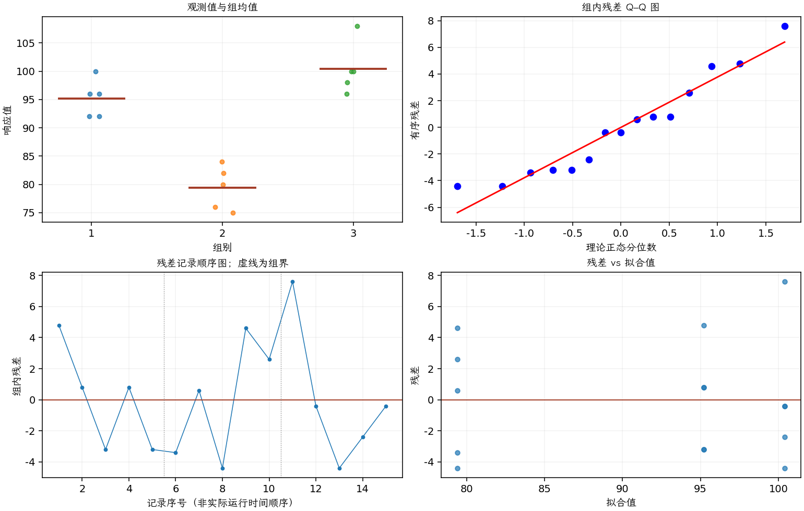

(exercise-3-47)=
# 习题 3.47：电池寿命的 Bartlett 检验

[习题与答案](../../index.md) / [第 3 章　单因子试验与方差分析](../chapter03.md)

第 9 版 · 第 3 章 · 原书章末习题见印刷页 125～134。

## 题目

对 [3.30](./exercise-3-30.md)，在 0.05 水平用 Bartlett 检验检查等方差，是否与残差图判断一致？

**所用数据（来自习题 [3.30](./exercise-3-30.md)）**

| 组别／处理条件 | 观测值（同一行属于同一组） |
| --- | --- |
| 1 | 100，96，92，96，92 |
| 2 | 76，80，75，84，82 |
| 3 | 108，100，96，98，100 |

## 答案与解析

**假设与统计量**：独立正态总体，检验 $H_0:\sigma_1^2=\sigma_2^2=\sigma_3^2$ 对至少一个不同。令 $\nu_i=n_i-1$、$\nu=\sum_i\nu_i$、$s_p^2=\sum_i\nu_i s_i^2/\nu$，Bartlett 统计量为

$$B=\frac{\nu\ln s_p^2-\sum_i\nu_i\ln s_i^2}{1+\{\sum_i1/\nu_i-1/\nu\}/[3(a-1)]}\overset{H_0}{\approx}\chi^2_{a-1}.$$

三个样本方差估计量 $s_i^2=\sum_j(y_{ij}-\bar y_i)^2/(n_i-1)$，结果分别为 **11.2、14.8、20.8**。$B=1.70107$，自由度 2，$P=0.42719>0.05$，不拒绝等方差。

**残差定义**：$\hat y_{ij}=\bar y_i$，$e_{ij}=y_{ij}-\bar y_i$。变换分析时使用相应变换尺度的响应。

**三项诊断**：Q–Q 图用于检查尾部、偏态及异常残差；残差记录顺序图用于展示原表记录的相邻变化；残差 vs 拟合值图用于观察方差是否随处理均值变化。

**时序资料的限制**：原题只提供分组观测，没有实际运行时间和随机运行次序。左下图按原表组内记录顺序排列，虚线表示组界，**不是实际残差时序图**；组界附近的变化不能解释为时间效应。若要完成真正的时序诊断，须取得原始运行顺序后按该顺序重画。当前不能仅凭此图断言误差在时间上独立。单样本或配对差的拟合值为常数时，残差 vs 拟合值图也不能检验复杂均值结构。

与残差 vs 拟合值图没有明显漏斗形相容。Bartlett 对非正态敏感，需结合 Q–Q 图；实际测量时序未提供，记录图不能证明时间独立性。

---

**答案来源**：参考：`ch03.pdf`，原题 3.40；本页按第 9 版编号。

**关联题目**：[3.30](./exercise-3-30.md)

← [上一题 3.46](./exercise-3-46.md) · [本章题目目录](../chapter03.md) · [下一题 3.48](./exercise-3-48.md) →
