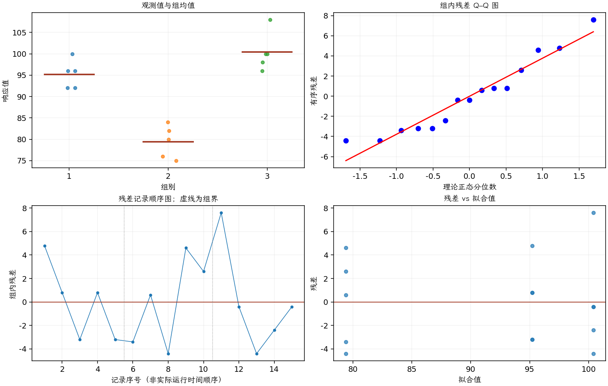

(exercise-3-48)=
# 习题 3.48：改进 Levene 检验

[习题与答案](../../index.md) / [第 3 章　单因子试验与方差分析](../chapter03.md)

第 9 版 · 第 3 章 · 原书章末习题见印刷页 125～134。

## 题目

对 [3.30](./exercise-3-30.md)，取 0.05 水平，用基于组中位数的改进 Levene 检验比较方差，并与残差图比较。

**所用数据（来自习题 [3.30](./exercise-3-30.md)）**

| 组别／处理条件 | 观测值（同一行属于同一组） |
| --- | --- |
| 1 | 100，96，92，96，92 |
| 2 | 76，80，75，84，82 |
| 3 | 108，100，96，98，100 |

## 答案与解析

改进 Levene 检验先变换 $z_{ij}=|y_{ij}-\tilde y_i|$，其中 $\tilde y_i$ 为组中位数。对 $z$ 建立单因子均值模型；其 F 参考分布为近似，绝对偏差本身未必严格正态。

以下模型和平方和中的 $y$ 均指绝对偏差 $z$，不是原始电池寿命。

**绝对偏差的工作模型与近似假设**：$y_{ij}=\mu_i+\epsilon_{ij}=\mu+\tau_i+\epsilon_{ij}$，$i=1,\ldots,a$，$j=1,\ldots,n_i$；$\epsilon_{ij}\overset{\mathrm{iid}}\sim N(0,\sigma^2)$。误差独立、正态且同方差，处理分配及抽样符合题意；不平衡设计使用实际 $n_i$。取 $\sum_i n_i\tau_i=0$ 识别参数；平衡时等价于 $\sum_i\tau_i=0$。

**原假设和备择假设**：$H_0:\mu_1=\cdots=\mu_a$；$H_1$：至少一个总体均值不同。

**平方和公式与检验统计量**：令 $N=\sum_i n_i$，$\bar y_i=\sum_jy_{ij}/n_i$，$\bar y_{\cdot\cdot}=\sum_i\sum_jy_{ij}/N$。

$$SS_A=\sum_i n_i(\bar y_i-\bar y_{\cdot\cdot})^2,\qquad SS_E=\sum_i\sum_j(y_{ij}-\bar y_i)^2,$$
$$SS_T=\sum_i\sum_j(y_{ij}-\bar y_{\cdot\cdot})^2=SS_A+SS_E,$$
$$MS_A=\frac{SS_A}{a-1},\quad MS_E=\frac{SS_E}{N-a},\quad F_0=\frac{MS_A}{MS_E}\overset{H_0}{\sim}F_{a-1,N-a}.$$

当 $F_0>F_{1-\alpha,a-1,N-a}$ 时拒绝 $H_0$，$P=P(F_{a-1,N-a}\ge F_0)$。本文分位数均为**下侧累积概率分位数**。

**点估计量**：$\hat\mu_i=\bar y_i$，$\hat\sigma^2=MS_E$；各组样本方差为 $s_i^2=\sum_j(y_{ij}-\bar y_i)^2/(n_i-1)$。以下对 $z_{ij}=|y_{ij}-\tilde y_i|$ 计算 ANOVA Table。F 校准为近似；绝对偏差未必严格正态，同组中位数估计还引入约束。

| 来源 | 自由度 | 平方和 | 均方 | $F$ | $P$ |
| --- | --- | --- | --- | --- | --- |
| 组别 | 2 | 0.933333 | 0.466667 | 0.07 | 0.932772 |
| 误差 | 12 | 80 | 6.66667 | — | — |
| 总计 | 14 | 80.9333 | — | — | — |

$H_0$：各总体方差相同；$H_1$：至少一个不同。$P=0.932772>0.05$，不拒绝等方差，与习题 [3.30](./exercise-3-30.md) 的残差图没有明显漏斗形相容。原始电池寿命的正态性、记录顺序与拟合值诊断如下：

**残差定义**：$\hat y_{ij}=\bar y_i$，$e_{ij}=y_{ij}-\bar y_i$。变换分析时使用相应变换尺度的响应。

**三项诊断**：Q–Q 图用于检查尾部、偏态及异常残差；残差记录顺序图用于展示原表记录的相邻变化；残差 vs 拟合值图用于观察方差是否随处理均值变化。

**时序资料的限制**：原题只提供分组观测，没有实际运行时间和随机运行次序。左下图按原表组内记录顺序排列，虚线表示组界，**不是实际残差时序图**；组界附近的变化不能解释为时间效应。若要完成真正的时序诊断，须取得原始运行顺序后按该顺序重画。当前不能仅凭此图断言误差在时间上独立。单样本或配对差的拟合值为常数时，残差 vs 拟合值图也不能检验复杂均值结构。

不拒绝方差相等并非证明方差完全相同。

---

**答案来源**：参考：`ch03.pdf`，原题 3.41；本页按第 9 版编号。

**关联题目**：[3.30](./exercise-3-30.md)

← [上一题 3.47](./exercise-3-47.md) · [本章题目目录](../chapter03.md) · [下一题 3.49](./exercise-3-49.md) →
