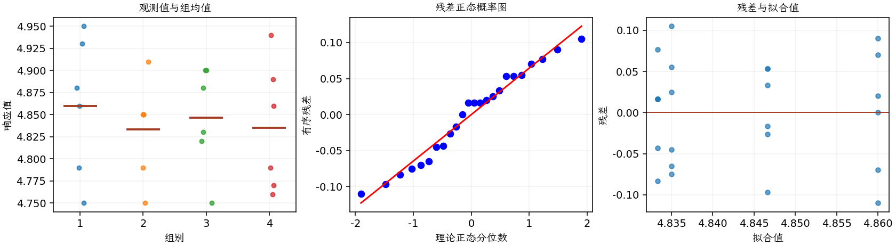

(exercise-3-54)=
# 习题 3.54：铝冶炼：平均槽电压

[习题与答案](../../index.md) / [第 3 章　单因子试验与方差分析](../chapter03.md)

第 9 版 · 第 3 章 · 原书章末习题见印刷页 125～134。

## 题目

参见正文第 3.8.3 节的铝冶炼试验。氧化铝不断加入反应槽以维持其与其他成分的适当比值，试验比较 4 种比值控制算法。每次运行期间传感器取得大量电压测量，以下数据是各运行的平均槽电压。

验证比值控制方法不会显著影响平均槽电压。构造残差正态概率图，并绘制残差对预测值的图。是否有迹象表明模型的任何基本假定被违反？

| 组别／处理条件 | 观测值（同一行属于同一组） |
| --- | --- |
| 1 | 4.93，4.86，4.75，4.95，4.79，4.88 |
| 2 | 4.85，4.91，4.79，4.85，4.75，4.85 |
| 3 | 4.83，4.88，4.9，4.75，4.82，4.9 |
| 4 | 4.89，4.77，4.94，4.86，4.79，4.76 |

## 答案与解析

| 来源 | 自由度 | 平方和 | 均方 | $F$ | $P$ 值 |
| --- | --- | --- | --- | --- | --- |
| 处理 | 3 | 0.00274583 | 0.000915278 | 0.204265 | 0.892221 |
| 误差 | 20 | 0.0896167 | 0.00448083 | — | — |
| 总计 | 23 | 0.0923625 | — | — | — |

| 组别 | 样本量 | 均值 | 样本标准差 |
| --- | --- | --- | --- |
| 1 | 6 | 4.86 | 0.0779744 |
| 2 | 6 | 4.83333 | 0.0557375 |
| 3 | 6 | 4.84667 | 0.0585377 |
| 4 | 6 | 4.835 | 0.0728697 |

在 0.05 水平未拒绝平均电压相等，未发现位置效应。图中无明显异常趋势。应表述为“未检出差异”，而不是证明各算法的真实均值完全相同；槽噪声是另一响应，见下一题。

---

**答案来源**：参考：`ch03.pdf`，原题 3.47；本页按第 9 版编号。

← [上一题 3.53](./exercise-3-53.md) · [本章题目目录](../chapter03.md) · [下一题 3.55](./exercise-3-55.md) →
