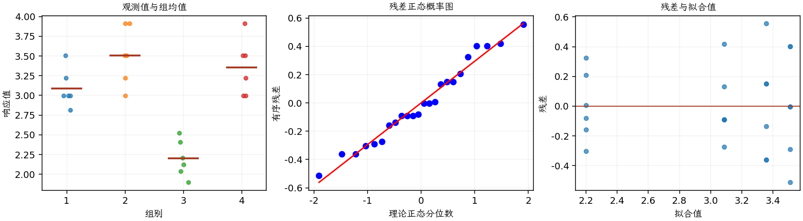

(exercise-3-55)=
# 习题 3.55：铝冶炼：槽噪声

[习题与答案](../../index.md) / [第 3 章　单因子试验与方差分析](../chapter03.md)

第 9 版 · 第 3 章 · 原书章末习题见印刷页 125～134。

## 题目

参见正文第 3.8.3 节的铝冶炼试验。除平均槽电压外，工程师还关心一次运行内槽电压的标准差，称为“槽噪声”，因为它会影响反应槽的整体效率。以下数据为各运行的电压标准差 $s$，与习题 [3.54](./exercise-3-54.md) 的运行一一对应。正文采用 $y=-\ln(s)$ 为响应。

复核表 3.17 所汇总的槽噪声方差分析，检查通常的残差诊断图，并评价试验的有效性。

| 组别／处理条件 | 观测值（同一行属于同一组） |
| --- | --- |
| 1 | 0.05，0.04，0.05，0.06，0.03，0.05 |
| 2 | 0.04，0.02，0.03，0.05，0.03，0.02 |
| 3 | 0.09，0.13，0.11，0.15，0.08，0.12 |
| 4 | 0.03，0.04，0.05，0.05，0.03，0.02 |

## 答案与解析

| 来源 | 自由度 | 平方和 | 均方 | $F$ | $P$ 值 |
| --- | --- | --- | --- | --- | --- |
| 处理 | 3 | 6.16605 | 2.05535 | 21.9631 | 1.53974e-06 |
| 误差 | 20 | 1.87164 | 0.0935821 | — | — |
| 总计 | 23 | 8.03769 | — | — | — |

| 组别 | 样本量 | 均值 | 样本标准差 |
| --- | --- | --- | --- |
| 1 | 6 | 3.08767 | 0.242181 |
| 2 | 6 | 3.50863 | 0.366738 |
| 3 | 6 | 2.19976 | 0.233674 |
| 4 | 6 | 3.35591 | 0.355777 |

复算与表 3.17 的四舍五入结果一致，算法对槽噪声影响显著。算法 3 的原始标准差较大，因此 $-\ln(s)$ 较小；1、2、4 的噪声较低。残差没有严重系统结构。负对数只是改变比较方向，不改变总体 $F$ 检验。

---

**答案来源**：参考：`ch03.pdf`，原题 3.48S；本页按第 9 版编号。

**关联题目**：[3.54](./exercise-3-54.md)

← [上一题 3.54](./exercise-3-54.md) · [本章题目目录](../chapter03.md) · [下一题 3.56](./exercise-3-56.md) →
