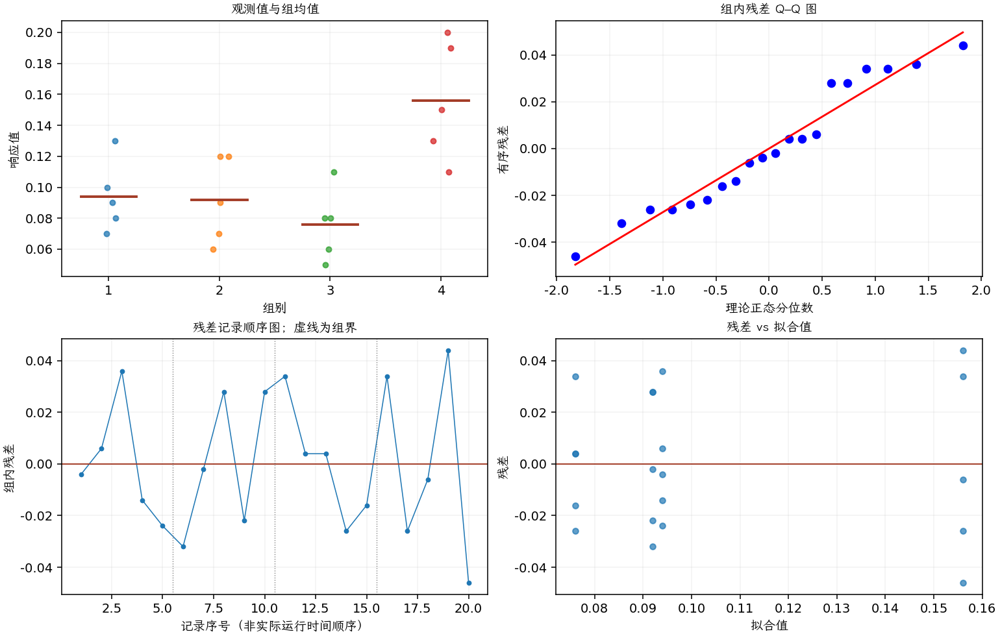
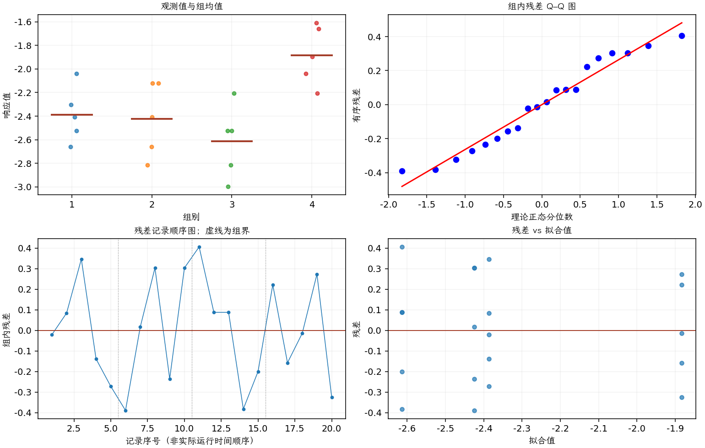

(exercise-3-56)=
# 习题 3.56：CNC 进给速度与尺寸波动

[习题与答案](../../index.md) / [第 3 章　单因子试验与方差分析](../chapter03.md)

第 9 版 · 第 3 章 · 原书章末习题见印刷页 125～134。

## 题目

一台 CNC 机床用于生产飞机辅助动力装置中的某个零件。负责试验的制造工程师知道，进给速度可能影响零件的某个关键尺寸，但以往经验表明，很可能只存在离散效应：改变进给速度不会改变平均尺寸，却可能改变尺寸的变异。

工程师考察 4 种进给速度 10、12、14、16 in/min，每种速度进行 5 次生产运行，记录每次运行中关键尺寸的标准差，单位为 $10^{-3}$ mm。所有运行按随机顺序进行，数据如下。

| 组别／处理条件 | 观测值（同一行属于同一组） |
| --- | --- |
| 10 in/min | 0.09，0.1，0.13，0.08，0.07 |
| 12 in/min | 0.06，0.09，0.12，0.07，0.12 |
| 14 in/min | 0.11，0.08，0.08，0.05，0.06 |
| 16 in/min | 0.19，0.13，0.15，0.2，0.11 |

**（a）** 进给速度是否影响这个关键尺寸的标准差？

**（b）** 用残差考察模型适合性。试验有效性是否有问题？

## 答案与解析

### （a）进给速度对标准差的影响

**模型与模型假设（固定效应）**：$y_{ij}=\mu_i+\epsilon_{ij}=\mu+\tau_i+\epsilon_{ij}$，$i=1,\ldots,a$，$j=1,\ldots,n_i$；$\epsilon_{ij}\overset{\mathrm{iid}}\sim N(0,\sigma^2)$。误差独立、正态且同方差，处理分配及抽样符合题意；不平衡设计使用实际 $n_i$。取 $\sum_i n_i\tau_i=0$ 识别参数；平衡时等价于 $\sum_i\tau_i=0$。

**原假设和备择假设**：$H_0:\mu_1=\cdots=\mu_a$；$H_1$：至少一个总体均值不同。

**平方和公式与检验统计量**：令 $N=\sum_i n_i$，$\bar y_i=\sum_jy_{ij}/n_i$，$\bar y_{\cdot\cdot}=\sum_i\sum_jy_{ij}/N$。

$$SS_A=\sum_i n_i(\bar y_i-\bar y_{\cdot\cdot})^2,\qquad SS_E=\sum_i\sum_j(y_{ij}-\bar y_i)^2,$$
$$SS_T=\sum_i\sum_j(y_{ij}-\bar y_{\cdot\cdot})^2=SS_A+SS_E,$$
$$MS_A=\frac{SS_A}{a-1},\quad MS_E=\frac{SS_E}{N-a},\quad F_0=\frac{MS_A}{MS_E}\overset{H_0}{\sim}F_{a-1,N-a}.$$

当 $F_0>F_{1-\alpha,a-1,N-a}$ 时拒绝 $H_0$，$P=P(F_{a-1,N-a}\ge F_0)$。本文分位数均为**下侧累积概率分位数**。

**点估计量**：$\hat\mu_i=\bar y_i$，$\hat\sigma^2=MS_E$；各组样本方差为 $s_i^2=\sum_j(y_{ij}-\bar y_i)^2/(n_i-1)$。以下为 ANOVA Table 与计算结果。

| 来源 | 自由度 | 平方和 | 均方 | $F$ | $P$ 值 |
| --- | --- | --- | --- | --- | --- |
| 处理 | 3 | 0.018655 | 0.00621833 | 7.5146 | 0.00233704 |
| 误差 | 16 | 0.01324 | 0.0008275 | — | — |
| 总计 | 19 | 0.031895 | — | — | — |

| 组别 | 样本量 | 均值 | 样本标准差 |
| --- | --- | --- | --- |
| 1 | 5 | 0.094 | 0.0230217 |
| 2 | 5 | 0.092 | 0.0277489 |
| 3 | 5 | 0.076 | 0.0230217 |
| 4 | 5 | 0.156 | 0.0384708 |

进给速度具有显著离散效应；16 in/min 组标准差较大，14 in/min 组的样本均值较低。响应是一次生产运行内的尺寸标准差，不是原始尺寸均值。

### （b）残差与模型适合性

**残差定义**：$\hat y_{ij}=\bar y_i$，$e_{ij}=y_{ij}-\bar y_i$。变换分析时使用相应变换尺度的响应。

**三项诊断**：Q–Q 图用于检查尾部、偏态及异常残差；残差记录顺序图用于展示原表记录的相邻变化；残差 vs 拟合值图用于观察方差是否随处理均值变化。

**时序资料的限制**：原题只提供分组观测，没有实际运行时间和随机运行次序。左下图按原表组内记录顺序排列，虚线表示组界，**不是实际残差时序图**；组界附近的变化不能解释为时间效应。若要完成真正的时序诊断，须取得原始运行顺序后按该顺序重画。当前不能仅凭此图断言误差在时间上独立。单样本或配对差的拟合值为常数时，残差 vs 拟合值图也不能检验复杂均值结构。

标准差本身可能偏态且方差随均值变化，可用 $z=\ln s$ 作补充分析：

本次分析的响应为 $z_{ij}=\ln(y_{ij})$；以下模型与平方和中的 $y$ 均代表该变换后的响应。

**模型与模型假设（固定效应）**：$y_{ij}=\mu_i+\epsilon_{ij}=\mu+\tau_i+\epsilon_{ij}$，$i=1,\ldots,a$，$j=1,\ldots,n_i$；$\epsilon_{ij}\overset{\mathrm{iid}}\sim N(0,\sigma^2)$。误差独立、正态且同方差，处理分配及抽样符合题意；不平衡设计使用实际 $n_i$。取 $\sum_i n_i\tau_i=0$ 识别参数；平衡时等价于 $\sum_i\tau_i=0$。

**原假设和备择假设**：$H_0:\mu_1=\cdots=\mu_a$；$H_1$：至少一个总体均值不同。

**平方和公式与检验统计量**：令 $N=\sum_i n_i$，$\bar y_i=\sum_jy_{ij}/n_i$，$\bar y_{\cdot\cdot}=\sum_i\sum_jy_{ij}/N$。

$$SS_A=\sum_i n_i(\bar y_i-\bar y_{\cdot\cdot})^2,\qquad SS_E=\sum_i\sum_j(y_{ij}-\bar y_i)^2,$$
$$SS_T=\sum_i\sum_j(y_{ij}-\bar y_{\cdot\cdot})^2=SS_A+SS_E,$$
$$MS_A=\frac{SS_A}{a-1},\quad MS_E=\frac{SS_E}{N-a},\quad F_0=\frac{MS_A}{MS_E}\overset{H_0}{\sim}F_{a-1,N-a}.$$

当 $F_0>F_{1-\alpha,a-1,N-a}$ 时拒绝 $H_0$，$P=P(F_{a-1,N-a}\ge F_0)$。本文分位数均为**下侧累积概率分位数**。

**点估计量**：$\hat\mu_i=\bar y_i$，$\hat\sigma^2=MS_E$；各组样本方差为 $s_i^2=\sum_j(y_{ij}-\bar y_i)^2/(n_i-1)$。以下为 ANOVA Table 与计算结果。

| 来源 | 自由度 | 平方和 | 均方 | $F$ | $P$ 值 |
| --- | --- | --- | --- | --- | --- |
| 处理 | 3 | 1.46185 | 0.487284 | 6.31938 | 0.0049477 |
| 误差 | 16 | 1.23375 | 0.0771095 | — | — |
| 总计 | 19 | 2.69561 | — | — | — |

| 组别 | 样本量 | 均值 | 样本标准差 |
| --- | --- | --- | --- |
| 1 | 5 | -2.38715 | 0.235155 |
| 2 | 5 | -2.42423 | 0.312953 |
| 3 | 5 | -2.61358 | 0.302693 |
| 4 | 5 | -1.88296 | 0.252147 |

**残差定义**：$\hat y_{ij}=\bar y_i$，$e_{ij}=y_{ij}-\bar y_i$。变换分析时使用相应变换尺度的响应。

**三项诊断**：Q–Q 图用于检查尾部、偏态及异常残差；残差记录顺序图用于展示原表记录的相邻变化；残差 vs 拟合值图用于观察方差是否随处理均值变化。

**时序资料的限制**：原题只提供分组观测，没有实际运行时间和随机运行次序。左下图按原表组内记录顺序排列，虚线表示组界，**不是实际残差时序图**；组界附近的变化不能解释为时间效应。若要完成真正的时序诊断，须取得原始运行顺序后按该顺序重画。当前不能仅凭此图断言误差在时间上独立。单样本或配对差的拟合值为常数时，残差 vs 拟合值图也不能检验复杂均值结构。

比较变换前后的 Q–Q 与残差散布，而不是假定变换自动解决问题。各运行用于计算标准差的样本数与采样方法还应相同；实际运行时序未提供。

---

**答案来源**：参考：`ch03.pdf`，原题 3.49；本页按第 9 版编号。

← [上一题 3.55](./exercise-3-55.md) · [本章题目目录](../chapter03.md) · [下一题 3.57](./exercise-3-57.md) →
