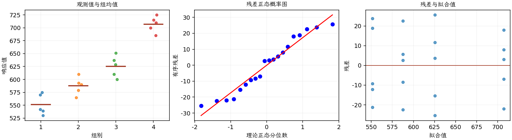

(exercise-3-58)=
# 习题 3.58：一般回归显著性检验

[习题与答案](../../index.md) / [第 3 章　单因子试验与方差分析](../chapter03.md)

第 9 版 · 第 3 章 · 原书章末习题见印刷页 125～134。

## 题目

对正文例 3.6 的刻蚀试验应用一般回归显著性检验。证明它与通常的单因子方差分析给出相同结果。本页重列该试验数据，便于独立阅读和计算。

**数据**：功率 160、180、200、220 W，每水平 5 片硅片，刻蚀速率如下。

| 组别／处理条件 | 观测值（同一行属于同一组） |
| --- | --- |
| 160 W | 575，542，530，539，570 |
| 180 W | 565，593，590，579，610 |
| 200 W | 600，651，610，637，629 |
| 220 W | 725，700，715，685，710 |

## 答案与解析

全模型有截距和 3 个处理指示变量，约简模型只有截距。

$$F_0=\frac{[SS_E(R)-SS_E(F)]/(4-1)}{SS_E(F)/(20-4)}.$$

约简残差平方和就是总平方和，全模型残差平方和就是组内平方和；差值是处理平方和，故与单因子 ANOVA 完全一致。

| 来源 | 自由度 | 平方和 | 均方 | $F$ | $P$ 值 |
| --- | --- | --- | --- | --- | --- |
| 处理 | 3 | 66870.5 | 22290.2 | 66.7971 | 2.88287e-09 |
| 误差 | 16 | 5339.2 | 333.7 | — | — |
| 总计 | 19 | 72209.7 | — | — | — |

| 组别 | 样本量 | 均值 | 样本标准差 |
| --- | --- | --- | --- |
| 1 | 5 | 551.2 | 20.0175 |
| 2 | 5 | 587.4 | 16.7422 |
| 3 | 5 | 625.4 | 20.5256 |
| 4 | 5 | 707 | 15.248 |

得到 $F_0=66.7971$。原答案一处将处理均方写为 22290.8，按实际平方和除以 3 应为 22290.1833。

---

**答案来源**：参考：`ch03.pdf`，原题 3.51；本页按第 9 版编号。

← [上一题 3.57](./exercise-3-57.md) · [本章题目目录](../chapter03.md) · [下一题 3.59](./exercise-3-59.md) →
