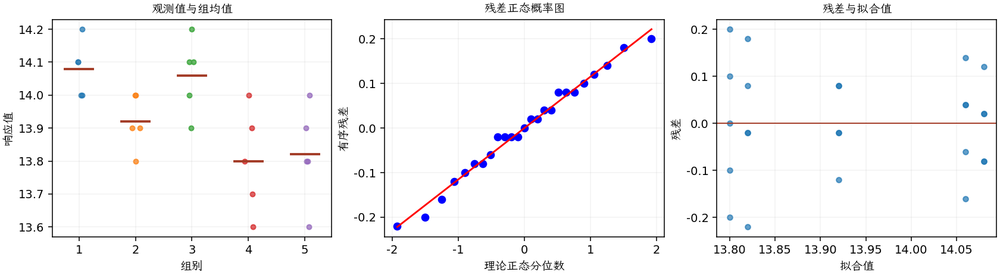

(exercise-3-62)=
# 习题 3.62：织布机产量的随机效应

[习题与答案](../../index.md) / [第 3 章　单因子试验与方差分析](../chapter03.md)

第 9 版 · 第 3 章 · 原书章末习题见印刷页 125～134。

## 题目

一家纺织厂有大量织布机，每台机器每分钟的布料产出本应相同。为了检查这一假定，随机选取 5 台织布机，在不同时间记录其产量，单位为 lb/min，数据如下。

| 组别／处理条件 | 观测值（同一行属于同一组） |
| --- | --- |
| 1 | 14，14.1，14.2，14，14.1 |
| 2 | 13.9，13.8，13.9，14，14 |
| 3 | 14.1，14.2，14.1，14，13.9 |
| 4 | 13.6，13.8，14，13.9，13.7 |
| 5 | 13.8，13.6，13.9，13.8，14 |

**（a）** 解释为什么这是一个随机效应试验。各织布机的产量是否相同？取 $\alpha=0.05$。

**（b）** 估计织布机之间的变异。

**（c）** 估计试验误差方差。

**（d）** 求 $\sigma_\tau^2/(\sigma_\tau^2+\sigma^2)$ 的 95% 置信区间。

**（e）** 分析残差。你认为方差分析的各项假定是否满足？

**（f）** 使用 REML 方法分析这些数据，并把 REML 的误差方差 95% 置信区间与精确卡方区间比较。

## 答案与解析

机器是从目标机器总体中随机抽取，推断对象是总体机间方差，不只是这 5 台的固定均值。

| 来源 | 自由度 | 平方和 | 均方 | $F$ | $P$ 值 |
| --- | --- | --- | --- | --- | --- |
| 处理 | 4 | 0.3416 | 0.0854 | 5.77027 | 0.00295615 |
| 误差 | 20 | 0.296 | 0.0148 | — | — |
| 总计 | 24 | 0.6376 | — | — | — |

| 组别 | 样本量 | 均值 | 样本标准差 |
| --- | --- | --- | --- |
| 1 | 5 | 14.08 | 0.083666 |
| 2 | 5 | 13.92 | 0.083666 |
| 3 | 5 | 14.06 | 0.114018 |
| 4 | 5 | 13.8 | 0.158114 |
| 5 | 5 | 13.82 | 0.148324 |

$n_0=5$，矩估计为 $\hat\sigma^2=0.0148$，$\hat\sigma_\tau^2=0.01412$。总方差为 0.02892，组间方差占比为 48.82%。组内相关系数的 95% 置信区间（截断到参数空间）为 $(0.113751, 0.906355)$。误差方差的精确 95% 卡方区间为 $(0.00866267, 0.030863)$。

平衡设计且方差分量为正时，REML 点估计与上述 ANOVA 矩估计相同。作为明确的近似比较，误差方差的正态 Wald 区间为 $\hat\sigma^2\pm1.959964\hat\sigma^2\sqrt{2/(N-a)}$，得 $(0.00562703, 0.023973)$。它与精确卡方区间不同，且小样本覆盖率可能较差；软件若使用轮廓似然区间，也会得到不同端点。

机间变异显著，残差散布总体相近。若同一台机器的观测相邻且有时间相关，应采用包含相关结构的模型；“不同时间测量”本身不能保证误差独立。本题为补充解析。

---

**答案来源**：参考答案文件无直接对应题；解析由编者补充。

← [上一题 3.61](./exercise-3-61.md) · [本章题目目录](../chapter03.md) · [下一题 3.63](./exercise-3-63.md) →
