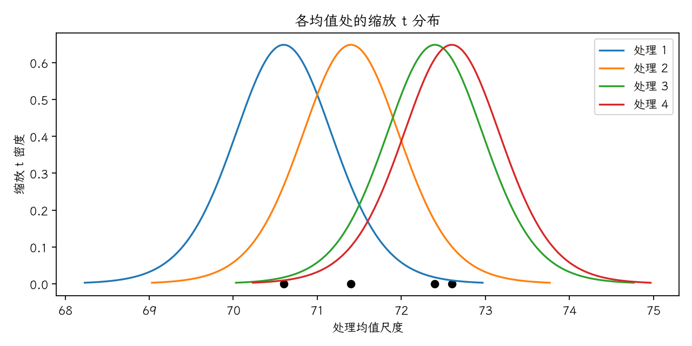

(exercise-4-10)=
# 习题 4.10：处理均值与缩放 t 分布

[习题与答案](../../index.md) / [第 4 章　随机区组、拉丁方与相关设计](../chapter04.md)

第 9 版 · 第 4 章 · 原书章末习题见印刷页 171～178。题目依据第 9 版，参考答案按题意匹配。

## 题目

绘制习题 [4.8](./exercise-4-8.md) 中各处理的样本均值，与适当缩放的 t 分布比较，并解释结论。

| 处理／区组（4.17 为组内受试者序号） | 1 | 2 | 3 | 4 | 5 |
| --- | --- | --- | --- | --- | --- |
| 化学剂1 | 73 | 68 | 74 | 71 | 67 |
| 化学剂2 | 73 | 67 | 75 | 72 | 70 |
| 化学剂3 | 75 | 68 | 78 | 73 | 68 |
| 化学剂4 | 73 | 71 | 75 | 75 | 69 |

## 答案与解析

绘制 $m_i+s_\bar y t_{12}$ 的密度曲线，其中 $s_\bar y=\sqrt{MS_E/b}=0.602771$，$m_i=\bar y_i$。曲线重叠仅作直观参考，正式逐对判断使用 $SE(\bar y_i-\bar y_j)=\sqrt{2MS_E/b}$，不能简单按两条均值区间是否重叠作显著性判断。

估计量为 $\hat\mu_i=\bar y_{i\cdot}$，$\widehat{\mu_i-\mu_j}=\bar y_i-\bar y_j$；$LSD=t_{0.975,12}\sqrt{2MS_E/b}=1.85732$。差值的逐对 95% 区间为估计差 $\pm LSD$。

| 处理 | 样本均值 |
| --- | --- |
| 1 | 70.6 |
| 2 | 71.4 |
| 3 | 72.4 |
| 4 | 72.6 |

| 处理对 | 均值差 | 95% 区间 | LSD 判定 |
| --- | --- | --- | --- |
| 1 − 2 | -0.8 | [-2.65732, 1.05732] | 不显著 |
| 1 − 3 | -1.8 | [-3.65732, 0.0573235] | 不显著 |
| 1 − 4 | -2 | [-3.85732, -0.142677] | 显著 |
| 2 − 3 | -1 | [-2.85732, 0.857323] | 不显著 |
| 2 − 4 | -1.2 | [-3.05732, 0.657323] | 不显著 |
| 3 − 4 | -0.2 | [-2.05732, 1.65732] | 不显著 |

Fisher LSD 为逐对比较，不能将其解释为所有区间联合具有 95% 覆盖率。整体检验不显著时，不以保护性 LSD 宣布处理差异。

---

**答案来源**：按题意对应 `Exercises/ch04.pdf` 的 4.9；公式与数值由编者复核，补充完整推导与诊断。

← [上一题 4.9](./exercise-4-9.md) · [本章题目目录](../chapter04.md) · [下一题 4.11](./exercise-4-11.md) →
